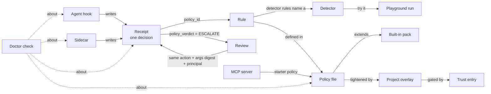

# UI/UX Brief — interlock console

> **Brief type:** net-new. A working prototype of four screens exists, but none of
> it was designed. Treat it as a record of the data and behaviour, not of the look.
> **Read time:** ~25 min
> **Designer can start:** yes. The one open dependency is how writes are unlocked
> (§14, question 1). It changes the mechanism, not the screens: design the
> locked and the unlocked state of every write either way.

**Where the files are.** Paths starting `web/`, `interlock/console/` or
`specs/console` are on the branch `mo/console` (the console prototype, not yet
merged). Every other path is on `main`. `file:line` citations point at those
branches as of 2026-10-13.

---

## 1. TL;DR

interlock is an open-source Python library that sits inside an AI agent's own
process and rules on every tool call before it runs. It can **allow** the call,
**block** it, **rewrite** its arguments, or **hold** it until a human decides.
Every decision is written to a tamper-evident log. The **console** is a local
web app, served on `127.0.0.1` only, with no accounts and no network calls. The
person running an agent uses it to see what the guard decided, settle the calls
waiting on them, and write and test the policy behind those decisions.

We are asking for:

- the design of **eight screens**;
- the **shell** that ties them together;
- the **component set** they share;
- **dark and light** variants;
- all of it built on the identity direction already given in
  [`front-page-brief.md`](front-page-brief.md).

**Success:** within five seconds, a user can tell whether protection is on and
whether anything is waiting on them. Within thirty, they can settle a held call
with full context.

## 2. Why now

Three things changed at once:

- **The product outgrew its prototype.** Since the console prototype was specified,
  interlock gained:
  - a fourth verdict (ESCALATE: hold the call for a human);
  - a durable review queue;
  - declarative JSON policies with trust-gated project overlays;
  - hooks for Claude Code, Codex and Cursor;
  - an MCP-server inventory;
  - a protection self-check (`interlock doctor`).

  All of these are CLI-only today.
- **The prototype doesn't know the fourth verdict exists.** No screen can
  display or filter ESCALATE (§6, rows 2–3).
- **Scope decision.** The console is to be a fully featured React app, designed
  first and then built to the design, not a debugging page.

## 3. Job to be Done

**Primary JTBD:**
> When my agent is working and interlock blocks or holds one of its calls, I want
> to see what was stopped, by which rule and why, and settle anything waiting on
> me, so I can keep the agent moving without switching protection off.

**Secondary jobs:**
- **Authoring.** When I write or change a policy, I want to try it against
  realistic calls and see exactly which rule fires, so I ship rules that catch
  what they should and nothing else.
- **Assurance.** When I need to know, or show someone, that the guard is really
  on and its record hasn't been tampered with, I want one verdict backed by its
  evidence, so I can trust it or fix it before it matters.
- **Discovery.** When I'm deciding what to protect against, I want to browse what
  interlock can detect and try a detector in one step, so I can choose protections
  without reading 115 docstrings.
- **Hygiene.** When I set up a machine or a project, I want to see which agents
  are hooked, which MCP servers are configured and which of them are risky, so I
  can close the gaps an agent could walk through.

## 4. Users

| User type | Proficiency | Frequency | Context | Permission |
|---|---|---|---|---|
| **Coding-agent user**: runs Claude Code, Codex or Cursor with interlock's hooks installed | medium–high; uses the built-in policy, rarely writes rules | many times a day, interrupt-driven: an agent is waiting on them | desktop; the console often sits in a **narrow side window** beside the agent's terminal | the OS user who launched the console |
| **Agent builder**: Python engineer embedding interlock in their own agent or app | high; reads code, writes rules | bursts while authoring a policy; daily while debugging | desktop, beside IDE and terminal | same |
| **Security / platform reviewer**: reviews policies, verifies the audit chain, approves overlays and four-eyes reviews | high on security, lower on the code | weekly, plus whenever asked to approve | desktop, focused; may be looking over someone's shoulder or screen-share | same |

There are **no accounts and no roles**. The console acts as the OS user who
launched it. The review queue records that user's login as the approver
(`interlock/reviews.py:301`). One console serves one user on one machine.

## 5. Current state inventory

### 5a. Files involved

| Role | File | What it contributes |
|---|---|---|
| App shell | `web/src/App.tsx` | hash router: `/`, `/catalog`, `/playground?detector=`, `/audit`, `/inspector`; unknown → "Not found" |
| Nav | `web/src/NavBar.tsx` | brand link + four text links; no active state, no counts |
| Overview | `web/src/Overview.tsx` | the home page, which shows only "API health: ok · v0.x" |
| Detector catalog | `web/src/Catalog.tsx` | search box, detectors grouped by category, detail panel with factory signatures, verdicts, docstring, "Try in playground" |
| Playground | `web/src/Playground.tsx` | preset picker, two raw-JSON textareas (rules, events), Evaluate, one verdict row per event |
| Audit log | `web/src/Audit.tsx` | receipt table, chain status, verdict filter, live-tail toggle (SSE) |
| Inspector | `web/src/Inspector.tsx` | scope document + principal + optional event → resolved parameters, sandbox profile, backend, enforced / not-enforced lists, verdict |
| API client | `web/src/api.ts` | typed fetch helpers; the shared error shape `{"error": {"code", "message"}}` |
| Styles | `web/src/styles.css` | about 140 lines of plain CSS, 7 colour variables, verdict badges for three verdicts |
| Server | `interlock/console/server.py` | Python standard-library HTTP server: loopback bind, Host allowlist, JSON-only POST, static bundle, CSP |
| Audit API | `interlock/console/audit.py` | `/api/receipts` (paged, max 500), `/verify`, `/stream` (SSE, 0.9 s poll, 15 s keepalive) |
| Catalog API | `interlock/console/catalog.py` | `/api/detectors`, `/api/detectors/<module>` |
| Playground API | `interlock/console/playground.py` | `/api/evaluate`, `/api/presets` (5 presets: destructive-shell, egress, pii, result-injection, rate-limit) |
| Inspector API | `interlock/console/inspector.py` | `/api/scopes/resolve`, `/api/scopes/example`, `/api/sandbox` |
| Tests | `web/src/*.test.tsx` | about 800 lines of Vitest; pin the current `data-testid`s (Appendix C) |

**Backing features with no UI yet** (all on `main`):

| Module | What it knows | Today's surface |
|---|---|---|
| `interlock/report.py` | aggregates a receipt log over a time window: totals, verdict mix, block rate, top rules, top blocked actions, what monitor mode *would* have done, how escalations were settled, failed calls, masked values, latency percentiles | `interlock report` |
| `interlock/reviews.py` | the durable review queue (SQLite, `~/.interlock/reviews.db`) | `interlock reviews list/show/approve/reject/revoke/wait` |
| `interlock/policy/declarative.py`, `policy/trust.py`, `policy/packs.py` | JSON policies; validation with "did you mean"; quarantined and locked rules; `extends` / `disable`; project overlays gated by content-hash trust; the policy epoch | `interlock policy check/show`, `interlock trust add/list/remove` |
| `interlock/cli/doctor.py`, `interlock/posture.py` | protection self-check: level `enforced` / `degraded` / `unprotected`, one check per weakening setting, each with a one-line fix | `interlock doctor` |
| `interlock/adapters/*`, `cli/install_hook.py` | whether Claude Code, Codex and Cursor have the interlock hook in their settings | `interlock install-hook --for … [--dry-run] [--uninstall]` |
| `interlock/mcp_inventory.py` | every MCP server configured across seven clients, with risk tags | `interlock mcp scan` / `where` |
| `interlock/sidecar/admin.py` | the optional guard daemon's `/healthz`, `/stats`, `/metrics`, `/config` (loopback HTTP) | `interlock-sidecar --admin` |

### 5b. Existing design assets

| Asset | Status |
|---|---|
| [`design/front-page-brief.md`](front-page-brief.md) | **The identity direction to build on.** It covers the landing page and the tokens that cascade into the docs: dark by default, type-led, verdict colours as the system, no third-party requests, WCAG AA, verdicts never shown by hue alone. Its tokens, logo and type are **not yet delivered**; this brief assumes they will be shared. |
| `docs/assets/stylesheets/landing.css` | the token names the landing page already uses: `--il-allow`, `--il-rewrite`, `--il-block`, `--il-dim`, `--il-rule`, `--il-glow`, `--il-shell-bg/-fg/-dim`. The console should use the same names. |
| Console mockups / prototypes | **None.** No console design exists. |
| Screenshots | **None in the repo.** Run the prototype (Appendix D) to see it. |

### 5c. Related docs

- `docs/guides/reviews.md`, `approvals.md`: the review queue and escalation model, in user language.
- `docs/guides/policies.md`: the policy format, overlays, trust and the epoch. The policy editor's content.
- `docs/guides/coding-agents.md`, `mcp.md`: hooks and the MCP inventory. The ops screen's content.
- `docs/guides/audit-log.md`: receipts, the chain and verification.
- `docs/reference/detectors.md`: the 115 detectors in 9 categories. The catalog's content.
- `docs/security-model.md`: what the guard does **not** protect against. Read the "Settings that weaken protection" table; each row is a doctor check.
- `specs/console/01..05-*.md`: the prototype's behavioural specs (error codes, edge cases).
- `research/hoop-review.md`, `research/agentjail-review.md`: why the review queue, policy files, hooks and MCP inventory exist.

### 5d. API surface: today and proposed

The console's browser code talks **only** to its own Python server. Everything
below is JSON, except the SSE stream.

| Endpoint | Status | Feeds |
|---|---|---|
| `GET /api/health` | built | shell |
| `GET /api/detectors`, `/api/detectors/<module>` | built | catalog |
| `GET /api/presets`, `POST /api/evaluate` | built | playground |
| `GET /api/receipts?offset&limit&verdict&order`, `/verify`, `/stream` | built | audit |
| `GET /api/scopes/example`, `POST /api/scopes/resolve`, `GET /api/sandbox` | built | inspector |
| `GET /api/report?since=24h` | **proposed**: wraps `report.summarize` + `verification` | activity |
| `GET /api/reviews?status=`, `GET /api/reviews/<id>` | **proposed** | review queue |
| `POST /api/reviews/<id>/approve`, `/reject`, `/revoke` | **proposed, write** | review queue |
| `GET /api/policy`, `POST /api/policy/check` (validate a draft, no write) | **proposed** | policy editor |
| `PUT /api/policy` | **proposed, write** | policy editor |
| `GET /api/policy/packs/<name>` | **proposed** | policy editor (view a built-in pack) |
| `GET /api/trust`, `POST /api/trust/add`, `/remove` | **proposed; add/remove are writes** | policy editor (overlays) |
| `GET /api/doctor` | **proposed** | ops, shell posture indicator |
| `GET /api/hooks` | **proposed** | ops |
| `GET /api/mcp` | **proposed** | ops |
| `GET /api/sidecar` | **proposed**: probe the socket + read the admin `/stats` and `/config` if configured | ops |

Design against the fields in Appendix B. If a design needs data not listed
there, flag it. Don't assume it exists.

## 6. Heuristic audit (of the prototype)

| # | Heuristic | Issue | Evidence |
|---|---|---|---|
| 1 | H1 Visibility of system status | The live-tail indicator shows "paused" both when the user paused it and when the connection dropped, so a dead stream looks deliberate. Loading states everywhere are a bare "loading…" line. | `web/src/Audit.tsx:137`; `Catalog.tsx:97`, `Audit.tsx:97` |
| 2 | H4 Consistency and standards | ESCALATE, the fourth verdict, has no badge style. The audit table's verdict cell is unstyled text while the playground's is a coloured badge. | `web/src/styles.css:127-140` (ALLOW / MODIFY / BLOCK only); `Audit.tsx:181` vs `Playground.tsx:156` |
| 3 | H5 Error prevention / H4 | The audit verdict filter offers ALL / ALLOW / BLOCK / MODIFY. The server rejects ESCALATE as a filter value, so held calls can't be isolated. | `web/src/Audit.tsx:16`; `interlock/console/audit.py:23` |
| 4 | H9 Recognise and recover from errors | A failed catalog load says "could not load the detector catalog." with no cause and no retry. A failed detail fetch silently closes the panel. A failed preset fetch leaves an empty picker. A JSON error doesn't say which editor or where. | `Catalog.tsx:106`, `:69-72`; `Playground.tsx:41`, `:145` |
| 5 | H6 Recognition over recall | The playground requires hand-writing JSON rule specs from memory: detector module, factory name, keyword arguments. The inspector prints the sandbox profile as one run-on sentence. Digests are truncated to 12 characters with no expand or copy. | `Playground.tsx:120-139`; `Inspector.tsx:105-112`; `Audit.tsx:28-30` |
| 6 | H2 Match with the real world / H10 Help | The home page shows only API health. Terms like *observed*, *principal*, *span*, *epoch* and *digest* appear with no gloss. | `Overview.tsx:47-53`; `Audit.tsx:159-167` |

**Data drift to design for.** Receipts on `main` carry eight provenance fields
the prototype predates:

- `call_id`
- `policy_epoch`
- `policy_verdict`
- `approval`
- `outcome`
- `enforcer`
- `elapsed_us`
- `masked`

Compare `interlock/receipt.py:153-187` with `web/src/api.ts:99-115`. In
particular, an escalated call's receipt has `policy_verdict = "ESCALATE"` and an
enforced `verdict` of ALLOW, MODIFY or BLOCK. The design has to show both.

## 7. Information architecture

### The objects and how they connect

The console is eight views over a handful of objects. The value is in the
links between them. Today there are none: no audit row links to its rule, its
detector or the playground.



### Proposed grouping (the designer may regroup)

| Group | Screen | Primary JTBD |
|---|---|---|
| **Monitor** | Activity (home) | primary + assurance |
| | Review queue | primary |
| | Audit log | primary + assurance |
| **Author** | Policy editor | authoring |
| | Playground | authoring |
| | Detector catalog | discovery |
| | Scopes & sandbox inspector | authoring |
| **Operate** | Ops & integrations | hygiene + assurance |

### The shell, on every screen

- **Brand + nav** with the three groups.
- **Posture indicator**: `enforced` / `degraded` / `unprotected` from the doctor.
  Clicking it opens Ops.
- **Pending-reviews count**: the one number that means "something is waiting on
  you". It must be noticeable when the tab is in the background; how is the
  designer's call (§14, question 6).
- **Connection state** of the console itself: the console process can be stopped
  while the tab stays open.
- **Lock state**: read-only or unlocked for writes (§10, write gate).
- **Which receipt log** this console reads. It is fixed at launch with
  `--receipts`, and can be absent.
- **Deep links.** Hash routes are bookmarkable on the same machine. Every list
  filter and every selected object belongs in the URL: `#/reviews/r-1a2b3c4d`,
  `#/audit?verdict=BLOCK&policy=no-force-push`, `#/catalog/shell.destructive_command_guard`.
  These are proposed; the build follows the designer's IA.

### Screen by screen

#### 7.1 Activity (home): net-new

- **H1:** Activity
  - **Window**: the time range the summary covers (the API accepts `30m`, `24h`,
    `7d`, `2w` …). Default proposed: 24h.
  - **Protection at a glance**: posture level plus the receipt chain's state
    (verified / unverified / broken). The two answers to "can I trust this?"
  - **What happened**:
    - receipts, decisions and calls;
    - sessions and principals;
    - the verdict mix;
    - block rate.
  - **Who stopped what**: top rules by count, with a verdict breakdown each;
    top blocked actions.
  - **Waiting on you**: pending reviews (count + the oldest one), linking to
    the queue.
  - **Would have**: what monitor-mode rules *would* have done had they been
    enforced. This is how a new rule is trialled before switching it on, and it
    must not read as enforcement.
  - **Escalations settled**: counts by outcome (approved once / for the session /
    for a time, reused, declined, no approver …).
  - **Problems**:
    - allowed calls that then failed, and who stopped them;
    - receipts that didn't parse or were dropped.
  - **Masked values**: counts per entity type (email, card number …). Counts
    only, never values.
  - **Evaluation latency**: p50 / p90 / p95 / p99 / max, in microseconds.
- **Cross-links:** every rule, action and verdict count opens the audit log
  pre-filtered to it.
- **Constraint:** this is computed from the receipt **log**, the durable record,
  not from live counters inside the agent's process. The console can't see
  those (§10). There is **no time series** today, only totals for the window.
  A chart over time needs a bucketed API (§14, question 3).

#### 7.2 Review queue: net-new

- **H1:** Reviews
  - **Pending**: the inbox. Each review carries:
    - the action and its phase;
    - the rule (`policy_id`) and the reason the rule gave;
    - the principal, and the requester (the OS user whose agent filed it);
    - when it was filed and **when it expires** (`pending_until`; default 1 h);
    - the approvals so far vs. needed (`min_approvals`, e.g. "1 of 2");
    - the **argument preview**: the call's arguments as JSON, cut at 4,000
      characters. This is the evidence the human decides on.
  - **Decision**:
    - **Approve.**
    - **Reject**, with a reason that is sent back to the agent.
    - **Revoke** an approval that hasn't been used yet.
  - **Approved, awaiting retry**: an approval is used once, by the agent retrying
    the *identical* call, within `approval_until` (default 15 min). Then it
    becomes `executed`.
  - **History**: rejected, revoked, expired and executed reviews, with who decided
    and when.
- **The mental model the design has to teach.** Approving does not run anything.
  It lets the agent's next *identical* attempt through, once. A different call,
  even with one argument changed, files its own review.
- **Four-eyes.** When self-approval is off, the person whose agent filed a review
  may not approve it. The UI must explain why the action is unavailable rather
  than fail on click.
- **Cross-links:** to the rule in the policy editor, to the matching receipts
  in the audit log, to the detector if the rule is a detector.
- **Sensitive content.** The preview is the **only place in the console where
  argument values appear**. Receipts hold digests, never values. Expect secrets
  and personal data in it. The design should not echo the preview into
  notifications, the page title, or anywhere that leaves the page.

#### 7.3 Audit log: redesign of an existing screen

- **H1:** Audit log
  - **Chain status**:
    - **verified / intact**;
    - **broken**, at a specific receipt, with the problem;
    - **unverified**: the console was started without the key.

    This is the tamper-evidence headline.
  - **Filters**: verdict (all four, plus "observed" for monitor mode), rule,
    action, principal, session (`span_id`), phase, time.
  - **Live tail** on/off, with an honest connection state.
  - **The receipt list**: newest first by default; paged by the server at most
    500 rows at a time. Rows can be **unreadable** (a line that doesn't parse),
    shown in place with their index.
  - **A receipt's detail**: every field in Appendix B. The escalation story
    (`policy_verdict` → `approval` → enforced `verdict`) and the provenance
    (`call_id`, `policy_epoch`, `enforcer`, `outcome`, `elapsed_us`, `masked`)
    belong here, not in the row.
- **Cross-links:** rule → policy editor; detector → catalog; ESCALATE →
  its review; digest → copy.
- **Constraint:** a receipt stores a **digest** of the arguments, never the
  arguments. The log can't show "what was in the call". That's deliberate.

#### 7.4 Policy editor: net-new

- **H1:** Policy
  - **The active policy file**: its path (default `~/.interlock/policy.json`),
    what it `extends` (e.g. `builtin:coding-agent`), its **epoch** (a short hash
    that changes whenever the effective policy does).
  - **Rules**:
    - id, verdict, reason, condition;
    - **locked** rules: they can't be disabled by anything that extends them;
    - **quarantined** rules: invalid, skipped, with the reason and often a
      "did you mean" (`'equals'` → `eq`);
    - inherited vs. own;
    - `disable`d inherited rules.
  - **Edit**. Users know this format as JSON, and the docs teach it as JSON, so
    raw JSON editing must stay possible. A structured rule builder on top is
    welcome, but is the designer's call.
  - **Check**: validate a draft without saving it. The result is the rule list,
    the locked ids, the quarantined rules, each overlay's status and the epoch
    the draft would have.
  - **Save** (a write): replaces the file. **Saving changes the epoch, and a new
    epoch voids every outstanding approval and approved review.** The user must
    see that consequence before confirming.
  - **Project overlays**: each overlay found, with its trust status (`ok`,
    `untrusted`, `changed` since trusted, `missing`). It is **ignored whole** if
    it tries to loosen the base. **Trust** / **untrust** are writes.
  - **Built-in packs**: view `builtin:coding-agent` read-only, to see what you
    inherit.
- **Validation granularity.** Errors are per **rule**, as strings like
  `"cap-rows: unknown operator 'equals' (did you mean 'eq'?)"`
  (`interlock/policy/declarative.py:384-404`), plus whole-document parse errors.
  The backend gives **no character positions** for rule errors. Inline squiggles
  would need new backend work; a per-rule problem list works today.
- **Cross-links:** a rule → its receipts (audit) → its hits in the playground.
  A detector rule → the catalog.

#### 7.5 Playground: redesign of an existing screen

- **H1:** Playground
  - **Rules**: detector factories with keyword arguments. The server will only
    call factories listed in the catalog; it never evaluates code.
  - **Events**: the calls to test. Each has an action, arguments, phase
    (call / result) and principal.
  - **Presets**: five worked examples (destructive shell, egress, PII, result
    injection, rate limit).
  - **Evaluate** → one result per event: verdict, reason, rule, the argument it
    blamed (`attributed_to`), and for MODIFY the rewritten arguments.
- **What the design should fix:** picking a detector and filling its parameters
  from its signature (the catalog API already returns each parameter's name,
  kind, required flag, default and type, `web/src/api.ts:48-61`), instead of
  hand-written JSON. Also: diffing the rewrite against the input, and re-running
  quickly while editing.
- **Open fit question:** the playground evaluates **detector rules** only. The
  policy editor deals in **declarative policy files**. Whether "test this policy
  against these events" belongs in the editor, the playground, or both is an IA
  call for the designer. Today's API can evaluate the former only.

#### 7.6 Detector catalog: redesign of an existing screen

- **H1:** Detectors
  - **115 detectors in 9 categories**, very unevenly sized:
    - prompt injection and jailbreaks (27);
    - secrets and personal data (24);
    - classic injection in arguments (16);
    - code execution and host access (14);
    - MCP servers and tools (11);
    - data leaving the system (9);
    - budgets, rate limits and loops (9);
    - provenance stamps (4);
    - tool allow/deny lists (1).
  - **Search** across module, summary and factory names.
  - **Detail**: summary, scope (call / result), the verdicts it can return,
    factory signatures with parameters, the full docstring, "Try in playground".
- Docstrings are long reStructuredText-ish prose. Today they are dumped into a
  `<pre>`.

#### 7.7 Scopes & sandbox inspector: redesign of an existing screen

- **H1:** Scopes & sandbox
  - **Inputs**: a scope document (JSON: templates and per-principal grants), a
    principal, optionally an event.
  - **Outputs**:
    - the resolved parameters per template;
    - the sandbox profile: read paths, write paths, network on/off, allowed
      hosts, environment keys passed through, CPU seconds, memory MB, PID
      isolation, working directory;
    - the backend that would run it;
    - what that backend **enforces vs. does not enforce** on this host;
    - with an event, the verdict.
- **The design problem.** "Not enforced" is the important half. A profile can
  promise "no network" and the host's backend can't deliver it. That gap must
  read as a warning, not a footnote.
- The inspector **never runs anything**. It computes the plan only.

#### 7.8 Ops & integrations: net-new

- **H1:** Ops
  - **Protection check (doctor)**: the level, then one row per check with
    `ok` / `info` / `warn` / `fail`, a one-line summary and a one-line **fix**.
  - **Coding-agent hooks**: for Claude Code, Codex and Cursor, whether the
    interlock hook is installed and in which settings file. Installing is a CLI
    action the user must run themselves, outside the agent (§14, question 2).
  - **MCP servers**: every configured server, with:
    - name, client (Claude Desktop / Claude Code / Cursor / VS Code / Windsurf /
      Gemini CLI / Codex), scope (user / project), transport, command or URL,
      the env var *names* it sets;
    - **risk tags**: unpinned package, unpinned image, plain HTTP, inline
      credential.

    Also offered: the **starter policy**, a rule that blocks MCP tools from any
    server not in this list, for review and adoption in the policy editor.
  - **Sidecar (guard daemon)**: not configured / unreachable / healthy. When
    healthy:
    - uptime;
    - decisions by verdict;
    - top policies;
    - escalations;
    - masked counts;
    - dropped receipts;
    - latency;
    - rule ids (never patterns);
    - the policy epoch;
    - whether a fallback policy is published.
  - **Receipt log**: path, writable, key present, single writer, dropped count.

### IA smells in the prototype

- **Orphan home page.** The Overview page holds one fact, API health, and
  nothing links from it.
- **Two editors, two layouts.** The playground and the inspector are both
  "editors + run button + results", laid out differently, with different error
  treatments (`Playground.tsx:144-151` vs `Inspector.tsx:90-94`).
- **Dead ends.** No object links to a related object (see the diagram above).

## 8. State machines

Every data-driven surface, every state. "Required" describes what the user must
be told. How to show it is the designer's job.

### Shell: the console API itself (`GET /api/health`)

| State | Current | Required |
|---|---|---|
| Checking | "checking…" text on Overview only | non-blocking; the rest of the shell renders |
| Healthy | "ok · v0.x" | version visible somewhere quiet |
| Unreachable | "unreachable" on Overview only; every other page fails on its own | **one** shell-level state: "the console process stopped", how to restart it, auto-retry; pages keep their last data, marked stale |
| Wrong Host / loopback refusal | server returns 403 + error body | explain: open it at `127.0.0.1` / `localhost` |

### Write gate (all writes: review decisions, policy save, trust)

| State | Required |
|---|---|
| Read-only (default, proposed) | every write action visibly unavailable, with *why* and *how to unlock*, not hidden |
| Unlocking | the unlock step itself (mechanism: §14, question 1) |
| Unlocked | persistent, unmissable indicator; how to re-lock |
| Write refused by server | the specific reason (wrong state, self-approval, epoch changed, file changed on disk) |

### Receipts list (`GET /api/receipts`)

| State | Current | Required |
|---|---|---|
| Cold / loading | "loading…" | the table's shape, without content |
| Not configured (`receipts_not_configured`) | a paragraph naming `--receipts` and `--key-file` | a first-run state that explains what a receipt log is and how to point the console at one |
| Empty log | empty table | "nothing decided yet". The guard may simply not have run; link to Ops (are hooks installed?) |
| Filtered to nothing | empty table | say the filter caused it; one-click clear |
| Partial: unreadable rows | an inline row "unreadable receipt at index N" | keep in place; explain it means a corrupt or partial line; never silently dropped |
| Success | table | + count of all vs. shown; paging past 500 |
| Error | "could not load the audit log." | the error code + message from the shared error shape; retry |

### Chain verification (`GET /api/receipts/verify`)

| State | Required |
|---|---|
| Verified / intact | calm, present, not celebratory |
| Unverified (no key) | not an error and not a pass: "can't tell"; how to supply the key |
| Broken | the loudest state in the product: where (which receipt), what (the `problem` text), what it means (edited, deleted or reordered). It must not be dismissible into invisibility. |

### Live tail (`GET /api/receipts/stream`, SSE: `hello`, `receipt`, `reset`, keepalive)

| State | Current | Required |
|---|---|---|
| Connecting | "paused" | distinct from paused |
| Live | "live" | new rows arrive without moving what the user is reading (no scroll jump) |
| Paused by user | "paused" | distinct from disconnected; a count of rows that arrived while paused |
| Disconnected | "paused" (indistinguishable) | say so; the browser auto-reconnects; show when it does |
| Reset (log truncated or rotated) | silent refetch | tell the user the log was reset; this can also mean tampering |
| Burst | unbounded prepend | must stay usable at tens of receipts a second; the spec requires a new receipt visible within 1 s |

### Activity report (`GET /api/report`, proposed)

| State | Required |
|---|---|
| Loading | layout holds; no jump when numbers land |
| No receipt log | same first-run state as the audit log |
| Empty window | "nothing in the last 24h"; offer a wider window; show when the last receipt was |
| Unverified / broken chain | numbers still shown but **labelled** as coming from an unverified or broken log; never silently trusted (`interlock/report.py:10-12`) |
| Monitor-only activity | "would have" figures distinct from enforced ones |
| Success | + the window's first and last timestamps |

### Review queue (`/api/reviews`, proposed)

| State | Required |
|---|---|
| Queue DB missing | "no reviews have ever been filed"; what the queue is for; that it is enabled in the guard's config, not here |
| No pending | an empty inbox that reads as good news; recent history still reachable |
| Pending | sorted by soonest expiry; each shows its countdown |
| Pending, partially approved | "1 of 2 approvals"; who approved |
| Approved, awaiting retry | countdown to `approval_until`; "the agent must retry the identical call"; revoke available |
| Executed | done; when |
| Rejected | by whom, the reason the agent was told |
| Revoked / expired | terminal; why |
| Action in flight | the button that was pressed shows progress; no double-submit |
| Action refused | "already settled by someone else" (state changed under you), "you filed this one" (four-eyes), "not unlocked" |
| Stale | the queue changes from the CLI and from other consoles; refresh without losing the item being read |

### Policy document (`/api/policy`, proposed)

| State | Required |
|---|---|
| No policy file | the default is `{"extends": "builtin:coding-agent"}`; explain the user is running the built-in pack |
| Loaded, valid | rules, locked, epoch |
| Loaded with quarantined rules | the file **works**, minus those rules; each problem with its rule id and message |
| Does not load (parse error) | the guard keeps the **last good** policy running; say so |
| Editing, unsaved | dirty indicator; leaving warns |
| Draft checked | the result of `check` against the draft, including the epoch it would produce |
| Save confirm | the epoch change voids outstanding approvals: say how many reviews that affects |
| Saved | new epoch; the guard picks it up on its next reload (a hook process reads the file on every call) |
| File changed on disk since loaded | a conflict; don't overwrite silently |
| Overlay states | `ok` · `untrusted` (ignored) · `changed` (ignored until re-trusted) · `missing` · ignored-whole because it tries to loosen |

### Detector catalog (`/api/detectors`)

| State | Current | Required |
|---|---|---|
| Loading | "loading…" | category skeleton |
| Search no match | nothing rendered | "no detector matches 'x'"; clear |
| Detail loading / error | silent | in-panel loading; error with retry |
| Error | generic sentence | code + message + retry |

### Playground (`/api/evaluate`) and Inspector (`/api/scopes/resolve`)

| State | Required |
|---|---|
| Draft invalid JSON | which editor, where (line), before any request |
| Server refused (`unknown_detector`, `bad_kwargs`, `bad_document` …) | the code + message next to the input that caused it |
| Running | quick; don't flash |
| Result per event | verdict (all four), reason, rule, blamed argument, rewrite diff for MODIFY |
| Inspector: not-enforced items present | a warning |
| Inspector: no event given | the profile only; the verdict area explains it needs an event |

### Ops (`/api/doctor`, `/api/hooks`, `/api/mcp`, `/api/sidecar`, proposed)

| State | Required |
|---|---|
| Doctor: enforced / degraded / unprotected | level + per-check status + fix line; `fail` first |
| Hooks: installed / not installed / agent not present on this machine | per agent; the exact CLI command to change it, copyable |
| MCP: none configured / servers with risks / unreadable config file | warnings list for configs that didn't parse |
| Sidecar: not configured / unreachable / healthy | unreachable is a **warning**: clients then deny, fall back or allow by their own setting |

## 9. Accessibility baseline

| Check | Current | Required |
|---|---|---|
| Keyboard nav | native buttons/links only; no shortcuts | full keyboard operation; **the review queue must be workable without a mouse** (next / previous / approve / reject); the designer proposes a shortcut map |
| Focus ring | `:focus-visible` 2 px accent outline on links and buttons (`styles.css:46-50`) | tokenised, visible on every interactive element, including table rows that open detail |
| Screen reader | no `aria-live`; tables without captions | polite live region for new receipts (rate-limited) and for pending-review count changes; tables with captions and header scope; verdicts announced as words |
| Contrast | spot check: `--text-dim #9aa1ad` on `--bg #0f1115` ≈ 7.2:1 | WCAG 2.2 AA in **both** themes, including the verdict colours on their backgrounds |
| Colour alone | playground badges carry the verdict word; the audit verdict is plain text | every verdict and status is **mark + word + colour**, per front-page brief §8.5 |
| Motion | none | respect `prefers-reduced-motion`; live rows arriving must not animate under it |
| Narrow viewport | the gap spec adds a narrow-viewport fix | designed narrow layout; see §13 for the bounds |
| `data-testid` | about 40 ids, pinned by tests and spec gates (Appendix C) | keep the existing ids; new ones as `<screen>-<element>` |

## 10. Constraints

**Technical (non-negotiable):**

- **Local only.** Served on `127.0.0.1` / `localhost` / `::1`. The server refuses
  any other bind and any other Host header. No accounts, no login, no roles.
- **No third-party requests.** No CDN, webfont service, analytics or hosted icon
  set: everything ships in the bundle. Same rule and same reason as front-page
  brief §8.1.
- **CSP `default-src 'self'`** on every page (`interlock/console/server.py:40-43`).
  In practice:
  - no inline `<style>`/`<script>`;
  - no `data:` URIs for images or fonts;
  - **no CSS-in-JS library that injects `<style>` tags at runtime**, which rules
    out MUI/Emotion and styled-components as-is;
  - icons as inline SVG components or bundled files.
- **React 18 + Vite + TypeScript, hash routing.** The Python server serves one
  static bundle and the JSON API; there is no server-side routing.
- **No component library today.** If the design implies one, it must be
  self-hostable, permissively licensed, and work under the CSP above.
- **The Python JSON API is the only data source.** The browser never reads files,
  sockets or agent processes directly.
- **No live view of the agent's process.** The console is a separate process. It
  sees:
  - files: receipt log, review DB, policy, trust list, agent and MCP configs;
  - the sidecar's admin endpoint, if one runs.

  It does **not** see in-process counters, installed approvers or grants. The
  doctor rows it can show are the host-level and file-level ones.
- **Secrets never reach the browser.** The receipt MAC key stays in the server
  process. Receipts carry argument *digests*. Only review previews carry argument
  values (§7.2).
- **SSE only** for live data (receipts). No websockets. Other screens poll or
  refresh.
- **Write gate.** The console's CSRF defence (JSON-only POST, no CORS, Host
  allowlist) stops a hostile **web page**. It does **not** stop an agent on the
  same machine from running `curl` against the console. The agent is barred from
  `interlock reviews approve` and from writing `~/.interlock`, but nothing stops
  the equivalent POST. So every write must sit behind a gate the agent can't
  pass: approve, reject and revoke, policy save, trust add and remove. Default
  proposed: **read-only until unlocked**. The mechanism is §14, question 1. The
  design must include the locked state, the unlock step and the unlocked state.

**Brand** (inherit from [`front-page-brief.md`](front-page-brief.md) §7–§8):

- **Dark by default, light designed too.** The console sits beside a terminal.
- **Verdict colour as the system**, now with **four** verdicts:
  - ALLOW;
  - MODIFY (the landing page calls it *rewrite*);
  - BLOCK;
  - ESCALATE (*held for a human*), which the triad lacks.

  Plus a variant for **observed** (monitor mode: recorded, not enforced). Extend
  the system; don't fork it. Reuse the `--il-*` token names.
- **Avoid:** shield/lock iconography, robots, purple-blue gradients, fake-metric
  dashboards, mascots. That list is from front-page brief §7. The lock-state
  indicator will need an icon that avoids the padlock cliché, or the designer can
  argue for an exception.
- **Feeling:** precise, sober, engineering-grade. Dense where operators scan, like
  the audit table and the review list. Calm where the answer is "all good".
- **System font stack or self-hosted fonts**, matching the decision the
  front-page brief asks the designer to make.

**Performance budget (proposed: confirm):**

- First meaningful paint < 1 s on localhost, cold.
- Initial JS ≤ 250 KB gzipped. There is no network to blame; this is about
  start-up on a busy laptop.
- The live tail stays responsive at 50 receipts per second; lists of 10,000+
  receipts stay scrollable (virtualisation).
- A new receipt is visible within 1 s of being written (already a spec gate).

## 11. Success metrics

All proposed. Confirm with PM.

| Flavour | Metric |
|---|---|
| User outcome | A first-time user can say whether protection is on and whether anything waits on them **in ≤ 5 s** from opening the console (hallway test, 5 users) |
| User outcome | A pending review is understood and settled **in ≤ 30 s** median: what call, which rule, why, what approving does |
| User outcome | Users correctly answer "does approving run the call?" (no: it lets the identical retry through once) ≥ 4 of 5 |
| Behavioural | Fewer reviews expire unanswered than with CLI-only settlement |
| Behavioural | Policy edits are checked (draft check or playground) before save in most sessions |
| Technical | Zero CSP violations in the console's own pages; axe-core: zero serious or critical violations |
| Technical | Budget in §10 met; no layout shift when activity numbers load |

## 12. References

- **GitHub Actions: "Review deployments"**: a gated job waiting on named
  reviewers, approve or reject with a comment, who and when recorded. Close to
  the review queue's pending → approved → executed flow and `min_approvals`.
- **Teleport Access Requests / hoop.dev reviews**: just-in-time approval of a
  specific, bounded action rather than a standing permission. The closest
  competitor pattern; hoop's review flow is summarised in
  `research/hoop-review.md`.
- **VS Code Problems panel**: a list of validation problems, each jumping to its
  source. Fits per-rule quarantine messages that have no character positions.
- **Log explorers with live tail** (Grafana Explore, Papertrail): filters in the
  URL, live tail that pauses on scroll and counts what arrived while paused.

## 13. Out of scope

- **Multi-user, accounts, roles, SSO.** One local user per console.
- **Remote or hosted access.** Loopback only, by design.
- **Phone layouts.** A **narrow desktop window** (a side panel next to a
  terminal, roughly 400–600 px wide) is in scope. A phone is not.
- **Editing Python rules.** Only declarative JSON policies are editable.
- **Live in-process metrics of the agent.** Only via the sidecar admin, when one
  runs.
- **A credentials UI.** The secret store lives in the agent's process; values
  must never be shown.
- **Installing hooks from the UI.** Proposed as show-status + copyable command
  (§14, question 2).
- **The docs site and landing page.** They are covered by `front-page-brief.md`;
  only the shared tokens overlap.
- **i18n.** English only.

## 14. Open questions for PM / engineering

1. **The write gate (blocks the unlocked-state visuals).** How does a human
   unlock writes in a way an agent on the same machine can't? Recommendation:
   - the console starts read-only;
   - its launch prints a one-time unlock link with a per-launch secret to its
     **own terminal only**: not to a file, not to argv;
   - add the console's write endpoints to the coding-agent pack's
     `interlock.tamper` intent.

   Design for read-only + unlock + unlocked regardless.
2. **Ops actions: do or show?** Recommendation: **show** the exact CLI command
   (copy button) for install-hook and for trust, rather than performing it.
   This keeps "run it yourself, outside the agent" true.
3. **Activity over time.** Is a time series (sparklines, a day chart) wanted? It
   needs a bucketed report API; today's report gives window totals only.
4. **Four-eyes on a one-person machine.** The approver is the OS user running the
   console. With self-approval off, a developer can't approve their own agent's
   reviews from their own console. Intended (pair with a colleague), or should
   the console warn when it's configured that way?
5. **Vocabulary.** The product says MODIFY and ESCALATE; the landing page says
   *rewrite*. Pick one user-facing word per verdict, used in the console, the
   docs and the CLI.
6. **Getting attention.** A pending review means an agent is stuck. Options: tab
   title count, favicon badge, browser notifications (permission prompt, and the
   preview must never be in one), sound. Which are wanted?
7. **One receipt log per console**, fixed at launch (a security decision: the
   browser can't choose files). Is a picker for several known logs needed, or is
   restart-with-flag acceptable?

## 15. Definition of done (for the design phase)

- [ ] IA: nav groups, screen list, deep-link scheme, cross-links (§7 diagram)
- [ ] Shell: posture, pending count, connection, lock state, receipt-log source, in both themes and the narrow layout
- [ ] Hi-fi mocks of all eight screens, **every state in §8**, dark + light, wide + narrow
- [ ] Component set:
  - verdict chip ×4 + observed variant;
  - chain status (verified / unverified / broken);
  - posture level;
  - doctor check row;
  - review card with countdowns and approval progress;
  - rule row (own / inherited / locked / quarantined / disabled);
  - overlay trust row;
  - JSON editor with error states;
  - live indicator (connecting / live / paused / disconnected / reset);
  - MCP risk tag;
  - empty / error templates
- [ ] Token spec mapped to the `--il-*` names (extending the front-page set), with contrast ratios for each verdict pair in both themes
- [ ] Copy for every empty, error and confirmation state, especially the approve and save confirmations and the broken-chain state
- [ ] Keyboard map (review queue first) and focus order annotations
- [ ] `aria-live` and motion annotations (live tail, pending count)
- [ ] `data-testid` names for new elements (`<screen>-<element>`), keeping Appendix C

---

## Appendix A — Glossary (for the designer, and candidate UI help text)

| Term | Meaning |
|---|---|
| **Tool call / action** | something the agent asks to do: run a shell command, write a file, call an API. `action` is the tool's name |
| **Verdict** | interlock's ruling on one call: **ALLOW** (run it), **BLOCK** (refuse), **MODIFY** (run it with rewritten arguments), **ESCALATE** (hold it for a human) |
| **Phase** | `call` (ruling on the request), `result` (ruling on what the tool returned, e.g. scrubbing a secret from it), or `outcome` (a record that an allowed call then failed) |
| **Rule / policy_id** | one check in the policy; its id is stamped on every decision it makes |
| **Detector** | a ready-made rule from interlock's catalog (115 of them), configured by its factory's parameters |
| **Policy** | the set of rules. As a file: declarative JSON that can `extend` a built-in pack and `disable` inherited rules |
| **Locked rule** | can't be disabled by a policy that extends it, or by an overlay |
| **Quarantined rule** | invalid, so skipped; the rest of the policy still runs |
| **Policy epoch** | a short hash of the effective policy; changes whenever the policy does; approvals are bound to it |
| **Overlay** | a project's own policy file (`.interlock/policy.json`) that can only **tighten** the base; ignored until trusted |
| **Trust** | a human's approval of one overlay's exact content (by hash). Editing the file revokes it |
| **Receipt** | the record of one decision, appended to the receipt log |
| **Chain / MAC / key** | each receipt is signed and linked to the previous one. With the key, the console can prove nothing was edited, deleted or reordered |
| **Digest** | a fingerprint of the call's arguments. Receipts keep this, never the arguments |
| **Observed** | recorded by **monitor mode**: what the rule *would* have done, not enforced. How new rules are trialled |
| **Principal** | who the call is on behalf of (an agent, a sub-agent, a user) |
| **Span / session** | one agent session or task; groups related calls |
| **Escalation** | a rule returned ESCALATE: a human must decide |
| **Review** | an escalation filed in the durable queue. Approving lets the agent's identical retry through, once |
| **Four-eyes** | the person whose agent filed a review may not approve it |
| **Posture** | is protection actually on: `enforced`, `degraded` (warnings) or `unprotected` (a check failed) |
| **Hook** | the line in Claude Code's / Codex's / Cursor's settings that sends every tool call through interlock |
| **MCP server** | a tool server an agent can use; configured per client, per user or per project |
| **Sidecar** | an optional guard daemon that rules on calls for other processes (e.g. Node.js agents) over a local socket |
| **Sandbox / backend** | where a guarded command runs; the backend decides which restrictions are really enforced on this host |

## Appendix B — Field reference (what the data actually contains)

**Receipt** (`interlock/receipt.py:153-187`)

| Field | Notes |
|---|---|
| `index` | position in the log (console-added) |
| `ts` | Unix seconds |
| `action`, `phase` | |
| `verdict` | enforced: ALLOW / BLOCK / MODIFY |
| `policy_verdict` | what the policy asked for, when it differs: notably `ESCALATE` |
| `approval` | how an escalation was settled: `approved:once`, `approved:session`, `approved:ttl`, `reused:session`, `reused:ttl`, `declined`, `no-approver`, `approver-error`, `delegated:<agent>` |
| `reason`, `policy_id`, `attributed_to` | `attributed_to` = the argument the rule blamed |
| `principal`, `span_id`, `call_id` | |
| `args_digest` | 64-hex digest, not the arguments |
| `observed` | monitor mode; absent when false |
| `policy_epoch` | |
| `outcome`, `enforcer` | `outcome = "failed"` when an allowed call then failed; `enforcer` = who stopped it |
| `elapsed_us` | evaluation time |
| `masked` | `{entity: count}` values masked in this call |
| `prev`, `mac` | chain links (hex); show only in detail |
| *unreadable row* | `{index, unreadable: true}` only |

**Review** (`interlock/reviews.py:83-117`): `id` (`r-` + 8 hex), `status`
(pending / approved / rejected / revoked / expired / executed), `action`,
`phase`, `principal`, `requester`, `policy_id`, `reason`, `args_digest`,
`preview` (arguments JSON, ≤ 4,000 chars, **sensitive**), `created`,
`pending_until`, `decided`, `approval_until`, `executed`, `decided_by`,
`rejection_reason`, `min_approvals`, `approvers[]`, `next` (`wait` /
`retry_identical_call` / `stop`). Defaults: 1 h to decide, 15 min to use an
approval, one approver, self-approval allowed.

**Report** (`interlock/report.py:75-161`):
- `window`: `since_seconds`, `first_ts`, `last_ts`, `active_days`, `first_day`, `last_day`;
- `totals`: `receipts`, `decisions`, `calls`, `results`, `sessions`, `principals`;
- `verdicts`: `{verdict: n}`;
- `block_rate`: 0–1;
- `top_rules[]`: `{policy_id, count, verdicts}`;
- `top_blocked_actions[]`: `{action, count}`;
- `would_have`: `{total, rows[]: {count, verdict, action, policy_id}}`;
- `escalations`: `{approval: n}`;
- `failed_outcomes`: `{enforcer: n}`, where `"tool"` means the tool itself failed;
- `dropped_receipts`: from `receipts.dropped` marker receipts;
- `masked`: `{entity: n}`;
- `latency_us`: `{p50, p90, p95, p99, max, samples}` or null;
- plus verification: `{status: verified | broken | unverified, detail}`.

**Doctor check** (`interlock/posture.py:48-76`): `{id, status: ok|info|warn|fail, summary, fix}`;
level = `unprotected` if any fail, else `degraded` if any warn, else `enforced`.

**Policy check** (`interlock/policy/declarative.py:970-981`): `{path, rules[] (ids), locked[], quarantined[] ("<id>: <message>"), overlays[]: {path, status}, epoch}`.

**MCP server** (`interlock/mcp_inventory.py:39-54`): `{name, client, config (file path), scope: user|project, transport: stdio|http|sse, command, args[], url, env_keys[] (names only), project, risks[] ("<tag>: <sentence>")}`.

**Detector** (`web/src/api.ts:48-75`): `{module, category, summary, scope, verdicts[], configurable, factories[]: {name, signature, params[]: {name, kind, required, default, annotation}}, doc}`.

**Sandbox profile** (`web/src/api.ts:213-231`): `read_paths[]`, `write_paths[]`, `allow_network`, `allowed_hosts[]`, `env_keys[]`, `cpu_seconds`, `memory_mb`, `unshare_pid`, `workdir`; plus `backend`, `enforced[]`, `not_enforced[]`, `available_backends[]`.

## Appendix C — `data-testid`s the build must keep

Pinned by `web/src/*.test.tsx` and the spec gates in `specs/console/`:

- **Nav:** `nav-catalog`, `nav-playground`, `nav-audit`, `nav-inspector`, `health-status`.
- **Catalog:** `catalog-search`, `category-header`, `detector-row`, `detector-detail`, `factory-signature`, `try-in-playground`.
- **Playground:** `preset-select`, `rules-editor`, `events-editor`, `evaluate-button`, `editor-error`, `api-error`, `results`, `result-row`, `verdict-badge`, `result-reason`, `modified-args`.
- **Audit:** `chain-status`, `live-indicator`, `live-toggle`, `verdict-filter`, `receipt-row`, `observed-marker`, `audit-empty`.
- **Inspector:** `scope-doc-editor`, `principal-input`, `scope-event-editor`, `resolve-button`, `scope-error`, `resolved-params`, `resolved-template`, `sandbox-profile`, `backend-name`, `enforced-tokens`, `not-enforced-tokens`, `scope-verdict`.

## Appendix D — Seeing the prototype

The prototype lives in the `mo/console` worktree. Ask engineering to run it for
you, or run it from that worktree:

```bash
npm --prefix web ci && npm --prefix web run build
python3 -m interlock.console --port 8787 --static web/dist \
    --receipts ~/.interlock/receipts.jsonl --key-file ~/.interlock/receipts.key
# open http://127.0.0.1:8787/
```

Without `--receipts`, the audit screen shows its first-run state.
