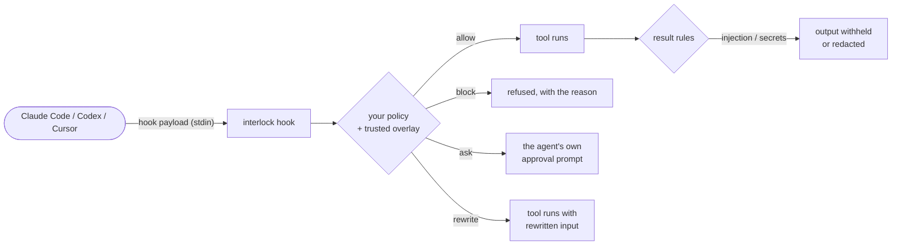

# Guard a coding agent

Put interlock in front of every tool call Claude Code, Codex or Cursor makes:
shell commands, file reads and writes, patches, web fetches and MCP tools. The
same policy language and detectors you use in your own agents decide each call,
through the agent's own hook system.

## Install

```bash
pip install "git+https://github.com/SourceShift/InterLock.git"
interlock install-hook --for claude-code      # or: codex, cursor, all
interlock doctor                              # check it took
```

`install-hook` adds `interlock hook --agent <name>` to the agent's hook settings
(`~/.claude/settings.json`, `~/.codex/hooks.json`, `~/.cursor/hooks.json`). It
keeps every other entry, backs the file up to `<file>.interlock-bak` first, and
replaces any earlier interlock entry, so running it twice is safe. It also
creates `~/.interlock/` with:

| File | What it is |
|---|---|
| `policy.json` | Your policy. By default `{"extends": "builtin:coding-agent"}` |
| `receipts.jsonl` | The receipt log, one line per decision, chained and MAC-signed |
| `receipts.key` | The log's MAC key (mode 0600) |
| `trusted.json` | Project overlays you approved (see below) |

Restart running agent sessions so they load the hooks. Use `--dry-run` to see the
change without writing anything, and `--uninstall` to remove it.

For **Codex**, `install-hook` also sets `[features] hooks = true` in
`~/.codex/config.toml` (only when that edit is unambiguous; otherwise it tells you
what to change), and Codex then asks you to trust the new hooks: open Codex, run
`/hooks`, press `t`.

## What happens on each call



Each agent's protocol can express a different part of this, and the hook never
claims more than the agent can do:

| Verdict | Claude Code | Codex | Cursor |
|---|---|---|---|
| Allow | silent: Claude's own permission rules still apply | silent | `allow` |
| Block | `deny` + reason | exit 2 + reason | `deny` + reason |
| Escalate (ask a human) | the native permission prompt | **refused**: Codex hooks can't open a prompt | the native prompt; **refused** for file reads |
| Rewrite the input | `updatedInput` | **refused**: can't be applied | **refused** |
| Block a result | output withheld (`updatedToolOutput`) | flagged only | no result hook |
| Rewrite a result | redacted output (`updatedToolOutput`) | flagged only | no result hook |

"Refused" means the call is denied with a message that says why: a rewrite that
can't be applied, or a question that can't be asked, must not quietly turn into
"run it anyway". The receipt records both verdicts: `policy_verdict` is what your
policy said and `verdict` is what was enforced.

An allow never auto-approves. The hook only adds restrictions on top of the
agent's own permission system.

Claude Code's rewrite and output-replacement paths follow the Claude Code hooks
reference (checked 2026-10-13). They have not been exercised against a live
Claude Code here, so confirm them on your version: ask the agent to `cat` a file
containing `API_TOKEN=abcdef123456` and check the output it reports is redacted.

## The built-in policy

`builtin:coding-agent` (run `interlock policy show builtin:coding-agent` for the
full text):

| Rule | Verdict | Catches |
|---|---|---|
| `self-protect-files` | block, **locked** | any write under `~/.interlock` |
| `self-protect-commands` | block, **locked** | `interlock trust`/`install-hook` and shell writes under `~/.interlock` |
| `destructive-commands` | block, **locked** | recursive delete or chmod of `/`, `~` or a system directory, raw disk writes, formats, however they're spelled |
| `fetch-and-execute` | block | `curl ... \| sh`, `bash -c "$(curl ...)"`, `bash <(curl ...)` |
| `secret-files` | block | reading or writing `~/.ssh`, `~/.aws`, `~/.gnupg`, `~/.kube`, `~/.netrc`, `~/.npmrc` and similar |
| `git-credentials` | block | `git config --get ...password`, `git config --list`, `git credential fill` |
| `force-push` | ask | force-push to a default branch, or with no branch named |
| `push-delete`, `discard-work` | ask | deleting a remote branch; `reset --hard`, `clean -f`, `checkout .`, `branch -D` |
| `publish` | ask | `npm/cargo/twine/gem/poetry/uv publish`, `docker push`, `gh release create` |
| `shell-init-write`, `scheduled-jobs` | ask | writing `~/.zshrc` and friends; `crontab`, `launchctl load`, `systemctl enable` |
| `privilege` | ask | `sudo`, `doas`, `su` |
| `env-files` | ask | reading `.env` (but not `.env.example`) |
| `agent-hook-settings` | ask | editing the agent's own hook settings |
| `result-injection` | withhold | prompt injection in tool output |
| `result-secrets` | redact | credentials in tool output |

Shell rules match **what a command does**, not its text. `rm -fr ~`,
`/bin/rm -Rf /`, `bash -c 'rm -rf /'`, `sudo rm -rf /` and
`python3 -c 'os.system("rm -rf /")'` are the same act to them (see
[parsed commands](detectors.md#parsed-shell-commands)).

## Change the policy

Edit `~/.interlock/policy.json`. Keep the pack and switch rules off, or add your
own:

```json
{
  "version": 1,
  "extends": "builtin:coding-agent",
  "disable": ["privilege", "env-files"],
  "rules": [
    {"id": "no-prod-kubectl", "verdict": "block", "on": "Bash",
     "reason": "no kubectl against production",
     "when": {"arg": "command", "matches": "kubectl\\b.*--context[= ]prod"}},
    {"id": "ask-before-terraform", "verdict": "escalate", "on": "Bash",
     "reason": "terraform changes infrastructure",
     "when": {"arg": "command", "matches": "^terraform (apply|destroy)"}}
  ]
}
```

Locked rules stay on: a `disable` naming one is ignored and reported.

```bash
interlock policy check ~/.interlock/policy.json
```

lists the rules, the locked ones, and any rule skipped as invalid, with the
reason ("`Bash` has no argument `cmd` (did you mean `command`?)"). The language is
in [declarative policies](policies.md).

## Per-project rules

A repository can carry `.interlock/policy.json`. The hook finds it from the
session's working directory, but **ignores it until you trust it**:

```bash
cd ~/src/payments
interlock trust add          # shows what it adds, asks, records its hash
interlock trust list         # ok / CHANGED / MISSING
```

An overlay can only add rules and widen lists the base marks `widenable`. It
can't disable, replace or relax anything. Editing the file revokes trust until
you approve it again, so an agent that rewrites the overlay gets nothing. The
agent can't run `interlock trust` itself (the locked `self-protect-commands`
rule).

## See what it did

```bash
interlock report ~/.interlock/receipts.jsonl --key-file ~/.interlock/receipts.key
interlock report ~/.interlock/receipts.jsonl --since 24h --monitor
```

Each tool call's receipts share a `call_id` (the agent's `tool_use_id` when it
sends one), so you can follow a call from its policy decision through the
agent's approval prompt to its result.

## Try it before it blocks

```bash
interlock install-hook --for claude-code --monitor
```

Nothing is blocked. Every decision is recorded, and Claude shows what would have
happened. After a day, `interlock report ... --monitor` lists what would have
been stopped. Re-run `install-hook` without `--monitor` to enforce.
`interlock doctor` warns while a hook is in monitor mode.

## When something goes wrong

Any error in the hook, whether unreadable input, a policy that won't load, or a
crash, **denies the call** and tells the agent to have you run
`interlock doctor`. `--on-error allow` lets calls through instead, with a loud
warning on each one; use it only if you'd rather keep working unguarded than
stop.

`interlock doctor` checks that each agent's hook is installed and that the
Python it runs still exists (a deleted virtualenv would break every call).

## Limits

- **Hooks are cooperative.** They see the tools the agent routes through its
  hook system. They are not an OS boundary: run the agent in a sandbox (or a
  container) if it must be contained.
- **Command parsing is best-effort.** Obfuscated commands (`$'\x72\x6d'`,
  base64, a downloaded script) get past it. The locked rules and the sandbox
  are the backstop, not the parser.
- **Codex** can't ask or rewrite at `PreToolUse`, and can't withhold tool output.
  **Cursor** has no result hook.
- **Each call starts a Python process.** For lower latency, run a sidecar and
  install with `--sidecar PATH`.
