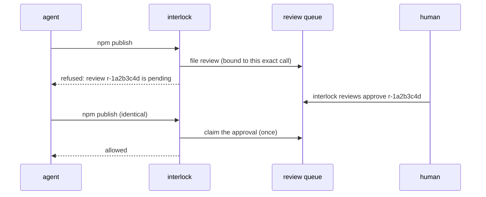

# Review queue: ask a human without holding the call

[Approvals](approvals.md) ask an approver while the call waits. Often that's not
possible: a coding agent's hook has a timeout, a job has a deadline, Codex can't
open a prompt. The review queue decouples the two. The call is refused now with
a review id, a human decides later, and the **identical** retry runs once.



## In your own agent

```python
import interlock
from interlock.reviews import ReviewQueue, queue_approver

queue = ReviewQueue()            # ~/.interlock/reviews.db
interlock.install(rules=[...], approver=queue_approver(queue))
```

The first escalation raises `NotApproved`: "review r-1a2b3c4d is pending; a
human must run `interlock reviews approve r-1a2b3c4d`, then retry this identical
call". After the approval, the same call (same tool, same effective arguments,
same agent, same working directory, same rule) runs **once**. Two concurrent
retries can't both run: the claim is a single conditional update. A different
call files its own review.

A review is filed for, and previews, the arguments **that will run**: when a
rule rewrites the call before it escalates, the preview shows the merged
`modified_args` and the digest binds that rewrite. An approved retry runs the
rewrite. If the agent's hooks cannot apply a rewrite, the retry is refused
rather than running the original arguments.

`queue_approver(queue, wait=60)` holds the call for up to 60 seconds first, for
callers that can afford to wait.

## For coding agents

The hooks use the queue automatically when an agent can't ask: Codex, and
Cursor file reads. Without it they could only refuse. Claude Code keeps its
native permission prompt; install with `--reviews always` to send its
escalations through the queue too, or `--reviews off` to disable the queue.

## Deciding

```bash
interlock reviews list                       # newest first; --status pending
interlock reviews show r-1a2b3c4d            # reason, rule, agent, the call
interlock reviews approve r-1a2b3c4d         # --as NAME (default: your login)
interlock reviews reject r-1a2b3c4d --reason "use the staging table"
interlock reviews revoke r-1a2b3c4d          # withdraw an approval not yet used
```

A rejected call that is retried unchanged gets the rejection back. It doesn't
file a new review and ask you again.

## Settings

```python
ReviewQueue(path=None, pending_ttl=3600, approval_ttl=900,
            min_approvals=1, allow_self_approval=True)
```

| Setting | Meaning |
|---|---|
| `pending_ttl` | Seconds to decide before the review expires |
| `approval_ttl` | Seconds to *use* an approval, counted from when it was granted |
| `min_approvals` | Distinct approvers needed (four-eyes: `2`) |
| `allow_self_approval` | `False` refuses an approval by the account that filed the review |

Each review row stores the `allow_self_approval`, `min_approvals` and
`approval_ttl` in force when it was filed. The database also records the
strictest policy it has ever been opened with: `allow_self_approval` ratchets to
false, `min_approvals` ratchets up and `approval_ttl` ratchets down. A decision
obeys the stricter of the row and that record, so a CLI or console process that
opens the queue with defaults cannot weaken the rules the review was filed
under (a console started with `--four-eyes` keeps applying it). Nothing loosens
the record implicitly; deleting the database resets it.

Statuses are `pending`, `approved`, `rejected`, `revoked`, `expired` and
`executed` (an approval that was used).

## Let the agent check on its review

`interlock reviews mcp` is a read-only MCP server (stdio, no dependencies). It
has three tools: `review_status`, `review_list` and `review_wait`. Each returns
`next: wait | retry_identical_call | stop` and an instruction, so an agent knows
whether to wait, retry or give up. It never approves anything.

```json
{"mcpServers": {"interlock-reviews": {"command": "interlock", "args": ["reviews", "mcp"]}}}
```

## Trust

- The queue file must not be writable by the agent. The coding-agent policy
  locks `~/.interlock`, and refuses `interlock reviews approve`/`reject`/`revoke`
  from inside an agent.
- Approver names come from the OS login (or `--as`). Anyone who can write the
  queue file can claim any name, so keep it private (mode 0600, the default).
- The queue stores a preview of each call (its arguments, truncated) so the
  approver can see it. Receipts never do.
- What an approval is bound to includes the policy epoch when it's stable
  across processes (declarative policies). A policy change then voids pending
  approvals.
