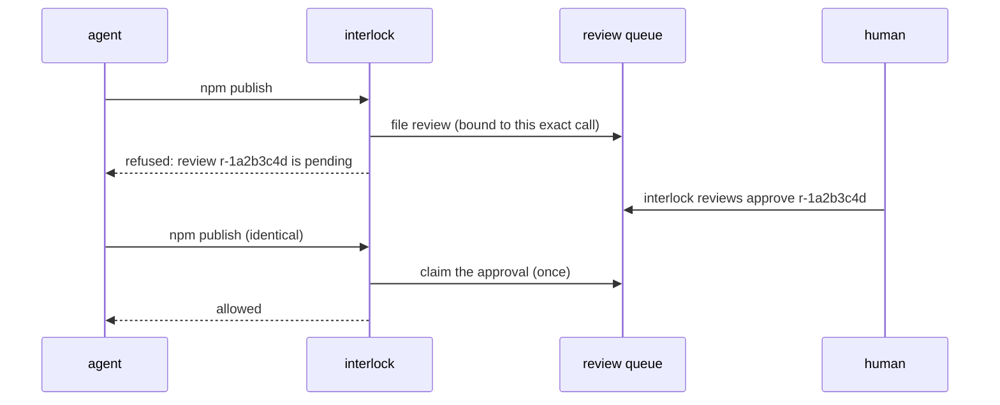

# Review queue: ask a human without holding the call

[Approvals](approvals.md) ask an approver while the call waits. Often that's not
possible: a coding agent's hook has a timeout, a job has a deadline, Codex can't
open a prompt. The review queue decouples the two. The call is refused now with
a review id, a human decides later, and the **identical** retry runs once.



## In your own agent

```python
import interlock
from interlock.reviews import ReviewQueue, queue_approver

queue = ReviewQueue()            # ~/.interlock/reviews.db
interlock.install(rules=[...], approver=queue_approver(queue))
```

The first escalation raises `NotApproved`: "review r-1a2b3c4d is pending; a
human must run `interlock reviews approve r-1a2b3c4d`, then retry this identical
call". After the approval, the same call (same tool, same effective arguments,
same agent, same working directory, same rule) runs **once**. Two concurrent
retries can't both run: the claim is a single conditional update. A different
call files its own review.

A review is filed for, and previews, the arguments **that will run**: when a
rule rewrites the call before it escalates, the preview shows the merged
`modified_args` and the digest binds that rewrite. An approved retry runs the
rewrite. If the agent's hooks cannot apply a rewrite, the retry is refused
rather than running the original arguments.

`queue_approver(queue, wait=60)` holds the call for up to 60 seconds first, for
callers that can afford to wait.

## For coding agents

The hooks use the queue automatically when an agent can't ask: Codex, and
Cursor file reads. Without it they could only refuse. Claude Code keeps its
native permission prompt - "Yes / No" in the session, nothing filed, so nothing
on the console's Reviews screen; `interlock install-hook --reviews always`
sends its escalations through the queue too, and `--reviews off` disables the
queue.

## Deciding

```bash
interlock reviews list                       # newest first; --status pending
interlock reviews show r-1a2b3c4d            # reason, rule, agent, the call
interlock reviews approve r-1a2b3c4d         # --as NAME (default: your login)
interlock reviews reject r-1a2b3c4d --reason "use the staging table"
interlock reviews revoke r-1a2b3c4d          # withdraw an approval not yet used
```

A rejected call that is retried unchanged gets the rejection back. It doesn't
file a new review and ask you again.

## Notify Slack or a webhook

Nothing tells you a review is waiting by default: `interlock reviews` and the
console are pull-only, on purpose - the queue never accepts a decision over a
network. To get a ping, point the hook at an incoming webhook:

```bash
export INTERLOCK_REVIEW_WEBHOOK=https://hooks.slack.com/services/...
export INTERLOCK_REVIEW_WEBHOOK_FORMAT=slack        # or json; default slack
export INTERLOCK_REVIEW_CONSOLE_URL=http://127.0.0.1:7878   # link in the message
interlock install-hook --for claude-code --reviews always
```

The hook posts one message per **filed** review: a pending review that is
asked about again, and a rejected call retried unchanged, notify nobody.

What leaves the machine is deliberately narrow: the review id, the tool, the
one argument that says what the call acts on (command, file or URL), the
principal, the rule, the reason and a console link - each passed through the
guard's own secret redactor first, because a rule's reason can quote an
argument. The call's full arguments never leave: they stay in the review
database for the console and `interlock reviews show`.

`slack` posts `{"text": ...}`. `json` posts
`{"event": "interlock.review.filed", "review_id", "action", "target",
"principal", "rule", "reason", "min_approvals", "pending_until",
"console_url"}`. A slow, failing or redirecting receiver never blocks or
changes a decision - you may simply get no ping. A malformed setting warns once
and disables the ping; it does not fail the hook.

The webhook URL is a credential: keep it in the environment or a secret store,
not in a policy file, and note that interlock never logs it.

From your own code, pass a notifier instead of setting the environment:

```python
from interlock.notify import ReviewNotifier
from interlock.reviews import ReviewQueue, queue_approver

queue = ReviewQueue(on_file=ReviewNotifier("https://hooks.slack.com/services/..."))
interlock.install(approver=queue_approver(queue))
```

The webhook is one-way: it announces, it never decides. Approval stays
`interlock reviews approve` (yourself, outside the agent) or the console. The
message is posted once; for a reminder, have cron post the pending count:

```bash
n=$(interlock reviews --json list --status pending | jq length)
[ "$n" -gt 0 ] && curl -s -X POST -H 'Content-type: application/json' \
  --data "{\"text\":\"$n interlock review(s) still pending\"}" "$INTERLOCK_REVIEW_WEBHOOK"
```

## Settings

```python
ReviewQueue(path=None, pending_ttl=3600, approval_ttl=900,
            min_approvals=1, allow_self_approval=True,
            key=None, key_path=None, on_file=None)
```

| Setting | Meaning |
|---|---|
| `pending_ttl` | Seconds to decide before the review expires |
| `approval_ttl` | Seconds to *use* an approval, counted from when it was granted |
| `min_approvals` | Distinct approvers needed (four-eyes: `2`) |
| `allow_self_approval` | `False` refuses an approval by the account that filed the review |
| `on_file` | Called once, after commit, when a new review is filed; a `ReviewNotifier` posts it to a webhook. Reusing a pending review does not call it, and an exception is logged without changing the decision |

Each review row stores the `allow_self_approval`, `min_approvals` and
`approval_ttl` in force when it was filed. The database also records the
strictest policy it has ever been opened with: `allow_self_approval` ratchets to
false, `min_approvals` ratchets up and `approval_ttl` ratchets down. A decision
obeys the stricter of the row and that record, so a CLI or console process that
opens the queue with defaults cannot weaken the rules the review was filed
under (a console started with `--four-eyes` keeps applying it). Nothing loosens
the record implicitly; deleting the database resets it.

Statuses are `pending`, `approved`, `rejected`, `revoked`, `expired` and
`executed` (an approval that was used).

## Integrity

Every row is signed with an HMAC-SHA256 key that lives **beside** the database
(`reviews.key`, mode 0600) and never inside it. The signature covers the
binding, the preview, the status and decision, the approver names and the
approval list. A writer who can edit `reviews.db` but cannot read the key can
no longer promote a pending review, redirect an approval to a different call,
edit the preview a human is shown, or add an approver to satisfy
`min_approvals`; the queue refuses the row with "does not match its signature"
and the call stays refused.

The key is the boundary. A process that can read both files can forge, and one
that can delete either can deny service. Keep the directory private (the queue
creates it 0700), and for a database on shared storage put the key somewhere
else with `key_path=` - or pass the bytes directly with `key=` from a secret
store; decisions made on another machine need the same key to verify. Deleting
or replacing the key invalidates every decision signed with it.

An upgrade from a database written before signing seals its existing rows on
first open, in the reviewer's own process.

A signature cannot see a **wholesale rollback**: an older copy of the database
is a valid set of signed rows, so restoring it replays the decisions made since
that copy. Every state change therefore also advances a **high-water mark**, a
small signed file (`<key>.head` by default, mode 0600) recording how many writes
the queue has committed. Opening a database whose counter is behind the mark is
refused as a rollback. The mark is written *after* the SQLite commit, so a crash
between the two leaves the database ahead of the mark; that direction heals (the
mark catches up) rather than blocking the queue. The mark only ever rises: with
several processes on one database, a writer holding a staler counter adopts the
higher value another process already wrote instead of overwriting it.

The mark is only as good as its storage. A backup that restores the database,
the key and the mark together is invisible to it, so point `head_path=` (or
`interlock reviews --head`) at storage your database backups do not restore.
Replacing the key also invalidates the mark's signature: a deliberate rotation
stops the queue from opening until you remove the old mark as well. Passing
`--key` and `--head` to the CLI selects both files explicitly.

## Let the agent check on its review

`interlock reviews mcp` is a read-only MCP server (stdio, no dependencies). It
has three tools: `review_status`, `review_list` and `review_wait`. Each returns
`next: wait | retry_identical_call | stop` and an instruction, so an agent knows
whether to wait, retry or give up. It never approves anything.

```json
{"mcpServers": {"interlock-reviews": {"command": "interlock", "args": ["reviews", "mcp"]}}}
```

## Trust

- The queue file and its key must not be writable by the agent. The
  coding-agent policy locks `~/.interlock`, and refuses
  `interlock reviews approve`/`reject`/`revoke` from inside an agent.
- Approver names come from the OS login (or `--as`). A name is only as good as
  the key that signed the row: a process that can read both the database and
  `reviews.key` can still claim any name, so keep both private (mode 0600, the
  default). Editing the database alone no longer buys an approval, and neither
  does restoring an older copy of it.
- The queue stores a preview of each call (its arguments, truncated) so the
  approver can see it. Receipts never do.
- What an approval is bound to includes the policy epoch when it's stable
  across processes (declarative policies). A policy change then voids pending
  approvals.
