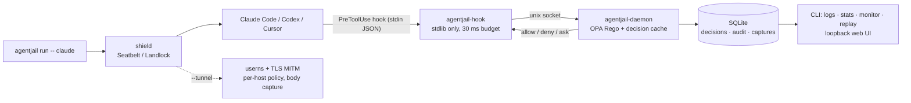
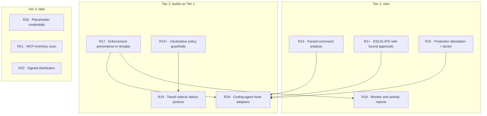

# agentjail review: what it does better, and the features interlock should take

**Question this answers:** [agentjail](https://github.com/LuD1161/agentjail) is the
closest open-source neighbour to interlock. Where is it ahead, which of those
leads matter for interlock's product, and what exactly should we build?

**Reviewed:** `main` at `944df1c` (2026-09-23, README badge v1.8.0), the README,
the 141 ADRs under `docs/adr/`, and the source of `internal/shellparse`,
`internal/commandintent` and `cmd/agentjail/policies/`. interlock reviewed at
`ee6e05d`.

**Output:** section 6 has eleven feature specs in the same shape as
[`ROADMAP.md`](../../ROADMAP.md) (Problem / What changes / Acceptance / Risks), so
promoting one is a copy-paste. Two of them amend existing items (R2, R10)
instead of adding new ones.

> **Implementation status (2026-10-13).** Everything in section 6 shipped
> except R22 (it needs network access to the package registries); see
> [`ROADMAP.md`](../../ROADMAP.md#r14r22--from-the-agentjail-review) for the evidence per item and
> the guides under [`docs/guides/`](../../docs/guides/) for usage. Where building
> it proved this document wrong, the spec below is corrected in place and
> marked **Corrected**.

---

## 1. What agentjail is

agentjail wraps off-the-shelf **coding agents** (Claude Code, Codex, Cursor).
It does not live inside the agent's process. It plugs into each agent's hook
protocol and adds an OS sandbox around the whole agent.



| Layer | agentjail | interlock |
|---|---|---|
| Who it's for | A developer running a coding agent they didn't write | A developer building an agent |
| Where it hooks | Agent hook protocol, out of process | Inside the agent's process: `@guard`, MCP session, LangChain, tool loop |
| Policy language | OPA Rego | Python rules (YAML/JSON planned: R10) |
| Verdicts | allow · deny · **ask** | allow · block · **rewrite** |
| Checks tool *results* | No (PostToolUse only used to attribute failures) | Yes, a core feature |
| Sandbox | Whole agent, by default via `agentjail run` | Subprocesses the agent launches (BRACE) |
| Network | Transparent tunnel, TLS MITM, per-host policy | In-process egress rules only |
| Audit | SQLite rows, value-redacted | HMAC-chained receipts, args hashed |
| Distribution | Signed installer, Homebrew, auto-update | `pip install git+...` |

The products overlap less than their pitches suggest. What carries over from
agentjail is mostly *operational maturity*: how it proves protection is on,
how it handles its own failures, and how it asks a human.

---

## 2. Where agentjail is ahead

Ranked by how much each gap costs interlock users today.

| # | agentjail does | interlock today | Evidence |
|---|---|---|---|
| 1 | **Parses shell commands** into binaries and semantic intents, recursing into `sh -c`, `$(...)`, `sudo`/`env`/`xargs` wrappers and string literals inside `python -c` | Matches raw text by design (`destructive_command_guard` docstring) | Probe below: **3 of 12** spellings of a root wipe blocked |
| 2 | **Ask a human**, with a one-use challenge bound to the exact command, reason, session and policy version; the approval channel is unreachable by the agent | No ESCALATE verdict (R2, `not started`) | ADR 0119, 0141 |
| 3 | **Proves protection is on.** The status line never renders blank; `doctor` cross-checks that enforcement actually ran | README limit #1: "No rules means everything is allowed. Check that rules are installed at startup." No API helps you check | ADR 0064, 0082, 0085 |
| 4 | **Reports what monitor mode would have blocked** (`agentjail monitor --since 24h`), plus `stats` with block rate and latency percentiles | Monitor receipts are written (`observed=True`) but nothing reads them | ADR 0091 |
| 5 | **Separates policy verdict, effective verdict and final outcome**, and names the enforcer (policy vs sandbox). One record per tool call. Dropped records are counted | One receipt per phase, no per-call ID, no policy version, sink failures propagate unannotated | ADR 0072, 0112, 0115 |
| 6 | **Tiered failure posture** when the daemon is down: `allow` / `degraded` (offline denylist) / `deny`, loud on every occurrence | Node client fails closed; the sidecar is an availability dependency (security model, "Known gaps") | ADR 0050, 0074 |
| 7 | **Custom rules can't break the baseline**: input fields type-checked at install, rules may only *add* candidates, bad rules quarantined, locked rules can't be disabled | R10 plans "last-good stays live" but nothing on schema checks, extension surface or locked rules | ADR 0116, README "Rule authoring" |
| 8 | **Project overlays are trust-gated by content hash** (direnv-style) and additive-only | No file-based policy yet; scopes attenuate sub-agents but there's no overlay trust model | ADR 0043 |
| 9 | **Credential broker**: the agent requests secrets by ID; values never hit argv or logs | Redaction after the fact only | ADR 0004, 0032, 0140 |
| 10 | **MCP surface discovery** (`mcp scan` across configs, npm, pip, Docker) and allowlist seeding at install | Pinning and attestation exist, but you must already know your servers | README "Managing MCP servers" |
| 11 | **Signed releases**: the installer verifies a minisign manifest and fails closed | Not on PyPI or npm; "pin a commit" | ADR 0145 |

### The shell-parsing probe

Reproduce from the repo root:

```python
from interlock.detectors.destructive_command_guard import destructive_command_guard
from interlock.event import SensorEvent

rule = destructive_command_guard()
for cmd in ["rm -rf /", "rm -fr /", "rm -r -f /", "rm --recursive --force /",
            "sudo rm -rf /", "bash -c 'rm -rf /'", "echo hi; rm -rf  /",
            "/bin/rm -Rf /", "rm -rf /*", "rm -rf ~", "find / -delete",
            "python3 -c 'import os; os.system(\"rm -rf /\")'"]:
    print("BLOCK" if rule(SensorEvent(action="run_shell", args={"cmd": cmd})) else "miss ", cmd)
```

Result at `ee6e05d`: blocked `rm -rf /`, `sudo rm -rf /`, `echo hi; rm -rf  /`.
Missed the other nine. Flag reordering (`-fr`), split flags (`-r -f`), long
flags, an absolute binary path, a glob, `~`, a `bash -c` wrapper, `find -delete`
and an interpreter escape all pass.

---

## 3. Where interlock is ahead (keep these, and lead with them)

- **Rewrite as a verdict.** agentjail can only allow, deny or ask. interlock can
  mask a secret or cap a row count and let the task continue.
- **Result-phase checks.** agentjail never scans what a tool returns, so prompt
  injection arriving in a web page or file reaches the model unchecked.
  interlock's `tool_result_injection_guard` and output redactors cover this.
- **105 detectors** against agentjail's 3 core policies and 7 library rules.
- **Scope delegation** (R1): sub-agents can't exceed their parent.
  agentjail has no principal hierarchy.
- **Tamper-evident receipts.** agentjail's audit is plain SQLite rows. Chained,
  MAC-signed receipts are stronger evidence.
- **In-process, zero dependencies, no daemon.** agentjail needs a daemon,
  launchd/systemd units, and a supervisor that must restart on clean exit
  (ADR 0070, 0088).

Feature R18 below turns the first two into a direct advantage over agentjail on
its home ground.

---

## 4. What not to copy

| agentjail feature | Why interlock should skip it |
|---|---|
| Transparent tunnel + TLS MITM | A different product (network appliance). Huge platform surface: 30+ ADRs of userns, AppArmor, gVisor, h2 and macOS Network Extension work |
| Cost analytics over agent transcripts | Off-mission for a guardrail library |
| Anonymous telemetry | "No network calls" is an interlock selling point. Don't trade it |
| Daemon auto-update | A library is updated by its host's dependency manager |
| `degraded` as the *default* failure posture | agentjail can justify it because its offline list mirrors rules that are locked online. interlock rules are user Python and can't be mirrored offline, so `deny` stays the default (see R19) |

---

## 5. Practices worth borrowing (not features)

- **"`action` must never overstate enforcement"** (ADR 0091). Any field named
  `verdict` must record what happened, never what policy wanted. Apply this
  rule to every new receipt field.
- **Dated compatibility claims.** ADR 0112 records the exact Claude Code and
  Codex versions and doc URLs it was verified against, with the date.
  Integrations (LangChain pin, MCP SDK) should do the same.
- **ADRs numbered and checked in CI** (ADR 0083, `scripts/adr-check.sh`). The
  roadmap's "Why now / Risks" prose already does half the job; the decisions
  themselves currently live only in commit messages.
- **A clean-environment release gate with a real agent** (ADR 0053, 0130). It
  fails rather than skipping when credentials are missing.

---

## 6. Feature specs

Proposed numbers continue from R13. Sizes use the roadmap's scale
(`S` one or two modules, `M` a new module plus tests, `L` a new subsystem).



R16 can ship verdict counts before R17. Its latency percentiles need R17's
timing field.

---

### R14 · Parsed command analysis (`interlock.shell`)

**Status:** `not started` · **Size:** M · **Tier:** 1
**From agentjail:** `internal/shellparse` (bounded recursion, wrappers,
interpreter literals), `internal/commandintent` (git push classification from
parsed argv, including `git -C` and inline aliases).

#### Problem

Shell detectors match raw text, so every respelling of a command is a bypass.
The probe in section 2 shows `destructive_command_guard` missing 9 of 12
spellings of one act. The docstring's argument ("the shell's grammar is larger
than any parser we could ship") is true but doesn't settle it: a best-effort
parser that only ever *adds* findings can't make a detector weaker.

#### What changes

- New pure-Python module `interlock/shell.py`, no dependencies, wrapping
  `shlex`:
  - `parse(cmd) -> ParsedCommand` with `invocations: list[Invocation]`, where
    `Invocation = (binary, argv, via)` and `binary` is reduced to a basename.
  - Splits on `|`, `&&`, `||`, `;` and newlines, without splitting inside quotes
    or `$(...)`/backticks.
  - Recurses into `sh|bash|zsh|dash -c`, command substitutions, and wrappers
    (`sudo`, `env`, `xargs`, `nice`, `nohup`, `timeout`, `command`, `exec`,
    `time`), skipping the wrapper's own flags and `VAR=x` assignments.
  - For `python|node|perl|ruby|php -c/-e`, extracts quoted string literals and
    parses each one as a shell command (catches `os.system("...")`).
  - Recursion depth capped (agentjail uses a small constant) so
    `bash -c 'bash -c "..."'` can't recurse without bound.
  - Never raises. Unparseable input returns `ParsedCommand(partial=True)`.
- `interlock/shell_intents.py`: flag normalisation (`-rf` = `-fr` = `-r -f` =
  `--recursive --force`) and an intent vocabulary: `fs.delete.recursive(target)`,
  `fs.chmod.world_writable`, `disk.overwrite`, `git.push.force(branch)`,
  `net.fetch_pipe_exec`, `pkg.publish`, `scheduler.persist` (cron, launchctl, at).
- Rebuild `destructive_command_guard` and `git_credential_guard` as **union**
  detectors: block if the existing pattern matches *or* a parsed intent
  matches. The parsed path can add findings, never remove them. **Corrected:**
  `shell_injection_guard` was left alone. It already blocks every shell
  metacharacter, so parsing adds nothing to it. A new `command_intent_guard`
  exposes the intents to policies instead.
- Root targets defined semantically: `/`, `/*`, `~`, `$HOME` and `/home/*` count
  as root-equivalent for `fs.delete.recursive`.

#### Acceptance

The probe's 12 cases become a parametrised test: all 12 blocked, while
`rm -rf ./build` and `rm -rf node_modules` stay allowed. **Corrected:**
`git commit -m "how rm -rf / works"` can't stay allowed under union semantics,
because the unchanged raw-text pattern still matches it. The *parser* treats
it as inert (the intent test asserts that), but the detector still blocks it. A fuzz test (random nesting,
quotes and wrappers, depth > cap) never raises and never takes longer than a
fixed bound.

#### Risks

False positives from parsing text that is data, not a command (the
`git commit -m` case above; agentjail added a special case for exactly this).
Keep detectors scoped to command-shaped arguments, using the catalog's
"Scoped to" mechanism. Parsing is not a boundary: obfuscation such as
`$'\x72\x6d'` or base64 will still pass, and BRACE remains the answer to that.
Say so in the detector docs.

---

### R2+ · ESCALATE with bound, one-use approvals (amends R2)

**Status:** amends R2 (`not started`) · **Size:** S → M · **Tier:** 1
**From agentjail:** ADR 0119 (challenge bound to the exact command and reason),
ADR 0141 (grant lifecycle and scope union), ADR 0047 (agent-unreachable approval
socket), locked `resolver/default`.

#### Problem

R2 as written ships the verb and an `on_escalate` hook, and leaves the hard
part to each deployment. agentjail's ADRs show where hand-rolled approval goes
wrong: an approval that can be replayed; an approval for one command that
silently covers a later, different one; a reason that changes after the human
read it; an approval the agent can grant itself; and a grant that outlives the
policy it was issued under.

#### What changes (on top of R2)

- `Approval` binds to a **canonical request**: `(action, args_digest, principal,
  span_id, policy_epoch, reason)`. `policy_epoch` comes from R17. Any mismatch
  at redemption fails closed.
- Approvals are **one-use by default**. Longer scopes are a closed union:
  `once | session | ttl(seconds)`. States are also closed: `requested ->
  approved -> consumed | expired | revoked | denied`. This unifies with the MCP
  leases from R6 instead of adding a second grant model.
- **Reason is bounded and frozen**: single line, at most 512 bytes, captured at
  request time and included in the binding. A changed reason is a different
  request.
- **Precedence is fixed.** An approval can satisfy an ESCALATE. It can never
  override a BLOCK from any rule.
- **No approver means block.** The default with no hook installed stays BLOCK
  (as R2 says), and an integration that has no human channel (for example a
  headless LangChain run) must block, not allow.
- The approval channel must be **unreachable from the guarded code**. In
  process this is a documented limit (same-process code is trusted, see the
  security model). Through the sidecar, approvals arrive on a separate socket
  with its own permissions, never on the evaluation socket.
- Every state transition is a receipt.

#### Acceptance

R2's tests, plus: a replayed approval is refused; an approval for `args A`
does not run `args B`; changing the reason after approval fails; a policy
reload between approval and redemption fails; a BLOCK from a second rule wins
over an approval. Each transition appears in the receipt chain.

#### Risks

Scope creep into a UI. Ship the binding and lifecycle in the library. The
console (`mo/console`) and R18's native agent prompts are two approvers that
plug into it.

---

### R15 · Protection attestation: `interlock.attest()` and `interlock doctor`

**Status:** `not started` · **Size:** S · **Tier:** 1
**From agentjail:** status line that "never renders nothing" (ADR 0064, 0085),
`doctor` cross-checking that enforcement ran (ADR 0082), `doctor --fix` repairs
only what it diagnosed (ADR 0086).

#### Problem

interlock's most dangerous state is silent. If `install()` is never called, the
default engine allows everything and nothing looks wrong. The security model
lists nine "settings that weaken protection", and a deployment has no way to
ask which of them are in effect.

#### What changes

- `interlock.attest() -> Posture`: a frozen dataclass computed from live state:
  engine installed, rule count and policy IDs, enforcement mode (enforce or
  monitor), `allow_unscoped` on any `ScopedEngine`, sink installed and whether
  its key is persistent or per-process, BRACE backend strength and its
  `enforced` set, sidecar reachability and timeout. Each check has
  `ok | warn | fail` and a one-line fix.
- `interlock.require(min_level="enforced")` raises at startup if the posture
  is below the bar. One line in `main()` turns "check rules are installed"
  from advice into a test.
- `python -m interlock doctor [--sidecar PATH] [--json]`: the same report for an
  operator. It is a CLI over `attest()`, plus a sidecar probe and receipt-file
  checks (chain verifies, newest receipt age).
- **Every row of the security model's "Settings that weaken protection" table
  becomes one doctor check**, so the table and the tool can't drift. A test
  asserts the mapping.

#### Acceptance

`attest()` reports `fail` with no engine, `warn` in monitor mode, `warn` for a
per-process sink key and `warn` for the `soft` BRACE backend. `require()` raises
on each `fail`. A test parses `docs/security-model.md` and fails if a
weakening setting has no matching check.

#### Risks

Low. Keep `attest()` read-only, with no side effects and no network. Defer a
`--fix` until there is something safe to fix.

---

### R16 · Monitor and activity reports (`interlock report`)

**Status:** `not started` · **Size:** S · **Tier:** 1
**From agentjail:** `agentjail monitor --since 24h` ("Would have blocked 3 tool
calls"), `agentjail stats` (block rate, top deny rules, latency percentiles,
days with activity but zero recorded decisions).

#### Problem

The README's step 3 tells users to trial rules with `@monitor()` and "see what
a rule *would* do". Monitor receipts are written with `observed=True`, but
nothing aggregates them, so "see" means hand-parsing JSONL.

#### What changes

- `python -m interlock report FILE [--since 24h] [--monitor] [--json]
  [--key-file K | --verifier ...]`
- Steps: verify the chain first and print whether it verified (an unverified
  log is labelled, not silently reported). Then aggregate by verdict, rule
  (`policy_id`), action and principal. Show a top-N rule table and the block
  rate. In `--monitor` mode, show only `observed` receipts under the header
  "would have blocked N calls".
- Latency percentiles once R17 adds a timing field; until then that row says
  "not recorded".
- Pure stdlib. The console's audit view can reuse the same aggregation
  function, so CLI and UI never disagree.

#### Acceptance

On a fixture log with known counts, the report's JSON matches exactly. A
tampered fixture is reported as unverified, with the break index.

#### Risks

None notable. Make sure the report never prints raw args: receipts hold only
`args_digest`, so keep it that way.

---

### R17 · Enforcement provenance in receipts

**Status:** `not started` · **Size:** M · **Tier:** 2
**From agentjail:** stable per-call `ToolUseID` and one record per action
(ADR 0112), `policy_action` vs `effective_action` vs `final_action` + `enforcer`
(ADR 0115), dropped-decision counter (ADR 0072), policy epoch in grants
(ADR 0141).

#### Problem

A receipt says what a rule decided at one phase. It can't answer: was the call
and its result the same action? Which version of the policy decided? Did the
tool actually run, and if it failed, was it the sandbox that stopped it? Were
any receipts lost? Today a `sink.write` exception propagates out of the guarded
call as whatever `OSError` the sink raised.

#### What changes

All new fields are optional and omitted when empty, the same trick
`observed` uses, so older receipts and readers are unaffected.

- `call_id`: minted once per guarded call and shared by its `call` and
  `result` receipts (and by R18's PreToolUse/PostToolUse, using the agent's
  `tool_use_id` when it has one).
- `policy_epoch`: a stable hash of the installed rule set (policy IDs and
  versions), recomputed on `install()`.
- `policy_verdict` vs `verdict`: when an adapter or mode changes the outcome
  (monitor, an approved ESCALATE, an integration that can't express MODIFY),
  `verdict` is what happened and `policy_verdict` is what the rule said.
  `verdict` must never overstate enforcement.
- `outcome` + `enforcer` on a closing receipt: `ran | failed | blocked`, and
  `policy | sandbox | tool`. BRACE sets `enforcer=sandbox` when the child exits
  with a permission error from a denied operation.
- `elapsed_us` for the evaluation.
- Sink failure handling: a failed write raises `Blocked` (fail closed, with the
  sink error as the reason) instead of a raw `OSError`, and increments a
  `dropped` counter. The next successful write emits a `receipts.dropped`
  receipt with the count, so a gap in the chain explains itself.

#### Acceptance

A guarded call that runs produces two receipts with one `call_id`. A monitor
call has `verdict=ALLOW, policy_verdict=BLOCK`. Changing rules changes
`policy_epoch`. A sink that raises once yields `Blocked`, then a
`receipts.dropped count=1` receipt on recovery. Chains written before this
change still verify.

#### Risks

The MAC covers every field, so field order and omission rules must be pinned
by test before release. This is a schema change for anyone parsing receipts:
document it in `audit-log.md`.

---

### R18 · Coding-agent hook adapters (Claude Code first)

**Status:** `not started` · **Size:** M (Claude Code) · L (Codex + Cursor) · **Tier:** 2
**From agentjail:** the whole product shape: hook adapters per agent, a
normalised event contract, `apply_patch` split into per-file events,
version-dated compatibility checks.

#### Problem

The largest population of agents running tools on real machines today is coding
agents, and interlock has no way to guard them. "One policy everywhere" stops
at the agents people actually run.

#### Why interlock can beat agentjail here

Claude Code's hook protocol (Agent SDK hooks reference,
`code.claude.com/docs/en/agent-sdk/hooks`, checked 2026-10-13) exposes, on
`PreToolUse`, `permissionDecision: allow | deny | ask | defer` and
**`updatedInput`**. On `PostToolUse` it exposes **`updatedToolOutput`** /
`updatedMCPToolOutput` (replace the result before the model sees it) and
`additionalContext`. Both phases share a `tool_use_id`. That maps one to one onto
interlock:

| interlock | Claude Code hook |
|---|---|
| `ALLOW` | `permissionDecision: "allow"` (or no output) |
| `BLOCK` | `permissionDecision: "deny"` + reason |
| `MODIFY` | `updatedInput` + `allow` |
| `ESCALATE` (R2) | `permissionDecision: "ask"` |
| result check BLOCK | `updatedToolOutput` with a redacted or withheld body |
| `call_id` (R17) | `tool_use_id` |

agentjail uses only allow, deny and ask. It can't redact a secret from a
command and let it run, and it doesn't scan tool output for injection at all.
interlock can do both.

**Corrected (as built), after reading agentjail's adapter source:** only Claude
Code has this full surface. Codex's `PreToolUse` cannot ask (Codex continues
the call) and has no input rewrite the adapter can prove is applied, and its
`PostToolUse` cannot withhold output. Cursor has no post-tool hook, and its
`beforeReadFile` cannot ask. The adapters degrade those verdicts to a deny and
record both verdicts. Claude Code's `updatedInput`/`updatedToolOutput` paths
follow its hooks documentation and still need confirming against a live
Claude Code; agentjail never used them.

#### What changes

- `interlock-hook` console script: reads one hook JSON object from stdin, maps
  it to a `SensorEvent` (`tool_name -> action`, `tool_input -> args`,
  `session_id`/`agent_id -> principal`, `tool_use_id -> call_id`), evaluates
  it, and writes the hook JSON to stdout. Evaluates in process by loading a
  policy module, or via `RemoteEngine` to a running sidecar for speed.
- Adapter seam per agent (`interlock/adapters/claude_code.py`, later `codex.py`
  and `cursor.py`). Each adapter declares which verdicts it can express. If an
  adapter can't express a verdict, it degrades toward safety (MODIFY becomes
  deny when there's no `updatedInput`), and R17 records `policy_verdict` vs
  `verdict`.
- Event normalisation: multi-file patch tools fan out to one event per target,
  so one protected file denies the whole patch (agentjail does this for Codex
  `apply_patch`).
- `python -m interlock install-hook --for claude-code` writes the hook entry
  into settings, shows a diff, and is idempotent. R15's doctor checks the hook
  is present and answering.
- A compatibility fixture recording the Claude Code version and doc URL, with
  the verification date (see section 5).

#### Acceptance

Against recorded hook payloads: a `Bash` call with `rm -fr /` is denied (via
R14). A `Write` containing a credit-card number is rewritten through
`updatedInput`. A `WebFetch` result containing an injection is replaced through
`updatedToolOutput`. Pre and post receipts share one `call_id`. A
version-pinned live test runs in CI when credentials are available and fails,
not skips, on the release gate.

#### Risks

Hook protocols change under us; agentjail's ADRs record several protocol
breaks. The hook is cooperative, not a boundary: an agent can still act outside
hooked tools. Say so, and point to BRACE or `agentjail`-style whole-agent
sandboxing for containment. Python start-up time is a hook latency budget,
which favours the sidecar path. Confirm that command hooks configured in
`settings.json` support `updatedToolOutput` the same way the Agent SDK does
before promising it.

---

### R10+ · Declarative policy guardrails (amends R10)

**Status:** amends R10 (`not started`) · **Tier:** 2
**From agentjail:** input schema type-checking (`hookinput_schema.go`),
candidate-only custom rules (ADR 0116), quarantine on load, locked rule set,
trust-gated additive overlays (ADR 0043).

Add to R10's "What changes":

- **Field references are checked at load.** A condition on `args.cmdd` is
  rejected with the line, and with the fields that *are* available for that
  action. A field that is declared but absent on some events stays legal. This
  stops the most common declarative-policy bug: a rule that loads clean and
  never fires.
- **Restricted extension surface.** A policy file can add rules (candidates).
  It can't redefine the combining logic, and it can't disable a rule marked
  `locked`.
- **Quarantine, not reject-all.** A bad rule in a file is skipped with a loud
  warning, and the rest of the file and the baseline load. This complements
  R10's "last-good stays live" for the whole-file parse-error case.
- **Overlays are additive-only and trust-gated.** A per-repo or per-tenant
  overlay can only tighten, or widen allowlists that the base marks as
  widenable. Trust is keyed on the file's content hash, so an edited overlay is
  ignored until re-approved. Both outcomes (`overlay.applied`,
  `overlay.ignored_untrusted`) are receipts.

Add to R10's "Acceptance": a typo'd field fails load with a suggestion; a
locked rule can't be disabled by any file; an edited trusted overlay is
ignored until re-trusted; an overlay can't remove a base BLOCK.

---

### R19 · Tiered sidecar failure posture

**Status:** `not started` · **Size:** M · **Tier:** 2
**From agentjail:** `daemon_unreachable: allow | degraded | deny` (ADR 0050),
the daemon publishing an offline fallback ruleset to a file the hook evaluates
locally (ADR 0074), a loud notice on every fail-open (ADR 0073).

#### Problem

The security model lists it as a known gap: "If [the sidecar is] down, every
guarded call is denied. That's safe, but it makes the sidecar an availability
dependency." Today the only choice is total outage or no protection.

#### What changes

**Corrected (as built):** the fallback file carries the policy as a JSON
*string*, and the HMAC covers `"<written_at>\n<policy>"` exactly, so the
Python and Node.js clients verify the same bytes without agreeing on a JSON
canonicalization (Python escapes non-ASCII by default, JS doesn't). The offline
subset excludes detectors, shell intents, regexes and rewrites, because both
clients must evaluate it identically. A daemon that answers with an error
frame is *reachable*: it always blocks, whatever `unreachable` says.

- `RemoteEngine(..., unreachable="deny" | "degraded" | "allow")`, in both the
  Python and Node clients. **Default stays `deny`.**
- `degraded`: the sidecar writes a fallback file on start and on every reload:
  a small declarative ruleset the client can evaluate with no Python (deny
  lists for destructive commands, egress allowlist, locked rules). It is
  MAC-signed with the sidecar's key, and the client refuses an unsigned or
  stale file. A missing file means `deny`, not `allow`.
- Every non-`deny` fallback decision is a receipt with
  `enforcer=fallback` (R17) and logs a warning **per occurrence**, not once.
- R15's doctor reports the configured level and the age of the newest fallback
  decision.

#### Acceptance

Sidecar killed: `deny` blocks everything; `degraded` blocks a fallback-listed
call and allows another; a tampered fallback file is rejected and the client
denies. Each fallback decision leaves a receipt.

#### Risks

The fallback ruleset can only express what R10's declarative format can, so
this depends on R10. Don't ship `degraded` as a default: interlock's real rules
are arbitrary Python, and an offline subset can't be presented as equivalent.

---

### R20 · Placeholder credentials (secrets substituted at the guard boundary)

**Status:** `not started` · **Size:** M · **Tier:** 3
**From agentjail:** credential broker with ID-only discovery (ADR 0140), the
"phantom credentials" design (ADR 0032). agentjail's shipped version delivers
real values into the agent's environment. interlock can go further because it
already sits at the argument boundary and can rewrite.

#### Problem

Agents need credentials to call tools, so credentials end up in the prompt,
the context window, tool arguments and logs. Redaction detectors clean up
afterwards. Better to never put the secret in front of the model at all.

#### What changes

- `interlock.secrets.SecretStore` (env, file or callable backends; no network
  in core) and a placeholder syntax in tool arguments, for example
  `{{secret:stripe_live}}`.
- Placeholders are substituted **after** the policy decision is final, only for
  actions on that secret's allowlist (for example `stripe_live` is only valid
  in `http_post` to `api.stripe.com`). A placeholder used elsewhere blocks.
  **Corrected:** this was specified as a "final-stage MODIFY rule", but the
  engine composes rewrites in rule order, so any rule placed after it would see
  the real value. It is built as a step at the enforcement boundary instead,
  which no rule can observe. The ordering risk below no longer exists.
- The model sees only IDs. `list_secret_ids()` can be exposed as a tool, with
  labels as non-secret metadata. Receipts record the secret ID and never the
  value. The result phase scrubs the real value if a tool echoes it back.

#### Acceptance

A guarded `http_post` with a placeholder reaches the function with the real
value. The same placeholder in a disallowed action blocks. The value never
appears in a receipt, a log line or a returned result.

#### Risks

Ordering is everything: substitution has to be the last MODIFY, or a later rule
sees (and might log) the real value. Pin the ordering with a test.

---

### R21 · MCP inventory scan and allowlist seeding

**Status:** `not started` · **Size:** S-M · **Tier:** 3
**From agentjail:** `agentjail mcp scan` (configs, npm, pip, Docker, audit
history), `mcp where <server>`, and the allowlist auto-seeded at install.

#### What changes

`python -m interlock mcp scan [--json]` reads known MCP client configs (Claude
Desktop, Claude Code `.mcp.json` and settings, Cursor, VS Code) and prints
each server with its launch command, and whether a pin or baseline exists for
it. `--emit-policy` writes a starter allowlist + `mcp_tool_pinning` baseline
for review. Read-only, no network.

#### Acceptance

Against fixture config directories the scan finds every server, never executes
a server, and the emitted policy round-trips through the MCP guide's loader.

---

### R22 · Signed distribution

**Status:** `not started` · **Size:** S · **Tier:** 3
**From agentjail:** signed release manifest, installer fails closed without a
valid signature (ADR 0145).

#### What changes

Publish `interlock-guard` to PyPI and the JS client to npm with trusted
publishing (OIDC, no long-lived tokens) and provenance attestations, and
document how to verify them. For a security library, "pin a commit" is the
weakest part of the trust story.

#### Acceptance

A release workflow publishes on tag, and the docs show a verification command
that succeeds on the published artifact.

---

## 7. Suggested order

1. **R15 attestation** (S). Cheapest, and closes README limit #1.
2. **R14 parsed commands** (M). Closes a measured 9/12 miss rate.
3. **R16 reports** (S). Turns monitor mode into a real trial workflow.
4. **R17 provenance** (M). Foundation for R2+, R18 and R19.
5. **R2+ escalation** (M). Already the top open roadmap item; ship it with
   bindings.
6. **R18 Claude Code adapter** (M). The market wedge, with rewrite and
   result scrubbing as the differentiators.
7. **R10+**, then **R19**, then Tier 3.

## 8. Decisions that need an owner

- **Is R18 in scope?** It moves interlock from "library for agent builders" to
  also "guard for coding agents". That's a positioning call, not a technical
  one.
- **Sidecar failure default.** This review recommends keeping `deny` and
  making `degraded` opt-in (R19). agentjail chose `degraded` by default for
  availability. Which matters more to interlock's users?
- **Does R14 change detector behaviour by default,** or ship behind a flag for
  one release so users can measure false positives first (which also feeds R5)?
