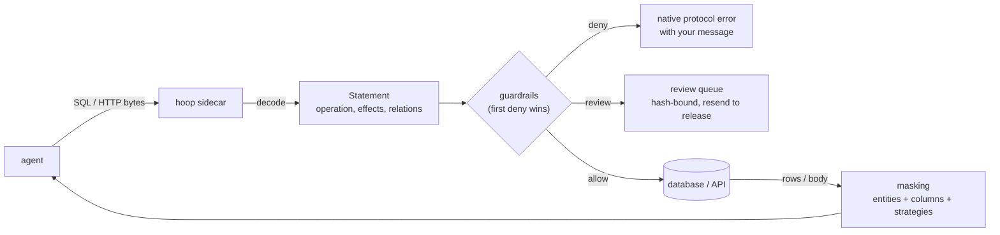
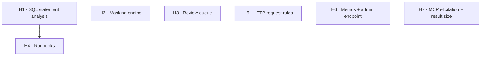

# hoop review: what it does better, and the features interlock should take

**Question this answers:** [hoop](https://github.com/hoophq/hoop) ("runtime
control for agents") guards what agents do to databases and APIs. Where is it
ahead of interlock, and what should interlock build, using local mechanisms only?

**Reviewed:** `main` at `a5b90d4` (2026-10-13): the README, `sidecar/README.md`
(4,233 lines), `sidecar/{lexer,inspect,policy,analyzer,audit,store,mcp,pii,daemon}`,
`gateway/{models,services,api,transport/plugins}`, `agent/controller`,
`common/runbooks`. The wire codecs and the `alcatraz` PII engine live in private or
external modules and were read through their adapters and docs only. Four parallel
read-only passes, each citing `file:line`; the citations live in the session record.

**Scope rule from the request:** nothing that needs a network call. That rules
out hoop's LLM Session Analyzer, OPA calls, Slack and webhook delivery, GCP DLP and
Presidio, git-fetched runbooks, the control-plane fleet sync, and the OCR screen
guard.

> **Implementation status (2026-10-13).** H1–H7 shipped; see
> [`ROADMAP.md`](../../ROADMAP.md#h1h7--from-the-hoop-review) for the evidence and
> [`docs/guides/databases.md`](../../docs/guides/databases.md) and
> [`docs/guides/reviews.md`](../../docs/guides/reviews.md) for usage. As built, the
> SQL analyzer also looks *inside* opaque bodies (`DO $$...$$`, `EXEC('...')`) for
> DML, and `EXPLAIN ANALYZE` counts as executing (hoop folds every `EXPLAIN` into
> a select).

---

## 1. What hoop is

hoop's current product is a **wire-protocol sidecar**. An agent points its
Postgres, SQL Server or HTTP client at the sidecar instead of the resource. The
sidecar decodes each statement, applies guardrails, masks the response, and
(optionally) holds risky statements for human review. A control plane manages
fleets of sidecars. The older **gateway** product covers human access: RBAC,
just-in-time access, runbooks, session recording, connectors.

| | hoop | interlock |
|---|---|---|
| Where it sits | On the wire, outside the agent | Inside the agent's process, at the tool call |
| Sees | SQL, HTTP, gRPC bytes | Tool name and arguments, any tool, and its result |
| Rewrites requests | Never ("a correctness change wearing a privacy label") | Yes (MODIFY) |
| SQL understanding | A lexer: effects, relations with read/write access | Regex (`sql_injection_guard`) |
| PII on results | One engine: 54 entities, checksum validation, column rules, 4 strategies | ~20 independent regex redactors, mostly on outbound args |
| Human approval | Async queue: hash-bound, resend to release once, quorum, no self-approval | Synchronous in-process approver (R2) |
| Audit | SQLite sessions and events, filterable API, `/metrics` | HMAC-chained receipts + `interlock report` |
| Tamper evidence | None | Chained, MAC-signed receipts |

## 2. Where hoop is ahead

| # | hoop does | interlock today |
|---|---|---|
| 1 | **Parses SQL** and classifies by *worst effect*: `WITH x AS (DELETE …) SELECT` is a delete, `SELECT 'DROP TABLE x'` is a select; relations carry read/write access; `DO`/`CALL`/`EXECUTE` are flagged opaque | `sql_injection_guard` matches text; no operation or table policy at all |
| 2 | **One masking engine**: checksum-validated entities (Luhn, IBAN mod-97, Verhoeff, CPF mod-11), deterministic column and JSON-path rules, strategies `redact`/`mask`/`partial`/`hash`, a value allow-list, a published false-positive table, masked counts in the audit (never values) | Separate regex redactors; no checksum beyond Luhn in one place; no column rules or strategies; receipts don't say what was masked |
| 3 | **Async reviews**: refuse now with a review id; the agent resends the identical statement and it is released exactly once (SHA-256 bound, claimed by a conditional update); separate "time to decide" and "time to use" clocks; group quorum; self-approval blocked; a read-only MCP server tells the agent `wait` / `resend` / `stop` | One synchronous approver callback; nothing survives the process; Codex and Cursor reads can only refuse |
| 4 | **Runbooks**: typed command templates (`required`, `options`, `minlength`, `maxlength`, `default`); only a template can run | Free-form shell commands, filtered by deny rules |
| 5 | **HTTP request rules**: path globs (`*` one segment, `/**` deep), methods, required/forbidden header shapes; response-status rules | Egress host allowlists only |
| 6 | **Operations surface**: `/healthz`, `/stats`, `/metrics`, `/config` (rule names only) on the sidecar | `interlock doctor` probes by deciding a dummy event; no metrics |
| 7 | **MCP proxy limits**: block elicitation, cap result size | Sampling guard and call caps exist; no elicitation guard, no result-size cap |

## 3. Where interlock is ahead (keep)

- **Tamper-evident audit.** hoop has no hash chain or signature on its events.
- **Tool-level semantics.** interlock sees *which tool* and *every argument*, for
  any tool, not only the protocols a codec decodes.
- **Rewrites on the way in.** hoop can only deny a request; interlock can cap,
  mask or dry-run it and let the task continue.
- **Prompt-injection, scopes, sandbox, coding-agent hooks** have no hoop
  counterpart.

## 4. What not to copy

| hoop feature | Why not |
|---|---|
| LLM Session Analyzer, OPA `gate`/`decide` | Network calls |
| Slack/webhook review delivery, control plane, fleet tokens | Network; a different product |
| Wire-protocol codecs and re-framing | interlock judges tool calls, not bytes |
| Unsalted `hash` strategy as specified | It leaks equality for low-entropy values; interlock's version takes a key (HMAC) |
| Allowing unclassifiable statements by default | interlock's SQL guard lets a policy block `unknown` explicitly *and* documents it |

---

## 5. Feature specs

### H1 · SQL statement analysis (`interlock.sql`)

**Problem.** A regex can't tell `WITH x AS (DELETE FROM t) SELECT * FROM x` from a
read, or `SELECT 'drop table x'` from a drop, and has no idea which tables a
query writes.

**What changes.** A dependency-free lexer and analyzer: comments (`--`, `/* */`
nested, MySQL `#`), strings (`'…'`, `E'…'`, `$tag$…$tag$`), quoted identifiers
(`"…"`, `` `…` ``, `[…]`), statements split at top-level `;`. Per statement:
`operation` (the most severe effect), `effects`, `relations` (`name`, `access`
read/write; write dominates), `tables`, and flags: `opaque` (`DO`, `CALL`, `EXEC`,
`EXECUTE`, `PREPARE`), `unbounded` (an `UPDATE`/`DELETE` with no `WHERE`, which
hoop doesn't detect), `writes_file` (`COPY … TO PROGRAM`, `INTO OUTFILE`), and
`multi`. A `sql_statement_guard(block=, escalate=, keys=, actions=, dialect=)`
detector takes selectors (`"delete"`, `"drop"`, `"write:customers"`,
`"read:payments*"`, `"unbounded"`, `"opaque"`, `"multi"`), and declarative
policies get `{"sql": selector}`.

**Acceptance.** CTE-hidden DML, string-hidden keywords, comment tricks
(`SELECT 1 -- ; DROP`), dollar-quoted bodies and `COPY` direction classify as
hoop documents; a fuzz run never raises.

### H2 · Masking engine (`interlock.masking`)

**What changes.** An entity catalog with validators: email, credit card (Luhn),
IBAN (mod-97), US SSN (area/group/serial rules), US ITIN, ABA routing (checksum),
phone, IPv4/IPv6, BR CPF/CNPJ (mod-11), IN Aadhaar (Verhoeff), DE tax ID (check
digit), UK NINO, AWS keys, JWT (header decoded, `alg` checked), private keys,
URL passwords, GitHub/Slack/Google/OpenAI-style tokens. Strategies `redact`
(`[REDACTED:ENTITY]`), `mask` (length-preserving), `partial` (keep last N,
punctuation kept), `hash` (**keyed** HMAC, so equality survives without a
dictionary attack). Structure-aware: dicts, lists, rows as dicts, and
`{"columns": [...], "rows": [...]}` tables; deterministic column and dotted-path
rules (case-insensitive, most specific wins); a value allow-list. A result-phase
`data_masking_guard`, and a call-side `pii_argument_guard` (block or ask when
an argument carries an entity, hoop's request-side `pii` rule). Decisions gain
`masked` (entity → count), copied into receipts and summed by `interlock report`.

### H3 · Review queue (`interlock.reviews`)

**What changes.** A durable queue in a local SQLite file. `queue_approver(queue)`
plugs into R2: the first ESCALATE files a pending review bound to a SHA-256 of
the request's binding and refuses with the id and instructions; an identical
retry after approval is released **exactly once** (a conditional `UPDATE`).
Separate `pending_ttl` and `approval_ttl`, `min_approvals` distinct approvers,
self-approval refused. Optional `wait=` holds the call and polls. `interlock
reviews list|show|approve|reject|revoke`. The coding-agent hooks use the queue
when an agent can't ask (Codex, Cursor reads): "pending review r-…, retry the same
command after `interlock reviews approve`". `interlock mcp-server reviews` is a
dependency-free, read-only stdio MCP server with `review_status`, `review_list`
and `review_wait`, each returning `next: wait | retry_identical_call | stop`.

### H4 · Runbooks (`runbook_guard`)

Typed command templates: `"kubectl rollout restart deployment/{name}"` with
`{"name": {"pattern": "^[a-z0-9-]{1,63}$"}}`, plus `options`, `minlength`,
`maxlength`, `required`, `default`. A shell command must be one invocation (no
pipes, chains or substitutions, via `interlock.shell`) whose tokens match a
template with every parameter valid; anything else blocks or asks. Templates
come from the policy (local files), never from the network.

### H5 · HTTP request rules (`http_request_guard`, `http_status_guard`)

Path globs (`*` one segment, `/**` deep), method lists, `headers` (forbidden
shapes) and `headers_not` (the one allowed shape), reading `url`/`method`/
`headers` arguments; a result-phase `http_status_guard` for status codes and
classes (`5xx`).

### H6 · Metrics and an admin endpoint

`interlock.metrics`: in-process counters (decisions by verdict and policy, masked
entities, escalations, latency histogram) and Prometheus text rendering.
`interlock-sidecar --admin 127.0.0.1:PORT` serves `/healthz`, `/stats`, `/metrics`
and `/config` (rule ids only, never patterns), bound to loopback.

### H7 · MCP elicitation and result size

`mcp_elicitation_guard` (block `elicitation/create` requests), and
`result_size_guard(max_bytes=)` (block a result larger than the limit).
