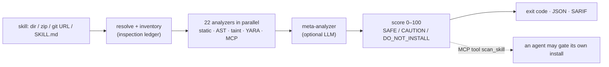

# SkillSpector review: what it does, where it stops, and the features interlock should build

**Question this answers:** [SkillSpector](https://github.com/NVIDIA/SkillSpector)
("security scanner for AI agent skills", NVIDIA, Apache-2.0) is the tool people
reach for before installing a Claude Code, Codex or MCP skill. What does it do,
where does it stop by design, and which features would make interlock the thing
every SkillSpector user needs next?

**Reviewed:** `main` at `d7338f5` (2026-10-22), release v2.13.1 (2026-10-23):
the README (1,043 lines), `docs/DEVELOPMENT.md`, `docs/scan-completeness.md`,
`docs/B.3.2-mcp-tool-poisoning.md`, `docs/OPENCODE_EXTENSION.md`, the
`skills/skill-inspector/SKILL.md` operator skill, the baseline example, and
`src/skillspector/{mcp_rug_pull,mcp_registry,allowed_tools,transitive,references,
inspection_ledger,bundled_execution_surface,mcp_server}`. Demand signals come
from the 170 open issues, ranked by engagement.

**Numbers that matter:** 21,590 stars and 1,902 forks since 2026-03-21; a
release every two to three weeks; 331 Python files; 71 patterns in 17
categories; a 42,447-skill research corpus behind it (26.1% of the analyzed
subset vulnerable, 5.2% likely malicious). This is the largest audience that
has ever been told, by NVIDIA, that agent skills are a security problem.

---

## 1. What SkillSpector is

A **pre-install scanner**. It takes a skill (directory, zip, Git URL, single
`SKILL.md`, or an MCP registry snapshot), runs 22 analyzer nodes in parallel
(regex pattern families, a Python AST walk, taint tracking, YARA, MCP
least-privilege and tool-poisoning checks), optionally sends file contents to an
LLM for a second opinion, and prints a 0–100 risk score with a recommendation:
`SAFE`, `CAUTION`, `DO_NOT_INSTALL`. Output is terminal, JSON, Markdown or
SARIF; the exit code is a CI contract.

Three things define its shape:

1. **It never executes the skill, and never sits in the path of one.** Its
   README says so plainly: "It does not sandbox the host. SkillSpector flags
   risky patterns *before* you install a skill; it does not contain or isolate a
   skill you choose to install anyway." Its limitations list is "non-English
   content, image-based attacks, encrypted/binary code, runtime behavior".
2. **Completeness is the installation gate, not the score.** Since draft PR
   #563 the scanner distinguishes "the checks found nothing" from "the content
   was interpreted". An unsupported encoding, an exhausted time budget, or an
   opaque referenced file makes the ledger incomplete, and an incomplete scan
   can never return `safe_to_install: true` over MCP, whatever the score says.
3. **It is built to be driven.** The MCP server exposes one tool,
   `scan_skill`, "so local MCP-capable agents can call scanning as a tool and
   gate skill/MCP installs on the result". Pi and OpenCode extensions wrap the
   CLI. The gate, though, is the agent's choice: nothing forces the call.

---

## 2. Where SkillSpector is ahead

- **Install-time coverage of the skill bundle as an artifact.** Nested zips,
  shipped bytecode (SC8), executables hidden in document containers (SC9),
  dependency source redirection (SC10), transitive external references,
  hooks and settings permission rules bundled *inside* a skill
  (`bundled_execution_surface`), typosquats (SC6), live CVE lookups (SC4).
  interlock reads none of this today: a skill directory is not an object it
  knows.
- **`allowed-tools` parsing.** `allowed_tools.py` splits Claude Code's grant
  syntax (`Bash(git status:*)`, `Read(./docs, notes.md)`) correctly, and LP1–LP4
  compare declared grants with what the bundled code can do. It flags the
  mismatch; it cannot enforce the grant.
- **Rug-pull detection between scans.** RP1–RP3 flag unpinned references and
  manifest changes (privilege expansion, trigger changes) against a previous
  report; `--mcp-registry-compare` diffs registry snapshots. Again: between two
  scans someone chose to run.
- **An honest completeness ledger.** `analysis_completeness.status`,
  `ledger_exceptions`, `scope_exclusions`, `analyzer_statuses` ride along with
  every report, and "incomplete `SAFE` becomes `CAUTION`". This is the best
  idea in the codebase and it is a reporting discipline, not a detector.
- **Evidence-bound acceptance.** A baseline fingerprint is bound to the scanned
  bytes and the scanner version; change either and the accepted finding comes
  back. Every suppression carries a required `reason`.
- **Distribution.** NVIDIA's name, a hosted guide, a Docker image, an operator
  skill that teaches an agent how to review a skill, and a place in the
  "NVIDIA Verified Skills" pipeline that *signs* skills before publication.

## 3. Where interlock is ahead (keep these, and lead with them)

SkillSpector's limitations list reads as interlock's feature list. Everything
it cannot see — obfuscated or non-English instructions, text in images,
behaviour that only exists at run time — arrives at interlock as a **real tool
call with real arguments**, and is judged there:

| SkillSpector cannot | interlock already does |
|---|---|
| see runtime behaviour | `@guard`, the coding-agent hooks, in-process MCP interception: every call, before it runs |
| contain a skill once installed | the coding-agent pack's locked rules, BRACE confinement, scopes that a sub-agent cannot exceed |
| enforce `allowed-tools` | `tool_policy`, declarative policies with `on:` tool matchers — the mechanism exists, the skill scope does not (S2) |
| catch a rug-pull between runs | `mcp_surface_baseline` blocks a changed tool listing and revokes leases on drift; `interlock drift` diffs a recorded surface (for MCP; not yet for skills, S3) |
| prove what happened | chained, signed receipts with `call_id`, `attributed_to`, `principal`; `interlock report`; `interlock anchor` |
| ask a human mid-flight | `ESCALATE`, the review queue, one-use approvals bound to the exact call |
| scan the clients' MCP configs | `interlock mcp scan` reads seven clients' configs with risk notes — SkillSpector issue #880 is an open request for exactly this coverage |
| measure its own false positives | the R5 harness (0 of 560 poisoned calls induce a block), mesh shadow mode and ring caps before a rule can block |

False positives are SkillSpector's dominant open-issue theme (#37, #644, #887,
#677, #751, #444, #440, #441, #888, #889). A static scanner has to guess intent
from text; a runtime guard judges an action, which is why interlock's rules can
afford to be deterministic and offline.

---

## 4. What not to copy

- **The LLM pipeline.** Twelve providers, a LangGraph workflow, per-file model
  calls, a model registry, token budgets, structured-output quirks per vendor.
  Two of the top-engaged issues are about its cost and its failure mode (#296
  "bound the cost of an LLM scan", #908 "LLM stage enabled by default + no key
  = whole scan crashes"). interlock's offline, deterministic premise is the
  differentiator; keep it.
- **YARA malware signatures and OSV lookups.** Antivirus and CVE feeds are
  someone else's product, and OSV needs the network.
- **The 0–100 score.** interlock's verdicts are `allow / rewrite / block /
  escalate` with an attributable reason. A number invites threshold theatre.
- **Scanning as the product.** A 21k-star scanner exists. The gap is the
  enforcement half, which nobody with that audience ships.

## 5. Practices worth borrowing (not features)

- **Completeness as a first-class output.** Where interlock cannot judge — an
  adapter that cannot express a verdict, a detector that skipped — the record
  should say so, and a pass should never be read as a check. The hook adapters
  already refuse rather than silently allow; S5 extends the discipline to a scan.
- **Evidence-bound acceptance with a reason.** An accepted risk is pinned to
  the bytes it was accepted for, and expires when they change (S3).
- **"A model may raise confidence, never lower a deterministic finding."** If
  interlock ever adds an LLM assist (S8), that rule comes with it.
- **Hardened subprocess for any CLI it shells out to.** `shell=False`, untrusted
  content on stdin only, environment scrubbed, timeout, fail closed. interlock's
  hook already behaves this way; the bridge in S5 must too.

---

## 6. Feature specs

Each is written so it can be lifted into `ROADMAP.md`. Sizes: S (days), M
(a week or two), L (more). "Traction" is a judgement of how directly the feature
rides the audience SkillSpector has already created.

### S1 · The install gate that is not optional (`skill-install` rules)

**Traction: highest. Size: S–M.**

**Problem.** SkillSpector's own answer to "gate installs" is an MCP tool the
agent *may* call. A skill that is being installed by the agent itself — `npx
skills add`, a write into `~/.claude/skills/`, `.claude/skills/`,
`.agents/skills/`, a `claude plugin install`, an edit to `.mcp.json` or `claude
mcp add` — is exactly the moment the agent is least likely to pause and scan.

**What changes.** The `builtin:coding-agent` pack gains rules that match skill
and MCP installation by its effects — writes under the skill directories of
every client `interlock mcp scan` already knows, the install commands of the
skill managers, and MCP config edits — and verdict `escalate` by default.
`interlock hook` attaches a verdict source to the escalation: if SkillSpector
is installed, run `skillspector scan --no-llm --format json` on the target
(hardened subprocess, time-boxed) and carry `recommendation`,
`risk_score`, `analysis_completeness.is_complete` and the top rule ids into the
review entry and the receipt; if it is not, run interlock's own static pre-check
(S5). Policy decides the mapping: `SAFE` → allow, `CAUTION` → ask,
`DO_NOT_INSTALL` or incomplete → block. The receipt records the verdict and
the scanner version, so "this skill was admitted on scan X" is provable later.

**Acceptance.** With the pack installed, an agent writing a `SKILL.md` under
`~/.claude/skills/evil/` is held; the review entry shows the scan verdict and
its completeness; `interlock reviews approve` admits it once; the receipt chain
carries the verdict. Without SkillSpector on the host the gate still holds, with
S5's verdict labelled as the weaker one.

**Risks.** Path heuristics drift with the clients; the inventory table in
`mcp_inventory.py` is the single place to keep them. A scan that takes long
must not stall the hook: cap it, and treat a timeout as incomplete (block), not
as allow.

### S2 · Skill-scoped least privilege, enforced

**Traction: highest; nobody has it. Size: M.**

**Problem.** A skill declares `allowed-tools: Read, Bash(git:*)` and
SkillSpector's LP1 will tell you if the bundled code wants more. Nothing stops
the skill, once active, from asking for `Bash(curl ...)` — the declaration is
documentation.

**What changes.** Claude Code exposes skill activation as a tool call
(`Skill`, carrying the skill name), which the hook already sees under its `*`
matcher. interlock opens a *skill window* on activation and attributes the
following calls in that session to the skill until the window closes (end of
turn, next activation, or a configurable cap). A new policy dimension
`skill:` lets a rule say `on: Bash, when: {skill: "deploy-helper"}`. The
pack's default rule reads the skill's own `allowed-tools` (parsed with the same
grammar SkillSpector's `allowed_tools.py` validates) and escalates any call
outside it. Receipts gain `skill` beside `attributed_to`, so `interlock report`
can answer "what did this skill actually do", and `interlock learn` can draft a
per-skill policy from observed traffic.

**Acceptance.** A skill with `allowed-tools: Read, Grep` that triggers a
`Bash` call is escalated with the reason naming the skill and the grant it
exceeded; the same call outside any skill window follows the ordinary policy;
`interlock report --by skill` lists calls per skill.

**Risks.** Attribution is a window, not proof: a call after the skill's turn is
the model's, not the skill's. The receipt must say `skill_window` not
`skill_caused`. Codex and Cursor expose less; the adapter table in the
coding-agents guide gains a row.

### S3 · Installed-skill integrity: accept once, pin the bytes

**Traction: high; mirrors a shipped MCP feature. Size: S.**

**Problem.** SkillSpector catches a rug-pull only when someone re-scans. An
installed skill that updates itself (RA1 self-modification is in its own
catalog) or is replaced by a marketplace push runs unchanged policy.

**What changes.** `interlock skills accept <path> --reason "..."` records the
skill's content digest (manifest plus every file the manifest references, the
same bounded resolver idea as SkillSpector's `references.py`) in interlock's
home, signed. A detector `skill_surface_baseline`, the sibling of
`mcp_surface_baseline`, is consulted on activation (S2's window) and on every
install-path write (S1): a skill whose digest no longer matches its accepted
one is escalated, its acceptance revoked, and re-acceptance is a fresh act.
`interlock drift --skills` diffs all accepted skills against disk.

**Acceptance.** Accept a skill; change one line of `SKILL.md`; the next
activation is held with "skill `x` changed since it was accepted on
2026-10-25 (digest a1b2… → c3d4…)". `interlock drift --skills` exits non-zero
and names the file.

**Risks.** Skills that legitimately write their own state need the state file
excluded from the digest; the acceptance records the exclusion.

### S4 · `interlock skills scan`: the inventory, with risk notes and a policy draft

**Traction: high; cheap; fills SkillSpector's own gap. Size: S.**

**Problem.** `interlock mcp scan` enumerates MCP servers across seven clients
with risk notes and `--emit-policy`. There is no equivalent for skills, and
SkillSpector's inventory (`AS2`) misses several clients (issue #880).

**What changes.** `interlock skills scan` walks the skill directories of every
client in the inventory table (user and project scope), lists each skill with
its `allowed-tools`, bundled executables, bundled hooks or settings rules,
external references (`curl | bash`, unpinned `npx`/`uvx`), and acceptance state
from S3. `--emit-policy` writes the S2 per-skill rules as a draft; `--json`
feeds CI. No network, no LLM.

**Acceptance.** On a machine with skills in `~/.claude/skills` and a project
`.agents/skills`, the command lists both sets with their grants and flags the
one that bundles `hooks/hooks.json`.

### S5 · `interlock scan`: a static pre-check that reuses the detectors, speaks SARIF, and bridges to SkillSpector

**Traction: medium-high. Size: M.**

**Problem.** S1 needs a verdict when SkillSpector is absent, CI wants a gate
(SkillSpector issue #72 asks for pre-commit and GitHub Actions), and interlock
already owns most of the text patterns SkillSpector's P*, AR*, TP* and E*
families encode: `prompt_injection`, `jailbreak`, `refusal_suppression_guard`,
`homoglyph_injection`, `unicode_tag_injection`, `html_comment_injection_guard`,
`markdown_link_injection_guard`, `markdown_image_exfil_guard`,
`mcp_tool_description_scan`, `base64_payload_scan`, `env_secret_read_guard`,
`shell_injection_guard`, the shell parser's intent classifier.

**What changes.** `interlock scan <skill-dir|SKILL.md|mcp.json>` runs the
text-shaped detectors over the manifest and the bundled scripts' string
literals and commands, emits findings with the detector name as the rule id,
and reports **coverage**: which files were read, which were skipped and why
(binary, oversized, unsupported encoding), in the spirit of the inspection
ledger. Output: terminal, JSON, SARIF 2.1.0. `--with skillspector` runs the
external scanner too and merges by file and line, keeping both rule ids.
A `pre-commit` hook definition and a workflow snippet ship in the docs.

**Acceptance.** Scanning SkillSpector's own `tests/fixtures/malicious_skill`
reports the hidden-instruction and exfiltration lines with interlock detector
ids; scanning a benign skill with an unreadable image lists the image under
"not inspected" and does not call the result complete.

**Risks.** This must not become a second scanner. Scope is "the detectors
interlock already ships, applied to files", nothing new per category; the
SkillSpector bridge is where depth comes from.

### S6 · Verified-skill signatures at load time

**Traction: medium-high; an ecosystem play. Size: M.**

**Problem.** NVIDIA's pipeline "scans, evaluates, and signs agent skills before
publication". SkillSpector parses OpenSSF Model Signing / DSSE bundles for
content but states "none of this verifies signatures, certificate chains,
transparency logs, or signer identity". Nobody checks the signature where it
matters: when the skill is loaded.

**What changes.** A detector `skill_signature_guard`, consulted by S1 and S2:
a skill carrying a DSSE bundle is admitted without escalation when the bundle
verifies against a pinned signer set — the same pinned-root, expiring-metadata
model the mesh already uses — and is held otherwise. Signers are
configuration: NVIDIA's catalog key, an organisation's own key. Offline by
construction; no transparency-log fetch, which the mesh's log design can add
later.

**Acceptance.** A skill signed by a configured signer activates silently; the
same skill with one byte changed fails verification and is held; an unsigned
skill follows the ordinary S1/S3 path.

**Risks.** Key distribution and rotation; reuse the mesh root ceremony
(`docs/guides/mesh-root-ceremony.md`) rather than inventing a second one.

### S7 · Mesh: runtime reputation of skills, by content hash

**Traction: medium now, compounding. Size: L.**

**Problem.** SkillSpector's corpus says 26% of skills look vulnerable. No one
has runtime evidence — which skills actually triggered blocks, escalations, or
secret redactions once installed — because no scanner is present at run time.

**What changes.** With S2's attribution in place, a node that has opted in
reports, per accepted skill digest, counts of verdicts by rule (never
arguments, never text) through the mesh's existing Prio3-over-DAP path, and
subscribes to the aggregate. `interlock skills scan` and S1's review entry show
"seen on N nodes, blocked on M, top rule …" beside the static verdict.

**Acceptance.** Two nodes accept the same skill; one records a block; the
collector's aggregate for that digest shows one block and two installs, and
neither node can learn which other node reported.

**Risks.** The data licence and warranty (`LICENSE-DATA`) already cover
indicators; digests of third-party skills need the same review. Low counts
reveal nothing by design, so the signal is only useful once adoption exists.

### S8 · An optional second opinion, on the review queue only

**Traction: low-medium. Size: S.**

**Problem.** Escalations arrive as a rule name and a reason; a reviewer
sometimes wants a summary of why the call looks wrong in context.

**What changes.** `interlock reviews explain <id>` can ask a local agent CLI
(the way SkillSpector's `claude_cli` provider does: no API key, the CLI's own
login, `shell=False`, stdin only, environment scrubbed) for a short
explanation, attached to the review entry as advisory text. It never changes
a verdict, and it is off unless invoked. SkillSpector's rule applies: a model
may add an explanation, never lower a deterministic finding.

---

## 7. Suggested order

1. **S1** install gate, with the SkillSpector bridge, because it converts
   SkillSpector's audience directly: "you scan; we make sure the scan ran".
2. **S3** integrity baseline, because it is small, mirrors shipped code, and
   is the runtime answer to rug-pulls.
3. **S2** skill-scoped least privilege, the feature no scanner can have.
4. **S4** inventory, as the on-ramp (`interlock skills scan` is a one-command
   demo and fills #880).
5. **S5** static pre-check and SARIF, which S1 needs when SkillSpector is
   absent and CI needs anyway.
6. **S6** signatures, once a signer exists to pin.
7. **S7** mesh reputation, once S2 has produced attributed receipts in the wild.
8. **S8** whenever a reviewer asks for it.

The positioning line for all of it: **SkillSpector decides whether a skill may
be installed; interlock decides what it may do once it is.**

## 8. Decisions that need an owner

- **Bridge or build.** S1 and S5 assume SkillSpector is an optional, preferred
  verdict source. The alternative — treating it as a competitor and matching
  its 71 patterns — is a year of work against NVIDIA's momentum, for a
  scanner that still cannot see run time. Recommended: bridge.
- **What `CAUTION` does by default.** SkillSpector leaves it to the integrator.
  interlock's default is `escalate`; a team may lower it to allow-with-receipt.
- **Attribution semantics for S2.** A skill window is heuristic; the receipt
  field name must not overclaim. `skill_window` is proposed.
- **Signer roots for S6.** Which keys ship pinned, if any, and who runs the
  ceremony.
- **Mesh scope for S7.** Whether third-party skill digests are reportable
  under the current data licence, and from what count an aggregate is shown.
