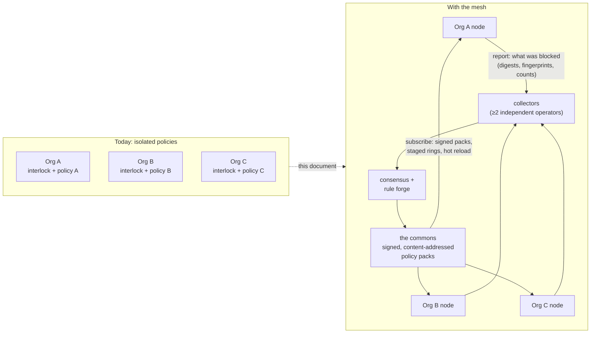
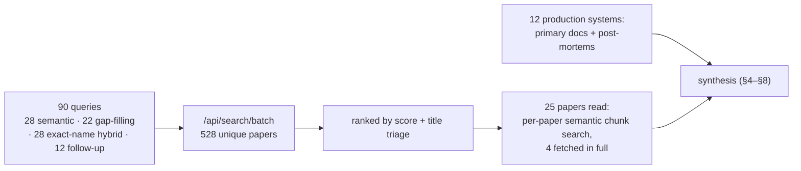
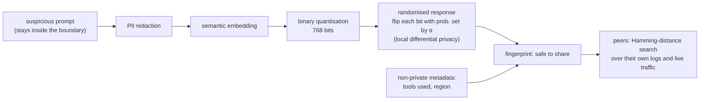
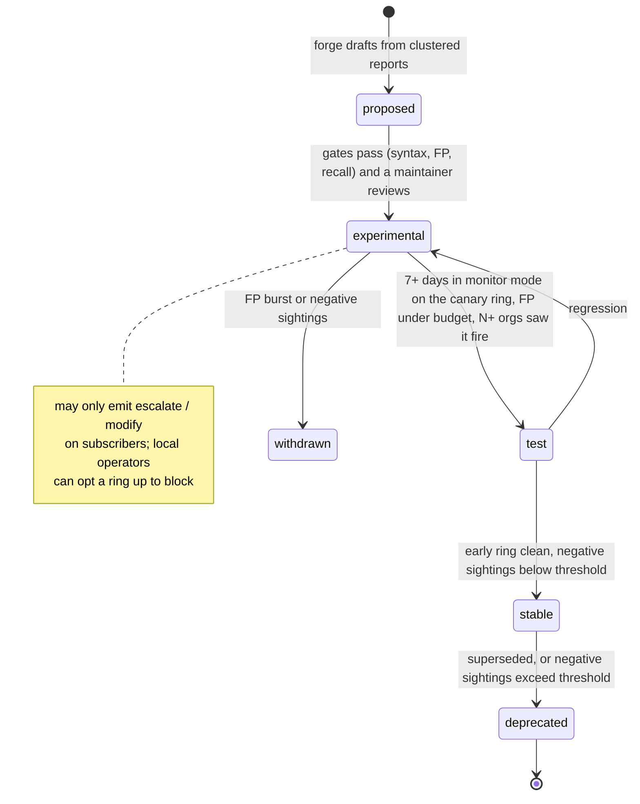
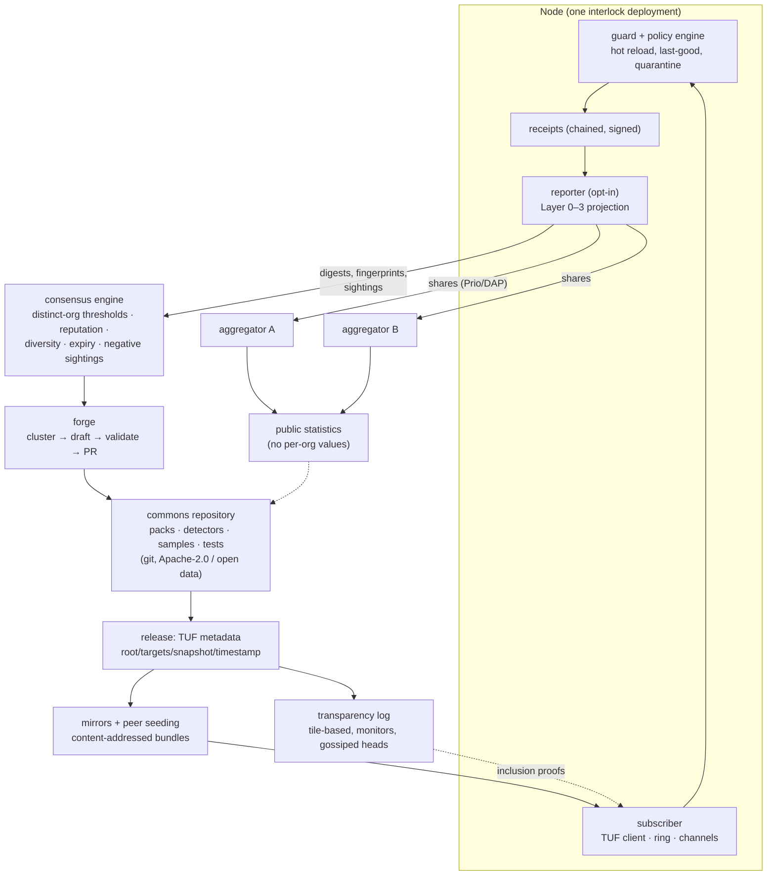
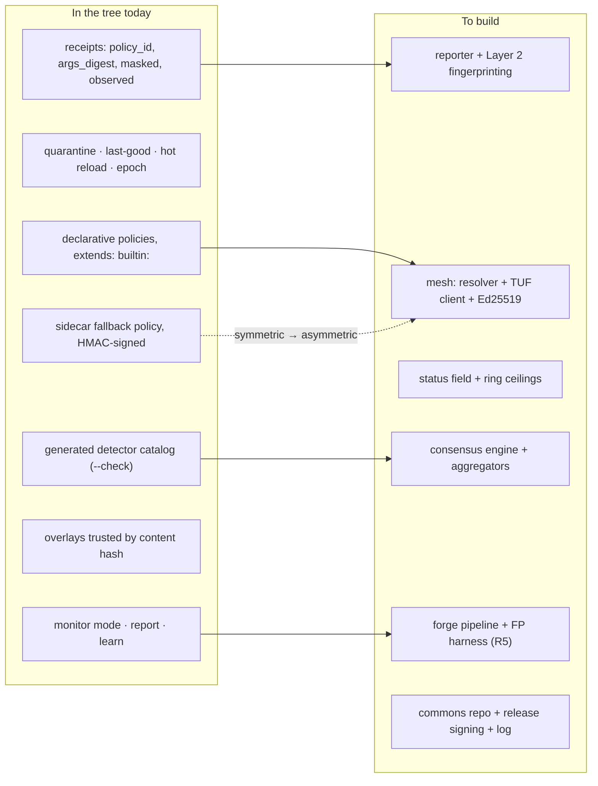
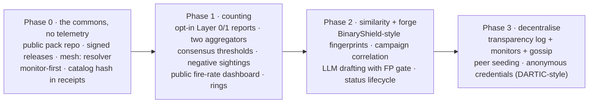

# interlock mesh: a shared, open policy network built on interlock

**Question this answers:** today every interlock deployment runs an isolated
policy. What would it take to let any organisation running interlock *report*
what its guard stopped, and *receive*, live, the policies the whole community
learned from those reports, in an open, peer-to-peer system that anyone can
build on and contribute to? Which parts has the literature already solved, which
production systems already do this for other kinds of threats, and what should
the first version look like?

**Working name:** *interlock mesh* for the network and protocol, *the commons*
for the curated policy corpus it distributes. Section 9 lists the alternatives.

**Corpus:** 528 unique papers from 90 searches against a curated AI/ML/CS
full-text corpus (`arxiv.libwit.ai`), 25 of them read at chunk level or in full,
plus the primary documentation of twelve production systems that already
crowdsource and distribute security decisions. Raw search data in
[`data/mesh-libwit-search.json`](data/mesh-libwit-search.json).

> **Implementation status (2026-10-25).** All four phases of §10 shipped as
> `interlock.mesh` and `interlock mesh`; see [`docs/guides/mesh.md`](../docs/guides/mesh.md)
> for usage and `CHANGELOG.md` for the per-phase summary. Where building it
> changed a detail of this document: the lexical embedding is a *dense* SimHash
> (a sparse feature hash made unrelated texts look alike, §3.1); the log's
> origin is the first root ever published, not the current key (§5.2);
> credentials are issuer-linkable pseudonyms per weekly epoch rather than the
> zero-knowledge scheme of §6.2, with that scheme as the stated upgrade; and
> counts are secret-shared without range proofs (§5.4), with the reconciliation
> step and reporter rate limits as the interim defence. The open decisions in
> §11 remain open: they are about who runs what, not about code.

---

## 1. The idea in one picture



An attack that one deployment's guard catches at 09:00 should be a policy
every other deployment is running in monitor mode by 09:05 and enforcing, if it
holds up, within a day. Nothing private leaves any deployment: the mesh carries
*what fired*, never *what the agent said*.

## 2. How this was researched



The arXiv corpus is strong on the *mechanisms* (privacy-preserving sharing,
poisoning resistance, rule generation, agent-specific attacks) and weak on the
*plumbing* (update frameworks, transparency logs, hash-prefix distribution),
which is engineering practice rather than research. The plumbing lessons come
from the systems in §5 and their incident reports.

## 3. What a report would be made of

The unit of contribution is a *receipt* interlock already writes. A receipt
records the detector or rule that fired (`policy_id`), the verdict, the phase,
a SHA-256 digest of the arguments, which entities a redactor masked and how
many, whether the rule was in monitor mode, and the policy epoch
([audit log guide](../docs/guides/audit-log.md)). It never stores arguments.
That is already most of a shareable report, and the choice of what to add is
the central privacy decision of the whole design.

| Layer | Carries | Reveals | Enables | Source |
|---|---|---|---|---|
| **0 · Counts** | detector id, verdict, tool *class*, time bucket, agent framework, interlock version, catalog hash | nothing about any payload | "detector X fired at 40 orgs this hour": the heartbeat of the network | Prio / ENPA, Poplar |
| **1 · Exact digests** | SHA-256 of the blocked argument (already in every receipt) | matches only to someone holding the identical payload | exact-match blocklists, Safe Browsing style | Safe Browsing v4, HIBP |
| **2 · Private fingerprints** | PII-redacted → embedded → binary-quantised → randomised-response bits | a bounded, formally stated privacy loss; cannot be inverted to text | "find similar": paraphrased variants of one attack across orgs | BinaryShield (SaTML 2026) |
| **3 · Redacted samples** | the payload with secrets and PII removed, opt-in, per report | the attack text itself | regression tests attached to the rule the report produced | CrowdSec Hub, Sigma |

Layers 0 and 1 cost nothing new: they are a projection of the receipt. Layer 2
is the research contribution worth adopting, and Layer 3 is what every mature
rule community ends up requiring before a rule goes stable.

### 3.1 Why not share embeddings, and what to do instead

Sharing dense embeddings of attack text is tempting (similarity search works)
and unsafe: embedding inversion now reconstructs text from sentence embeddings
with few shots and even zero-shot, across embedding models
(`2502.11308` *ALGEN*, `2504.16609`, `2504.00147` *Universal Zero-shot Embedding
Inversion*).

**BinaryShield** (`2509.05608`, accepted at SaTML 2026) is the closest existing
design to what the mesh needs and solves exactly this. Its setting is an
enterprise whose LLM services sit behind separate compliance boundaries and
therefore cannot share prompts; the same attack then "may persist undetected in
others for months". Its pipeline, run inside the reporting boundary:



Measured results worth carrying into the design: at privacy budget α = 1.5 the
fingerprint reaches F1 0.90 on paraphrased variants, 13 points above SimHash
(0.77) while SimHash offers no privacy; raising α from 0.25 to 3.0 cut false
positives 22.8× (821 → 36); against a 50K-prompt corpus Accuracy@1 was 93.8%
versus 99.3% for unprotected dense embeddings, a *constant* rather than
compounding cost as the corpus grows. The paper also shares the "public
features" (tools used, region) alongside the fingerprint to help correlation.
The mesh's Layer 2 is this pipeline, with interlock's existing redactors as the
first stage.

### 3.2 Why cross-org sharing is worth the trouble

Three results say attacks seen at one deployment will appear at others:

- **Transfer is structural, not accidental.** Across 20 open-weight models and 33
  jailbreaks, transfer is driven by representational similarity and attack
  strength, and natural-language (persona-style) attacks transfer far more than
  cipher-style ones (`2506.12913`). Models that share representations share
  vulnerabilities, and most agents run the same handful of models.
- **Campaigns are already distributed across agents.** `2607.18826` *Cross-Agent
  Campaign Attribution* formalises one adversary spreading paraphrased
  injections across independent agents so that "each local guardrail observes
  only an isolated fragment", and links them at 0.82 pairwise AUC from
  proxy-observable tool-use and prompt residue. Two of its warnings shape the
  mesh: timing is a diagnostic channel, not evidence; and "never convert
  clusters directly into blocks", because stable team habits form dense benign
  clusters.
- **Worms make latency the whole game.** `2603.15727` *ClawWorm* persists in an
  agent's own configuration files and propagates through web content, a skill
  supply chain, and direct agent-to-agent instruction; `2606.03811` shows
  AI-driven worms that tailor an exploit per host at zero marginal cost. A
  defence that updates every deployment within minutes of the first sighting is
  the only one that keeps pace.

## 4. Turning reports into decisions

This is where crowdsourced security systems succeed or fail, and the pattern is
the same across all of them: **weight the reporter, weight the signal, demand
diversity, and expire everything.**

### 4.1 The CrowdSec consensus model, adapted

CrowdSec is the closest production analogue (an open-source IPS whose agents
report attacking IPs and receive community blocklists). Its published pipeline
([our-data](https://www.crowdsec.net/our-data),
[community blocklist](https://docs.crowdsec.net/docs/next/central_api/community_blocklist)):

| CrowdSec mechanism | What it protects against | interlock mesh equivalent |
|---|---|---|
| **Scenario trust score**: spoofability and confidence (0–3) per detection scenario | a scenario that fires on misconfiguration | a per-detector *confidence* in the catalog; `tool_result_injection_guard` on a web page is stronger evidence than `path_traversal` on free text |
| **User trust score**: commitment, tenure, corroboration by honeypots | cheap poisoning by throwaway reporters | reporter reputation from tenure, volume consistency and agreement with **canary payloads** maintainers seed (§6.3) |
| **Only unmodified Hub scenarios count**, verified by content hash | reports from edited or home-made rules that nobody can vet | the detector catalog is generated from code (`scripts/gen_detector_catalog.py`) and the policy epoch is a content hash; a report is counted only if its `policy_id` resolves to a published detector at a published hash |
| **Consensus calculator**: minimum reports, minimum trust | isolated attackers that are irrelevant to everyone else | thresholds on *distinct organisations*, not events |
| **Expert system**: diversity across users, IP ranges and ASNs | one actor with many machines | diversity across organisations, agent frameworks and model vendors |
| **Tailored lists** per installed scenarios | irrelevant blocks | channels: a coding-agent node never receives business-data rules |

The failure modes are documented too, and they are the design requirements for
§7. A production review of CrowdSec deployments
([perun.au](https://perun.au/insights/crowdsec-production)) found teams
applying community decisions to enforcement "without weighting confidence or
false-positive history", so "a bad signal from one participating organization
can propagate as an auto-applied block decision to every other subscribed
instance", and bouncers switched to blocking "without a decision-only
validation window first". Both are exactly what interlock's monitor mode exists
to prevent, and the mesh must make monitor-first the default, not advice.

### 4.2 Sightings, negative sightings, and status

MISP, the reference threat-sharing platform, lets receivers record *sightings*
of an indicator, including **negative sightings** (a false positive) and
**expiration sightings**, and distributes per attribute with distribution
levels and sharing groups ([features](https://www.misp-project.org/features)).
Sigma, the largest open detection-rule corpus (3,000+ rules), ships every rule
with a `status` (`experimental` → `test` → `stable`), a `level`, and a
`falsepositives` list that is "not parsed by the converters" but exists for the
analyst who triages the alert
([Sigma rules](https://sigmahq.io/docs/basics/rules.html)). Community
guidance is to promote a rule from experimental only after it has run in a
non-alerting mode for about a week without unexplained noise.

interlock has the vocabulary for this already: `policy check` quarantines
invalid rules at load, `learn` drafts only `escalate` rules and never
auto-enforces, and overlays can only tighten
([policies guide](../docs/guides/policies.md)). The mesh adds one field,
`status`, and one rule: **nothing experimental may carry a `block` verdict on
a subscriber by default.**



### 4.3 Who generates the rules

The literature has converged on an LLM-in-a-validation-loop for turning threat
intelligence into deployable rules, and on the same guard-rails for it:

- **FALCON** (`2508.18684`) generates Snort and YARA rules from CTI with syntax,
  semantic-alignment and performance validation stages, and notes the real
  operational problem is *unbounded rule growth*: "the generation of new rules
  must be balanced with the identification and reconciliation of existing ones".
- **GRIDAI** (`2510.13257`) decides, per new attack sample, whether it is a new
  attack (generate) or a *variant of one an existing rule covers* (repair the
  rule to generalise), keeps a representative sample per rule, validates every
  operation with tools in real time, and rolls back on failure.
- `2509.16749` (Sublime Security) is an open framework that scores generated
  rules on effectiveness against held-out human rules, robustness, and
  economic efficiency: the three numbers a maintainer wants before merging.
- CrowdSec's own account of generating WAF rules with an LLM behind an MCP
  server ([blog](https://www.crowdsec.net/blog/crowdsec-mcp-use-ai-to-write-waf-rules-automatically))
  is the practitioner's version: 20+ validation tools, syntax validation
  against public schemas, and a mandatory test case "for regression and
  false-positive detection". They track ~100 new vulnerabilities a month.

The mesh's **forge** is this loop with interlock's own tools as the validators:
`interlock policy check` for syntax and quarantine, a benign-traffic corpus for
the false-positive gate (the harness the roadmap already lists as R5), the
report's redacted samples (Layer 3) for recall, and the evaluator's bounds (a
regex of at most 512 characters scanning at most 64 KiB) as the cost budget.
A human maintainer merges; the forge only opens pull requests.

## 5. Distributing policy safely: lessons from the systems that do it

### 5.1 Integrity and freshness: The Update Framework

TUF is the standard for delivering updates to clients that must not trust the
server ([security](https://theupdateframework.io/docs/security),
[spec](https://theupdateframework.github.io/specification/latest)). Its four
roles and the attacks each stops map directly onto a policy feed:

| Role | Key custody | Signs | Stops |
|---|---|---|---|
| **root** | offline, threshold (e.g. 3 of 5 maintainers) | the other roles' keys | a single compromised key owning every client |
| **targets** | maintainers, threshold | each policy pack's hash and size | a tampered or wrong pack ("wrong software installation"); size caps stop endless-data attacks |
| **snapshot** | online | the current version of every targets file | mix-and-match: a view of the repository that never existed together |
| **timestamp** | online, short expiry (hours) | the snapshot's hash | freeze attacks (serving a stale view forever) and rollback; **its expiry is the mesh's kill switch** |

"Trust should expire if it is not renewed" and "keys that are kept online…
should not pose an immediate risk to clients if compromised" are the two
sentences to design around. Sigstore distributes even its own log URLs through
TUF and rotates logs yearly ([Rekor v2 GA](https://blog.sigstore.dev/rekor-v2-ga)).

### 5.2 Transparency: an append-only log and monitors

Certificate Transparency and Sigstore's Rekor add a public, Merkle-tree log of
everything that was ever signed, so a compromised signer cannot publish
quietly. Rekor v2 moved to tile-based logs that are "cheaper to run, simpler to
maintain", serve inclusion proofs from static tiles, and are read by
independent monitors. CT's remaining weakness is the *split view*: a log that
shows one tree to victims and another to monitors, which is why CT gossips
signed tree heads between clients
([LogPicker](https://petsymposium.org/popets/2021/popets-2021-0066.pdf),
`2609.11552`). `2601.23132` applies the same idea to MCP: signed tool manifests
appended to a Merkle ledger, verified before execution, at 50,000 manifests
with near-linear cost.

For the mesh: every pack release and every revocation is logged; nodes gossip
tree heads to their peers; anyone can run a monitor. This is what makes "open
so anyone can build it" more than a slogan: the maintainers are accountable to
the log.

### 5.3 Privacy of the lookup: ship the whole list

Safe Browsing v4 downloads 4-byte hash prefixes to a local database and asks
the server for full hashes only on a prefix collision, with mandatory back-off
and a checksum over the local state
([Update API](https://developers.google.com/safe-browsing/v4/update-api)).
Have I Been Pwned's range query does the same with a 5-hex-character SHA-1
prefix, chosen so every bucket holds many entries
([Cloudflare](https://blog.cloudflare.com/validating-leaked-passwords-with-k-anonymity)).
Both are k-anonymity designs, and Trail of Bits showed the k-anonymity breaks
when a client sends *correlated* prefixes in a short window: the server can
intersect them and recover the URL
([analysis](https://blog.trailofbits.com/2019/10/30/how-safe-browsing-fails-to-protect-user-privacy)).

The mesh can avoid the problem entirely. A policy pack is kilobytes and an
indicator set for one channel is at most a few megabytes, so **nodes download
whole lists and never query for a match**. The only upstream traffic is the
report, which the node controls. ClamAV's `cdiff` incremental patches are the
model for keeping that cheap.

### 5.4 Aggregates without a trusted aggregator

For Layer 0 counts ("how many orgs saw detector X fire"), the deployed answer
is **Prio**: each client splits its value into secret shares sent to two
aggregators run by non-colluding organisations, which compute the sum without
seeing any input. It ran at national scale in Apple and Google's Exposure
Notification Private Analytics, and its operators' lessons were operational,
not cryptographic: federating identities across clouds "is an opportunity to
get something wrong", so the follow-on IETF standard (PPM / DAP) defines
everything as HTTP so operators can be platform-diverse
([Divvi Up](https://divviup.org/blog/lessons-from-running-mpc-at-scale)).
**Poplar** extends it to private heavy hitters over strings, which is exactly
"which fingerprints are most common this week" without learning any one
reporter's fingerprints. Heavier alternatives from the CTI literature
(multiparty homomorphic encryption in `2209.02676`, DP federated learning in
`2512.14242` with accuracy dropping from 98.4% to 86.0%) buy generality the
mesh does not need in its first years.

### 5.5 Peer-to-peer, and what "torrent-like" should mean here

The useful property of BitTorrent is not the swarm; it is **content
addressing**: a bundle is named by its hash, so any peer or mirror can serve it
and the client verifies it regardless of who it came from. With TUF signatures
on top, mirrors and peers are trusted for *availability only*. That is the
right split for a security feed: a P2P layer that cannot be poisoned because it
cannot change anything, only serve or withhold it.

What P2P does add is risk on the gossip side. Peer sampling is attackable
(eclipse and Sybil attacks; `2309.02952` *SecureCyclon*, `2601.20368` *LIFT*),
so the first versions should seed from maintainer-run mirrors and let peers
*assist* distribution, with the timestamp role telling a node when its view is
stale regardless of which peers it talked to.

### 5.6 The rollout lesson nobody gets to skip

On 19 July 2024 a content update to a widely deployed security sensor crashed
about 8.5 million machines. The vendor's root cause analysis: the sensor
expected 20 input fields and the update carried 21, the content validator did
not check it, and the content went to every host at once. The fixes are a
checklist for any live policy feed: validator checks on the content format,
bounds checking in the interpreter, successive **deployment rings**, and
customer control over when content applies
([RCA executive summary](https://www.crowdstrike.com/wp-content/uploads/2024/08/Executive-Summary_Root-Cause-Analysis_Channel-File-291.pdf)).

interlock's evaluator already refuses to be the interpreter in that story: a
policy file is data, unknown keys fail at load, an invalid rule is quarantined
rather than applied, a file that stops parsing leaves the last good policy
running, and an exception while evaluating blocks rather than allows. The mesh
adds the rings.

## 6. Threats to the mesh itself

A shared defence is a shared attack surface. These are the ones with evidence
behind them.

### 6.1 False-positive cascade

The dominant real-world failure (§4.1). Controls: `status` gating (§4.2),
monitor-first on every subscriber, thresholds on distinct organisations,
negative sightings that *demote*, and a published per-rule false-positive rate.
Two 2026 studies quantify how badly agent guardrails already over-refuse:
`2608.27009` *The Guard That Cried Wolf* (scary words in legitimate requests
trigger refusals) and `2608.29942` *Influence Is Not Authority* (causal
guardrail signals mistake legitimate tool use for attacks). A rule that is
wrong at one org and shipped to a thousand is the mesh's worst outcome, worse
than a missed attack.

### 6.2 Poisoning and Sybil reporters

Federated and crowdsourced systems are poisoned by many small, individually
plausible contributions (`2609.21573` *Micro-Collaborative Poisoning*;
`2505.09983` Sybil-based poisoning; the SoK in `2502.03801`), and classic
defences weight contributors by how much they look like each other
(`1808.04866` *FoolsGold*). CrowdSec's answer is economic: commitment and
honeypot corroboration earn trust, so poisoning consensus is not cheap. A
stronger, heavier option is **DARTIC** (`2605.18146`): pseudonymous reporters
bound to a single access token by zkSNARK set-membership proofs, so one
identity cannot become many and cannot reset a bad reputation; proof
generation under 3 s, 1,024 proofs verified in under a second after
aggregation. Right for a later phase, once there is a reputation worth
protecting.

### 6.3 Induced blocking and guardrail denial of service

Flooding reports to make everyone block something legitimate is the
report-side version of the cascade, and the countermeasures are the same plus
reporter rate caps. There is also a newer finding: LLM-based guardrails can be
made to reason 13–63× longer, up to 148× latency, by a single poisoned
document, and "none of the evaluated mitigations directly resolves the threat"
(`2606.14517` *From Shield to Target*). interlock's deterministic rules do not
reason, which is the point, but the mesh must keep it that way: every published
rule carries a measured evaluation cost, regular expressions stay inside the
evaluator's existing bounds, and the forge rejects a candidate that fails a
benign-corpus latency gate. **Canary payloads** maintainers seed into the
network (known-bad samples with known fingerprints) give the ground truth that
CrowdSec gets from honeypots: a reporter that never sees them, or reports
things they contradict, loses weight.

### 6.4 Disclosure helps attackers too

Published rules are a test oracle for evasion (`2602.00750` *Bypassing Prompt
Injection Detectors through Evasive Injections*; `2609.07529` co-evolutionary
attacks). Every open rule corpus lives with this. Two mitigations hold:
interlock's own documentation already tells operators to pair detectors with
**allowlists**, which do not depend on wording; and MITRE's AI Incident Sharing
initiative shows the accepted compromise, a public submission path with a
*trusted community* that receives the protected, anonymised detail
([MITRE](https://www.mitre.org/news-insights/news-release/mitre-launches-ai-incident-sharing-initiative)).
The mesh can run an **early ring** with the same membership logic.

### 6.5 Leakage through the mesh

Exact digests of low-entropy arguments can be dictionary-attacked, so Layer 1
must only ever carry digests of what a detector classified as *attack
content*, never of what a redactor masked (a card number's digest is a card
number). Layer 2 is covered by local differential privacy by construction.
Layer 0 is covered by secret sharing. And since a public GitHub repository is
a publication, the commons must hold no sample that identifies its reporter;
`2608.24957` *ToolMinimize* (auditing and rewriting tool-call arguments to
minimise exposure) is the right reference for the sanitiser that produces
Layer 3 samples.

### 6.6 The silo problem

Twenty years of open CTI show "a fragmented ecosystem of distinct silos where
vendors demonstrate significant geographic and sectoral reporting biases" and
no single vendor with a comprehensive view (`2602.17458` *The CTI Echo
Chamber*, 13,308 reports). The MISP framework's own designers describe the
retained information as "only the tip of the iceberg" and name the free-rider
problem (`2209.02676`). An open commons with a low-cost, privacy-safe Layer 0
is the structural answer: the cheapest possible contribution, counted
publicly, is what gets the long tail to contribute.

## 7. Proposed architecture



### 7.1 The node

Everything below `SUB` and `REP` exists today. The additions:

| Component | What it does | Builds on |
|---|---|---|
| **Reporter** | Projects BLOCK / ESCALATE / MODIFY receipts (never ALLOW) into Layer 0 counts and Layer 1 digests; computes Layer 2 fingerprints with the existing redactors as stage one; attaches a Layer 3 sample only when the operator opts in per detector. Batches, rate-caps itself, signs with an org key | `receipt.py` fields, `report.summarize`, the redactor detectors |
| **Subscriber** | `"extends": "mesh:coding-agent@stable"` next to `builtin:` in the policy resolver; a TUF client that verifies root → targets → snapshot → timestamp, refuses stale or oversized content, and stores the last good bundle; applies new rules in monitor mode for a configurable window before honouring their verdict | `_resolve_extends` in `interlock/policy/declarative.py`, hot reload with last-good, monitor mode, `policy_epoch` on receipts |
| **Catalog hash** | The installed detector set and pack versions hashed and included in every report, so only reports from unmodified published rules are counted | generated catalog, `engine.epoch` |
| **Signature verification** | Ed25519 verification of TUF metadata. The standard library has no Ed25519, so this is either a small pure-Python verifier (a handful of signatures per reload) or the optional Rust accelerator, keeping the zero-dependency promise | `rust/`, the existing HMAC chain |

Two existing commands grow a flag each: `interlock report --mesh` prints what
the node *would* contribute and what monitor-mode mesh rules would have done,
and `interlock doctor` warns when the subscription's timestamp has expired.

### 7.2 Channels and rings

Channels follow the detector starter sets the docs already define (coding
agent, browsing and research, business data) plus MCP trust. Rings follow the
deployment-ring lesson:

| Ring | Who | Receives | Default verdict ceiling |
|---|---|---|---|
| **canary** | maintainers' own deployments and volunteers | `experimental` and up, within minutes of merge | `escalate` |
| **early** | contributing organisations (trusted community) | `test` and up | `escalate` / `modify` |
| **stable** | everyone | `stable` only, after the early ring is clean | the pack's verdict, after the local monitor window |

An operator may raise or lower the ceiling per ring; the defaults are the
safety story.

### 7.3 Governance of the commons

- One public repository per channel, Apache-2.0 for code and an open data
  licence for samples and indicators, with a contributor agreement that
  requires the contributor to hold the rights to any sample.
- Maintainers hold the targets keys; root is a threshold of offline keys held
  by people in different organisations, rotated on a schedule.
- Every rule carries `status`, `level`, `falsepositives`, a confidence score,
  the detector it depends on, at least one positive test and one benign test,
  and the number of distinct organisations that reported the pattern.
- The forge opens pull requests; humans merge; CI runs the same gates the forge
  ran, so a human merge cannot skip them.
- Public, versioned false-positive rates per rule, and public post-mortems for
  every withdrawn rule. The log makes silent fixes impossible anyway.

## 8. What interlock already provides, and what is missing



| Capability | Status | Gap |
|---|---|---|
| Policy as data with a resolver for named packs | shipped | add a `mesh:` scheme and a fetch-verify-cache step |
| Fail-at-load, quarantine, last-good reload | shipped | nothing; this is the interpreter-safety story from §5.6 |
| Receipts that carry everything a Layer 0/1 report needs | shipped | a projection function and an org signing key |
| Monitor mode and "what would it have done" reporting | shipped | make it the default entry state for subscribed rules |
| Detector catalog generated from code | shipped | publish its hash with each release so reports can cite it |
| Signed policy for clients | HMAC, symmetric (sidecar fallback) | asymmetric signatures so a public feed can be verified by anyone |
| False-positive harness on benign traffic | planned (roadmap R5) | prerequisite for the forge's FP gate and for publishing rates |
| Signed PyPI / npm releases | planned (roadmap R22) | the root-of-trust story for the client should land with it |

## 9. Naming

The user's instinct ("a torrent system or something like that") points at the
right property, content-addressed replication, and the name should say
*shared* and *open* without claiming the network is the product.

| Name | Says | Risk |
|---|---|---|
| **interlock mesh** (recommended for the network) | peers, no centre, replication | "mesh" is used for service meshes |
| **the commons** (recommended for the corpus) | an open, co-owned resource anyone may draw on and must not spoil | generic |
| interlock flock / herd | collective immunity | playful; weaker in a security context |
| interlock hive | many nodes, one memory | collides with several security products |
| interlock exchange | the ISAC model | sounds closed, membership-only |

"interlock mesh" and "the commons" are also both free of any current
guardrail vendor's naming, which matters for a public project.

## 10. A path to a first version

Each phase ships on its own and is useful without the next.



| Phase | Deliverable | Acceptance |
|---|---|---|
| **0** | A `commons` repository of policy packs with TUF-signed releases on static hosting; `"extends": "mesh:<pack>@stable"` in interlock, verifying signatures and falling back to the last good bundle; catalog hash stamped on receipts | A deployment subscribes, a maintainer publishes a pack, every node reloads it in monitor mode within one poll interval, a tampered bundle is refused, an expired timestamp is reported by `doctor` |
| **1** | Opt-in reporter (Layers 0–1), two aggregators run by different organisations over DAP, a consensus service with distinct-org thresholds and negative sightings, rings | A detector fired at ≥N distinct orgs appears on the public dashboard without any org's count being recoverable; a false-positive report demotes a rule within one release |
| **2** | Layer 2 fingerprints; the forge as a bot that opens reviewed pull requests with tests; the R5 harness as its FP gate | A paraphrased variant of an attack seen at one org is matched at another with no raw text shared; every merged rule carries measured FP rate and cost |
| **3** | Tile-based transparency log, independent monitors, gossiped tree heads; peer-assisted distribution of content-addressed bundles; DARTIC-style membership credentials for the early ring | A split view is detected by monitors; the feed survives all maintainer mirrors being offline; a reporter cannot cheaply re-register after demotion |

Phase 0 is the CrowdSec Hub, Sigma repository and ClamAV mirror model applied
to interlock policies, and it is where "anyone can contribute to this policy
engine" starts being literally true: a pull request with a rule, two tests and
a `falsepositives` note.

## 11. Open decisions

1. **Who holds the root keys.** TUF makes this a people problem by design. A
   neutral home (a foundation or a multi-organisation maintainer group) is the
   usual answer; the project needs at least three organisations before Phase 0
   is credible.
2. **Who runs the two aggregators.** They must be organisations that will not
   collude, with different cloud providers, following the ENPA lesson.
3. **Default reporting posture.** Off until enabled, per detector, with Layer 2
   and 3 separately enabled. The alternative (on by default, Layer 0 only) is
   what makes the network useful fastest and what the free-rider literature
   recommends, and it is a decision the project should make out loud.
4. **Data licence for the commons.** Code is Apache-2.0; samples and indicators
   need an open data licence and a rights-warranty from contributors.
5. **Whether `block` ever ships through the mesh by default.** This document
   says no: `stable` rules carry the pack's verdict only after the local
   monitor window. Operators can choose otherwise per ring.

## 12. Papers and systems read

| Id / system | Why it matters here |
|---|---|
| `2509.05608` BinaryShield | the fingerprint pipeline for Layer 2; measured privacy/utility curve |
| `2607.18826` Cross-Agent Campaign Attribution | campaigns span agents; link after detection, never block from clusters |
| `2506.12913` Jailbreak transferability | why one org's attack is everyone's |
| `2603.15727` ClawWorm · `2606.03811` adaptive worms | why minutes matter |
| `2603.15714` Indirect Prompt Injection Arena | 272K attempts, 8,648 successes across 13 models: the shape of a public attack corpus |
| `2508.18684` FALCON · `2510.13257` GRIDAI · `2509.16749` rule evaluation | generate-or-repair with validation loops; three metrics for merged rules |
| `2606.14517` From Shield to Target | guardrails as DoS targets; keep rules cost-bounded |
| `2608.27009` · `2608.29942` | measured over-refusal of agent guardrails |
| `2609.21573` · `2505.09983` · `2502.03801` · `1808.04866` | poisoning and Sybil defences |
| `2605.18146` DARTIC | anonymous yet accountable reporters |
| `2604.15641` Half-Moon Cookie | private similarity blocklisting; check once, prove later |
| `2601.23132` Secure Tool Manifest | signed manifests and a Merkle ledger for MCP |
| `2602.17458` CTI Echo Chamber · `2209.02676` · `2512.14242` LegionITS · `2608.27967` DisCTI | what two decades of CTI sharing got wrong and right |
| `2502.11308` · `2504.16609` · `2504.00147` | never share raw embeddings |
| `2309.02952` SecureCyclon · `2601.20368` LIFT | gossip and peer sampling under attack |
| `2609.11552` | accountability gaps in Certificate Transparency |
| `2608.24957` ToolMinimize | sanitising tool-call arguments before they leave |
| CrowdSec, MISP, Sigma, Safe Browsing v4, HIBP, Prio/ENPA/DAP, TUF, Sigstore Rekor v2, Certificate Transparency, ClamAV, MITRE ATLAS AI Incident Sharing, AVID, MCPThreatHive (`2604.13849`) | production mechanisms and incidents in §4–§6 |

### Reproduce

```bash
# the 90 queries and their top results
python3 - <<'EOF'
import json; d = json.load(open("research/data/mesh-libwit-search.json"))
print(d["unique_papers"], "papers;", sum(len(b["queries"]) for b in d["batches"]), "queries")
for b in d["batches"]:
    for q in b["queries"][:2]:
        print(b["name"], "|", q["query"][:60], "|", q["results"][0]["arxiv_id"])
EOF
```

Per-paper reading used `POST /api/paper/{id}/search` with a focused question
and `top=4`; papers absent from the corpus (`2606.14517`, `2512.14242`,
`2209.02676`, `2605.18146`) were fetched with `POST /api/fetch`.
