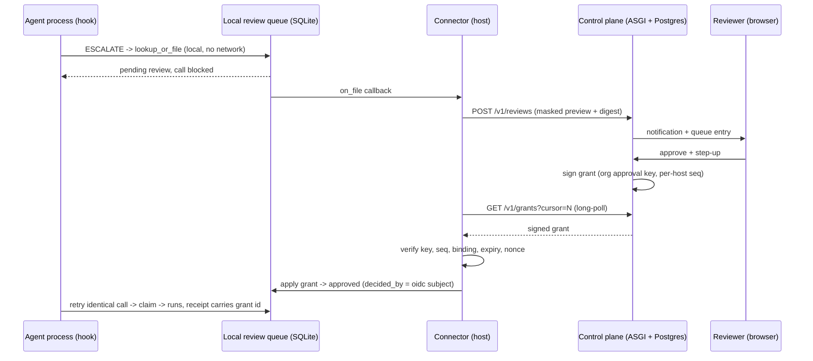

# Cloud control plane: remote reviews, audit and policy

Depends on: `specs/console/01-console-server.md` (the loopback console contract
this spec leaves untouched), `interlock.reviews`, `interlock.receipt`,
`interlock.policy.scopes`.

Today every interlock surface is local: the hook decides in the agent's
process, the review queue is a SQLite file, the console binds loopback only,
and receipts are a file on the host. A team running agents on many machines
cannot see held calls, cannot approve from a phone, cannot search the audit
trail across hosts, and cannot publish one policy to all of them.

This spec adds an optional hosted **control plane**: a multi-tenant web service
an organisation enrolls hosts into, plus a small **connector** that runs beside
each host and moves data between the host and the plane. The plane is a
reporting and approval surface, not a decision engine. The hook never opens a
network connection, and the host keeps the only copy of the key material that
can release a call.

## Overview and user value

- **Review from anywhere.** An on-call engineer approves a held call from a
  browser or phone; the approval reaches the host as a signed grant the host
  verifies before the next identical call runs.
- **One audit trail across the fleet.** Hosts stream their receipt chains to
  the plane; an auditor searches and verifies them per host without holding any
  host's signing key.
- **Policy as an org artefact.** Scope bindings are authored once, published
  with a monotonic epoch, and materialised on each host as a signed, pinned
  policy file.
- **No new trust in the plane.** A plane outage never loosens a host, a plane
  compromise cannot silently approve a call without a signed grant, and the
  local console keeps working exactly as it does today.

### Decisions settled in the workshop

| Decision | Choice |
|---|---|
| Shape | Control plane plus the full hosted stack (web UI, API, Postgres) |
| Tenancy | Organisations, fully isolated |
| Human auth | OIDC SSO, step-up (WebAuthn, TOTP fallback) to approve |
| Agent auth | Per-agent keys issued by the plane, scoped to one host |
| Queue authority | Local-first; the plane returns signed grants the host verifies |
| Data egress | Masked previews plus argument digest; no raw arguments |
| Plane stack | New ASGI service under `interlock/cloud/` with Postgres |
| v1 scope | Remote approvals, receipt ingest and audit search, org/user admin, policy distribution |

## Personas

- **Owner** provisions the org, configures SSO, issues host enrollment tokens
  and manages members.
- **Admin** manages hosts, agent keys and policy documents.
- **Reviewer** sees held calls for the org and approves or rejects them.
- **Auditor** reads and exports receipts and admin history; cannot decide.
- **Host operator** runs `interlock cloud enroll` and keeps the connector
  running.
- **Agent** is a machine identity: it submits reviews and receipts, and never
  has a permission that can decide one.

## Inputs

- Browser requests to the hosted UI and its same-origin JSON API.
- OIDC authorization-code callbacks from the org's identity provider.
- WebAuthn registration and assertion ceremonies, and TOTP codes.
- Connector requests authenticated with a per-agent key: review upserts,
  receipt batches, grant long-polls, policy pulls, checkpoints.
- Admin requests: org settings, members, hosts, agent keys, policy publish,
  webhook endpoints.
- Operator CLI: `interlock cloud enroll|run|status|leave`.
- A local review queue (`interlock.reviews.ReviewQueue`), a receipt log and a
  policy file on each enrolled host.

## Outputs

- A hosted web UI: review queue, review detail, receipt search, host fleet,
  policy editor, org administration.
- A JSON API under `/v1/` with OpenAPI served at `/v1/openapi.json`.
- Signed **decision grants** delivered to connectors.
- Signed **policy documents** delivered to connectors.
- A materialised policy file on each host, written atomically and pinned by
  epoch.
- Streamed receipt batches stored per host with a chain head and a verification
  level.
- Webhook notifications on new reviews and decisions.
- An append-only admin audit log.
- `interlock cloud status` output: connection, last sync, spool depth, queue
  lag, policy epoch, verification level.

## Architecture



Trust boundaries:

- The **hook** stays process-local and network-free. Its inputs are the local
  queue and the local policy file.
- The **connector** is the only host process that speaks to the plane. It holds
  the agent key and the pinned plane public keys, and it never holds the review
  signing key.
- The **plane** holds org policy authoring, review metadata, receipts and
  grants. It holds hosts' *public* keys only.
- The **browser** holds a short-lived session cookie and a step-up assertion;
  it never sees an agent key or a host seed.

The plane cannot dial a host. Connectivity is outbound from the host only;
there is no reverse channel in v1.

## Data model (Postgres)

Every tenant table carries `org_id` and is protected by row-level security in
addition to application filters; the app role is not the table owner and does
not have `BYPASSRLS`.

| Table | Purpose |
|---|---|
| `orgs` | Slug, name, SSO issuer/client id, step-up policy, retention days |
| `org_domains` | Verified email domains for JIT membership |
| `users` | `(org_id, issuer, subject)` unique; role; status |
| `sessions` | Token hash, user, CSRF secret, step-up time/method, expiry, IP, UA |
| `webauthn_credentials` | Credential id, public key, sign count, last used |
| `totp_secrets` | Encrypted secret, confirmed at |
| `enrollment_tokens` | Single-use token hash, org, intended host name, expiry |
| `hosts` | Host id, name, owner subject, pinned public keys, state, last seen |
| `agent_keys` | Key id/prefix, secret hash, host, scopes, expiry, revoked at |
| `reviews` | `(org_id, host_id, id)` PK; masked preview ciphertext; metadata |
| `decisions` | Reviewer, step-up method/time, decision, grant id, grant seq |
| `receipts` | `(org_id, host_id, mac)` PK; canonical receipt body; verification |
| `receipt_heads` | Per-host chain head, count, last checkpoint |
| `policy_documents` | Org, epoch, signed document, author, published at |
| `audit_log` | Append-only admin and disclosure events |
| `webhook_endpoints`, `webhook_deliveries` | Outbound notifications and retries |

The local queue gains one table, created by a forward migration:

```sql
CREATE TABLE IF NOT EXISTS cloud_grants (
    grant_id TEXT PRIMARY KEY,
    review_id TEXT NOT NULL,
    decision TEXT NOT NULL,
    approver TEXT NOT NULL,
    seq INTEGER NOT NULL,
    applied REAL NOT NULL
);
```

The review row's own MAC already covers `status`, `decided`, `decided_by`,
`approval_until` and the approver list, so a remote decision is sealed by the
existing queue signature. The grant table records why the decision was
accepted; the receipt emitted when the call finally runs carries
`approval = "cloud:<grant_id>"`.

## API surface

All routes are JSON, same origin, versioned under `/v1`. Unknown request
fields are rejected (`422`), bodies are capped (`413` means "too large"), and
every tenant route resolves `org_id` from the session or key before touching
data.

| Method | Path | Caller | Purpose |
|---|---|---|---|
| `POST` | `/v1/enroll` | enrollment token | Register host, return host id, agent key, pinned public keys |
| `POST` | `/v1/reviews` | agent key | Upsert masked pending reviews and decisions |
| `GET` | `/v1/reviews` | session | List reviews, filtered by status/host, cursor paged |
| `GET` | `/v1/reviews/{id}` | session | Review detail (decrypts masked preview, logged) |
| `POST` | `/v1/reviews/{id}/decision` | session + step-up | Approve, reject or revoke; returns grant id |
| `GET` | `/v1/grants` | agent key | Long-poll grants after cursor |
| `POST` | `/v1/receipts` | agent key | Upload a receipt batch (gzip allowed) |
| `POST` | `/v1/checkpoints` | agent key | Append-only chain checkpoint |
| `GET` | `/v1/policy` | agent key | Pull signed policy documents after an epoch |
| `GET` | `/v1/audit` | auditor+ | Search receipts and admin events |
| `GET` | `/v1/hosts` | admin | Fleet state and verification levels |
| `POST` | `/v1/keys` | admin + step-up | Issue or rotate an agent key |
| `POST` | `/v1/keys/{id}/revoke` | admin + step-up | Revoke immediately |
| `POST` | `/v1/policy/publish` | admin + step-up | Compile, sign and publish a new epoch |
| `GET` | `/healthz`, `/readyz` | unauthenticated | Liveness and database readiness |

### Grant envelope

```json
{
  "v": 1,
  "grant_id": "g-6f1c0a2b",
  "org_id": "org_...",
  "host_id": "host_...",
  "review_id": "r-07079caa",
  "binding": "<binding hash recorded on the review>",
  "decision": "approve",
  "approver": {"issuer": "https://idp.example", "subject": "...", "email": "..."},
  "step_up": {"method": "webauthn", "at": 1761446400},
  "issued_at": 1761446410,
  "expires_at": 1761447010,
  "seq": 42,
  "prev": "<previous grant signature or GENESIS>",
  "sig": "<hex Ed25519 over canonical JSON without sig>"
}
```

`seq` is per host and strictly increasing; `prev` chains grants so a deleted or
reordered grant is visible. The signature covers every field. Hosts pin the
org's approval public key at enrollment; rotation happens only through a
grant-like rotation document signed by the old key.

## Functional requirements

### Enrollment and host identity

- **FR-001** When a host operator submits a valid single-use enrollment token,
  the plane shall register a host, issue one agent key, and return the host id
  and the pinned approval, policy and (when used) receipt public keys.
- **FR-002** The plane shall store agent keys only as a hash plus a public
  prefix, shall display the secret exactly once, and shall never log it.
- **FR-003** The connector shall write `~/.interlock/cloud.json` with mode
  `0600`, refuse to start if the file is group- or world-readable, and never
  print the key.
- **FR-004** When an enrollment token is reused or expired, the plane shall
  answer `401` and shall not create a host.
- **FR-005** When an agent key is rotated, the plane shall accept the old key
  for at most 24 hours and the new key immediately.
- **FR-006** When an agent key is revoked, the plane shall reject it within 5
  seconds on every route, including an in-flight long-poll.
- **FR-007** The connector shall generate a host identity seed on first enroll
  and register its public half; the seed shall never leave the host.

### Connector behaviour

- **FR-008** The connector shall be the only component that opens a network
  connection to the plane; the hook, the review queue and the policy loader
  shall make no network calls.
- **FR-009** While the plane is unreachable, the connector shall retry with
  capped exponential backoff (1 s to 5 min) and shall not exit.
- **FR-010** While the plane is unreachable, local approvals and rejections
  shall continue to work and the hook shall keep enforcing the last good
  policy file.
- **FR-011** The connector shall spool outbound review and receipt batches on
  disk, cap the spool at 256 MiB, and drop the oldest batches first with a
  counter exposed by `interlock cloud status`.
- **FR-012** The connector shall refresh reviews from the queue using its
  `on_file` callback plus a periodic reconciliation scan, so a review filed
  while the connector was down is uploaded on restart.
- **FR-013** When the connector receives a decision for a review that is no
  longer pending, it shall acknowledge the grant, apply nothing, and report
  the local status so the plane can reconcile.
- **FR-014** The connector shall expose `interlock cloud status` with
  connection state, last successful sync, spool depth, queue lag, policy epoch
  and receipt verification level.

### Review data minimisation

- **FR-015** Before upload, the connector shall pass every argument preview
  through `interlock.masking.Masker` with the org's additional deny patterns
  and shall upload only the masked preview, the argument digest, the mask
  counts and the review metadata.
- **FR-016** The plane shall reject any review field outside the documented
  schema, including raw `event`, `args` or unredacted preview fields.
- **FR-017** The plane shall store previews encrypted with a per-org envelope
  key and shall log every disclosure (who, which review, when) in
  `audit_log`.
- **FR-018** The plane shall not include preview text in notifications,
  webhooks, URLs, metrics or application logs.
- **FR-019** The connector shall upload the local requester as a stable hashed
  label unless the org enables `share_usernames`, in which case it uploads the
  local username.

### Remote decisions

- **FR-020** When a reviewer approves a pending review, the plane shall require
  a step-up assertion no older than 300 seconds, record its method and time,
  and sign a grant bound to that review's binding hash.
- **FR-021** When a review requires `min_approvals` greater than one, the plane
  shall require that many distinct OIDC subjects and shall refuse a repeated
  subject with `409 distinct_approver_required`.
- **FR-022** Where `allow_self_approval` is false, the plane shall refuse a
  decision by the host owner's OIDC subject.
- **FR-023** When a reviewer decides a review at or after `pending_until`, the
  plane shall refuse with `409 review_expired`.
- **FR-024** When the host's last successful sync is older than 300 seconds,
  the plane shall require an explicit "approve anyway" confirmation and record
  its reason in the decision.
- **FR-025** When the connector receives a grant, it shall accept it only if
  the organisation, host id, signature, sequence, binding, expiry and unseen
  grant id all check out.
- **FR-026** If any grant check fails, the connector shall apply nothing, keep
  the review pending, log the refusal with the failed check, and report it to
  the plane on the next sync.
- **FR-027** When an approval grant is accepted, the connector shall release
  the call once: `approval_until` shall be the earlier of the local approval
  TTL and the grant expiry, and the review shall remain claimable by exactly
  one caller.
- **FR-028** When a rejection or revocation grant is accepted, the connector
  shall record it with the reviewer's OIDC subject so the agent stops waiting.
- **FR-029** The connector shall persist applied grant ids in `cloud_grants`
  and shall treat a redelivered or replayed grant as an acknowledged no-op.
- **FR-030** The plane shall deliver a signed grant to a waiting connector
  within 3 seconds p95 of the decision being committed.
- **FR-031** The plane shall sign grants with an org key held in KMS (hosted)
  or an operator-supplied key file (self-hosted); the key shall never be
  readable by the web process in plaintext for longer than one signing call.

### Receipts and audit

- **FR-032** The connector shall tail the receipt log from a persistent byte
  offset, upload only complete canonical receipt lines, and advance the offset
  only after the plane acknowledges the batch.
- **FR-033** Where a host has registered an Ed25519 receipt public key, the
  plane shall verify every receipt's signature and `prev` linkage and mark the
  chain `verified`.
- **FR-034** Where a host signs receipts with HMAC, the plane shall verify
  `prev` linkage only, mark the chain `linkage_only`, and require a signed
  checkpoint at least every 1,000 receipts or 15 minutes.
- **FR-035** If a checkpoint is older than 24 hours for a `linkage_only` host,
  the plane shall mark that host `receipts_unverified` and surface it in the
  fleet view.
- **FR-036** When an incoming batch does not continue the stored chain head and
  is not an exact replay of already stored receipts, the plane shall answer
  `409 chain_fork`, freeze that host's ingest and open an admin alert.
- **FR-037** The plane shall answer duplicate receipt uploads idempotently;
  `(org_id, host_id, mac)` shall be unique.
- **FR-038** An auditor shall be able to search receipts by host, time range,
  action, verdict, principal, policy id and text in the masked fields, and to
  export the result as JSONL.
- **FR-039** The plane shall retain receipts for the org's configured period
  (default 365 days, minimum 30, maximum 2,555) and delete expired rows in a
  daily job whose runs are themselves audited.
- **FR-040** The plane shall verify an exported chain with the host's pinned
  verifier before export and shall refuse to export a chain marked broken.

### Policy distribution

- **FR-041** When an admin publishes policy, the plane shall compile the
  proposed scope bindings through `ScopeRegistry`, refuse invalid bindings,
  and sign the resulting document as a new epoch strictly greater than the
  active one.
- **FR-042** The connector shall poll policy every 15 seconds, verify the
  signature against its pinned policy key, and refuse an epoch less than or
  equal to the one it holds.
- **FR-043** The connector shall write the policy file atomically
  (temporary file, fsync, rename), keep the previous file as a fallback, and
  never leave a truncated file in place.
- **FR-044** If a policy document fails verification or appears rolled back,
  the connector shall keep the last good file, report the failure, and raise
  it in `interlock cloud status`.
- **FR-045** The hook shall load the materialised policy file on every
  invocation; a missing or invalid file shall fail closed under the hook's
  existing bootstrap behaviour.
- **FR-046** Where a long-running in-process agent uses the policy file, the
  spec shall document that a new epoch applies on restart in v1; live reload
  is out of scope.

### Human authentication and sessions

- **FR-047** The plane shall authenticate humans only through OIDC
  authorization code with PKCE, validating `iss`, `aud`/`azp`, `nonce`,
  `state`, `exp` and `iat` (60 s skew), and shall require `email_verified`.
- **FR-048** The plane shall identify a user by `(org_id, issuer, subject)` and
  shall never merge accounts by email address.
- **FR-049** The plane shall issue a server-side session cookie named
  `__Host-il_session` with `Secure`, `Path=/`, no `Domain`, `HttpOnly` and
  `SameSite=Lax`; idle timeout 30 minutes, absolute lifetime 12 hours.
- **FR-050** The plane shall reject state-changing requests without a matching
  CSRF token and without a JSON content type.
- **FR-051** When an admin disables a user, the plane shall revoke all of that
  user's sessions immediately.
- **FR-052** Where an org requires phishing-resistant step-up, the plane shall
  offer WebAuthn only and refuse an approval made with TOTP.
- **FR-053** The plane shall rate-limit login, step-up and decision endpoints
  per user and per IP, answering `429` with `Retry-After`.

### Authorization and tenancy

- **FR-054** The plane shall enforce a fixed role model — owner, admin,
  reviewer, auditor — with deny-by-default route permissions, and agents shall
  have only `ingest:reviews`, `ingest:receipts`, `pull:policy` and
  `poll:grants` on their own host.
- **FR-055** The plane shall scope every tenant query by `org_id` in the
  application and shall enable Postgres row-level security on every tenant
  table.
- **FR-056** When a user requests a resource belonging to another org, the
  plane shall answer `404`, never `403`, so existence is not disclosed.
- **FR-057** The plane shall prevent an agent key from reading reviews,
  receipts or audit data of any host other than its own.
- **FR-058** The plane shall record every admin action and every role change in
  the append-only `audit_log` with actor, target, before/after hash, IP and
  time.

### Notifications and operations

- **FR-059** When a review is filed, the plane shall notify the org's
  configured webhook with review id, host, action, policy id and reason only.
- **FR-060** The plane shall sign webhook bodies with HMAC-SHA256 and a
  per-endpoint secret, retry with backoff for 24 hours, and never follow a
  redirect.
- **FR-061** The plane shall expose `/healthz`, `/readyz` and Prometheus
  metrics that contain no tenant data.
- **FR-062** The plane shall write structured logs with request id, org id,
  actor id and outcome, and shall redact tokens, keys, cookies and previews.

## Non-functional requirements

- **NFR-001 (isolation)** No request may read or write another org's rows;
  the test suite shall include a cross-org matrix for every route.
- **NFR-002 (hook cost)** The hook's decision path shall make no network call
  and its p95 latency shall not regress by more than 5% against the current
  benchmark.
- **NFR-003 (latency)** Review filed on the host to visible on the plane: p95
  ≤ 2 s. Decision on the plane to applied on the host: p95 ≤ 3 s.
- **NFR-004 (API)** p95 ≤ 300 ms at 100 requests/s per region, excluding
  long-poll requests held open by design.
- **NFR-005 (availability)** Hosted target 99.9% monthly for authenticated
  routes; the host's enforcement and local approvals remain available during
  any plane outage.
- **NFR-006 (durability)** RPO ≤ 5 minutes via Postgres point-in-time
  recovery; RTO ≤ 1 hour.
- **NFR-007 (scale)** 1,000 orgs, 50,000 hosts, 5 million receipts/day,
  100,000 reviews/day at the stated latency.
- **NFR-008 (security)** TLS 1.2+, HSTS, CSP with no third-party script,
  Argon2id or SHA-256 over high-entropy key material, no secret in logs, and a
  published threat model.
- **NFR-009 (privacy)** Only masked previews leave a host; org deletion
  removes tenant rows within 30 days; exports are audited.
- **NFR-010 (compatibility)** Core `interlock` keeps zero runtime
  dependencies; the connector uses the standard library only; the `cloud`
  extra may add dependencies and requires Python 3.11+.
- **NFR-011 (accessibility)** Review queue and approval flow meet WCAG 2.2 AA
  and work on a 390 px viewport.
- **NFR-012 (self-hosting)** A single `docker compose` stack with Postgres
  runs the plane without any hosted-only component except optional KMS.

## Security model delta

The loopback console's guarantee is "only a process on this machine can reach
it". The plane cannot reproduce that guarantee, so it replaces it with:

| Loopback property | Cloud replacement |
|---|---|
| Network unreachable from off-host | TLS-only public edge, authenticated sessions, rate limits, WAF |
| Host header / rebinding checks | Strict `Host` allowlist, `Origin` checks on state-changing requests, CSP |
| Read-only until unlocked on the terminal | Server-side session plus step-up; no ambient write authority |
| No user accounts | OIDC SSO, org roles, per-user audit |
| One operator | Four-eyes across distinct OIDC subjects |
| Local disk is trusted | Per-org RLS, field encryption, KMS-held signing keys |

Residual risk, stated plainly: a fully compromised plane that also holds the
org approval signing key can forge grants for its own hosts. Mitigations are
KMS key custody with signing audit, host-side pinning, per-host grant chains,
four-eyes, and the independent receipt chain; v1 does not claim the plane is
trustless. Hosts may additionally pin an allowed approver subject list in
`cloud.json`, refusing grants from any other subject.

## Errors

| Condition | Status | Body code | Connector / UI behaviour |
|---|---|---|---|
| Malformed JSON or unknown field | 422 | `invalid_request` | Connector logs and drops the batch; UI shows field error |
| Missing/expired session or key | 401 | `unauthenticated` | UI redirects to SSO; connector backs off and retries |
| Role or step-up insufficient | 403 | `forbidden` / `step_up_required` | UI prompts step-up; connector never retries with the same key |
| Unknown or cross-org resource | 404 | `not_found` | No existence leak |
| Review not pending / expired | 409 | `review_not_pending` / `review_expired` | Connector acks, applies nothing, reconciles |
| Duplicate subject for four-eyes | 409 | `distinct_approver_required` | UI asks a different reviewer |
| Receipt chain fork | 409 | `chain_fork` | Host ingest frozen, admin alerted |
| Policy epoch not newer | 409 | `stale_epoch` | Connector keeps last good document |
| Revoked host or key | 410 | `revoked` | Connector stops syncing and reports unhealthy |
| Body over cap | 413 | `payload_too_large` | Connector splits the batch |
| Rate limit | 429 | `rate_limited` | Honour `Retry-After` |
| Database unavailable | 503 | `unavailable` | UI shows retry; connector spools |

## Edge cases

- **Clock skew.** Grants carry both `issued_at` and `expires_at`; the host
  accepts 60 seconds of skew and refuses a grant issued in the future beyond
  it. Expiry is evaluated on the host clock after skew correction.
- **Concurrent decisions.** Two reviewers deciding at once: the first commits,
  the second gets `409 review_not_pending`. A local reviewer racing a remote
  grant: whichever the queue settles first wins; the later grant is acked and
  ignored.
- **Connector restart.** Review upload reconciles from the queue; receipt
  upload resumes from the stored byte offset; grants resume from the stored
  cursor; all three are idempotent.
- **Database restore.** Restoring the plane below the last delivered grant
  sequence must not re-issue an old sequence; the connector refuses a repeated
  `seq` unless the `grant_id` is unseen and the binding matches.
- **Step-up expires mid-form.** The decision request fails with
  `step_up_required`; the form keeps its state and re-prompts.
- **SSO outage.** Existing sessions continue until their absolute expiry; no
  new login succeeds. Deprovisioning in the IdP takes effect at the next
  absolute expiry unless back-channel logout is configured.
- **Org deletion.** Ingest and logins stop immediately; tenant data is purged
  on the retention schedule and the purge is audited.
- **Key rotation.** Approval, policy and receipt keys each rotate through a
  document signed by the previous key; hosts refuse an unsigned rotation.
- **Revoked host reconnects.** The connector gets `410`, stops, and instructs
  the operator to re-enroll; it never falls back to an unauthenticated mode.
- **Policy file corrupt on disk.** The hook bootstrap fails closed (denies),
  exactly as it does for any corrupt pinned policy today.

## Constraints

- The local console must remain loopback-only and unchanged in behaviour; the
  existing loopback tests stay green.
- No plane-initiated connection into a customer network in v1.
- No raw tool arguments on the plane in v1, including on demand.
- No decision authority for agent keys.
- Receipt signing keys never leave the host.
- The plane does not execute policy; it compiles and signs documents, and the
  host's `ScopedEngine`/`PolicyEngine` remains the decision engine.
- Public docs only under `docs/`; internal notes under `internal-docs/`.
- New runtime dependencies live in the `cloud` extra; core stays dependency
  free.

## Delivery order

1. **M0 — Skeleton.** `interlock/cloud/` package, config, health routes,
   migration runner and schema, `cloud` extra, `interlock cloud` CLI stub.
2. **M1 — Identity and tenancy.** OIDC login, sessions, CSRF, RBAC, RLS,
   org/user admin, cross-org test matrix.
3. **M2 — Enrollment and connector.** Enrollment tokens, host/key issuance,
   `enroll|run|status|leave`, spool, long-poll transport, revocation.
4. **M3 — Reviews and grants.** Masked upload, queue UI, step-up decisions,
   grant signing and delivery, host verification and `apply_grant`, nonce
   store, receipts' `approval` stamp.
5. **M4 — Receipts and audit.** Tailer, batch ingest, Ed25519 and linkage
   verification, heads/forks, checkpoints, search and export, retention.
6. **M5 — Policy distribution.** Scope authoring and validation, signed
   epochs, connector pull/verify/atomic write, hook policy loading, docs.
7. **M6 — Operations.** Webhooks, admin audit, metrics, compose stack,
   threat-model page, runbook, public guide.

## Acceptance criteria

1. **Given** a reviewer in org A is signed in, **when** they request a review
   id belonging to org B, **then** the plane answers `404` and writes no data.
2. **Given** an unauthenticated browser, **when** it calls any `/v1/` route
   other than health, **then** the plane answers `401` and sets no session.
3. **Given** an OIDC callback with a wrong `nonce`, `state`, `aud` or `iss`,
   **when** it is submitted, **then** login fails and no session is created.
4. **Given** a pending review and a reviewer without a fresh step-up, **when**
   they approve, **then** the plane answers `403 step_up_required` and no grant
   is signed.
5. **Given** a fresh WebAuthn step-up, **when** the reviewer approves, **then**
   a grant is signed within 3 seconds and the waiting connector applies it.
6. **Given** a granted approval, **when** the agent retries the identical call,
   **then** it runs exactly once; a second identical call is blocked again
   after the approval TTL.
7. **Given** a replayed grant id, **when** the connector receives it, **then**
   it applies nothing, acknowledges it, and the queue remains unchanged.
8. **Given** a grant signed by a key the host did not pin, **when** it arrives,
   **then** the connector refuses it, keeps the review pending, and reports the
   failed check.
9. **Given** the plane is stopped, **when** a local reviewer approves on the
   host, **then** the call runs and the hook still enforces the last good
   policy.
10. **Given** a preview containing a card number, IBAN and API key, **when** it
    is uploaded, **then** none of those values appear in the request, the
    database plaintext, or logs, and the mask counts are present.
11. **Given** an Ed25519 receipt chain, **when** one field is edited before
    upload, **then** the batch is rejected with the index of the first bad
    receipt and the stored head does not advance.
12. **Given** an HMAC-signed host, **when** a checkpoint is older than 24
    hours, **then** the fleet view marks the host `receipts_unverified`.
13. **Given** a receipt batch that forks the stored chain, **when** it is
    uploaded, **then** the plane answers `409 chain_fork`, freezes ingest and
    alerts an admin.
14. **Given** policy epoch 7 is on a host, **when** the plane serves epoch 6 or
    a bad signature, **then** the connector refuses it and the host keeps
    enforcing epoch 7.
15. **Given** a published valid epoch, **when** the connector polls, **then**
    the policy file is replaced atomically within 15 seconds.
16. **Given** a review with `min_approvals=2`, **when** the same OIDC subject
    approves twice, **then** the second request returns `409
    distinct_approver_required`; **when** a different subject approves, the
    review becomes approved.
17. **Given** an agent key, **when** it calls a session-only route, **then**
    the plane answers `403` and no audit data is returned.
18. **Given** an admin revokes a key, **when** the connector's in-flight
    long-poll is open, **then** the poll ends, the next request gets `410`, and
    the connector reports unhealthy.
19. **Given** a review filed while the connector is stopped, **when** it
    restarts, **then** the review appears on the plane within one poll cycle.
20. **Given** the local console is started with a non-loopback `--host`,
    **when** it starts, **then** it still refuses, and no cloud route exists on
    the local console.
21. **Given** a webhook endpoint, **when** a review is filed, **then** the
    delivery is HMAC-signed, contains no preview text, and is retried on
    failure.
22. **Given** receipts older than the retention period, **when** the daily job
    runs, **then** they are deleted, the deletion is audited, and newer
    receipts remain.

## Verify

These gates are added with the implementation; the commands below are the
contract for "done" at each milestone.

```bash
# Unit and integration suites (no external services for the local parts).
python3 -m pytest -q tests/test_cloud_*.py
python3 -m pytest -q tests/test_reviews.py tests/test_receipt.py
python3 -m pytest -q tests/test_console_server.py -k loopback

# The plane against a disposable Postgres.
docker compose -f deploy/cloud/docker-compose.yml up -d --wait
python3 -m interlock.cloud.migrate --dsn "$IL_CLOUD_DSN"
curl -fsS http://127.0.0.1:8787/healthz
curl -fsS http://127.0.0.1:8787/readyz

# End-to-end: enroll a host, file a review, approve it, watch the grant apply.
python3 -m interlock.cloud enroll --url http://127.0.0.1:8787 --token "$TOKEN"
python3 -m interlock.cloud run --once
curl -fsS -b "$COOKIE" http://127.0.0.1:8787/v1/reviews?status=pending
python3 -m pytest -q tests/test_cloud_e2e.py

# Local console invariant is unchanged.
python3 -m interlock.console --host 0.0.0.0 --port 0   # must exit non-zero
```

## Implementation TODO

### M0 — Skeleton

- [ ] Add `interlock/cloud/__init__.py`, `app.py`, `config.py`, `db.py`,
      `migrate.py`; keep the package importable without optional deps.
- [ ] Add `interlock/cloud/sql/001_init.sql` with every tenant table, indexes
      and `ENABLE ROW LEVEL SECURITY` plus `CREATE POLICY` for each.
- [ ] Add `[project.optional-dependencies] cloud = [...]` (ASGI server,
      Postgres driver, OIDC client, WebAuthn, TOTP, crypto) and a `cloud`
      console script entry point.
- [ ] Add `interlock cloud` subcommands to `interlock/cli/` with
      `enroll|run|status|leave|policy|keys` stubs and argument tests.
- [ ] Add `/healthz`, `/readyz`, structured logging and request ids.
- [ ] Add `deploy/cloud/docker-compose.yml` with Postgres and a dev secret.

### M1 — Identity and tenancy

- [ ] Implement OIDC login/callback/logout with PKCE, state, nonce and claim
      validation in `interlock/cloud/auth/oidc.py`.
- [ ] Implement server-side sessions, CSRF, idle/absolute expiry and
      `__Host-` cookie in `interlock/cloud/auth/sessions.py`.
- [ ] Implement WebAuthn registration/assertion and TOTP fallback with
      step-up freshness in `interlock/cloud/auth/stepup.py`.
- [ ] Implement the role permission table and a single `authorize()` seam used
      by every route.
- [ ] Implement org/user admin routes and screens; revocation of sessions on
      disable.
- [ ] Add the cross-org matrix test that walks every route as a foreign user
      and asserts `404`.
- [ ] Enable and test RLS with a non-owner app role.

### M2 — Enrollment and connector

- [ ] Implement enrollment tokens, host registration and pinned public keys.
- [ ] Implement agent-key issuance, rotation (24 h overlap), revocation and
      hashed storage.
- [ ] Implement the connector: config file, TLS, auth header, backoff, spool,
      `--once`, signal handling and `status`.
- [ ] Implement the long-poll transport with cursor persistence and revocation
      checks on every wake-up.
- [ ] Add launchd/systemd unit examples and a container image for the
      connector.
- [ ] Tests: token reuse, revoked key, connector restart, spool cap.

### M3 — Reviews and grants

- [ ] Add the queue migration for `cloud_grants` and
      `ReviewQueue.apply_grant(grant, verifier=...)` that re-checks binding,
      four-eyes and expiry, then settles the row in one transaction.
- [ ] Wire the connector to `ReviewQueue(on_file=...)` plus a reconciliation
      scan; implement masking with org deny patterns before upload.
- [ ] Implement review upload/list/detail with field-level encryption and
      disclosure audit.
- [ ] Implement decision routes with step-up, four-eyes, expiry and
      "approve anyway".
- [ ] Implement the grant signer, per-host sequence and `prev` chain; store
      the signed grant and delivery state.
- [ ] Implement connector grant verification (signature, seq, prev, binding,
      expiry, nonce) and redelivery acknowledgement.
- [ ] Stamp `approval="cloud:<grant_id>"` on the receipt of the call released
      by a grant; add a test that it survives chain verification.
- [ ] Build the review queue and detail screens (mobile-first) and the
      desktop-alert parity hook.
- [ ] Tests: replay, wrong key, offline host, local/remote race, TTL release.

### M4 — Receipts and audit

- [ ] Implement the receipt tailer with a durable byte offset and batch
      framing for complete lines.
- [ ] Implement receipt and checkpoint ingest, gzip support, idempotency by
      mac, chain-head tracking and fork detection.
- [ ] Reuse `interlock.receipt.verify_chain` with
      `ed25519_verifier(public)` for verified hosts; add the linkage-only
      path and verification-level display.
- [ ] Implement audit search, filters, JSONL export and pre-export
      verification.
- [ ] Implement the retention job, its audit record and an operator override
      with a reason.
- [ ] Tests: edited receipt, reordered receipt, duplicate batch, fork,
      checkpoint staleness.

### M5 — Policy distribution

- [ ] Implement scope-document authoring, validation through `ScopeRegistry`
      and signed publish with monotonic epochs.
- [ ] Implement `GET /v1/policy` with epoch cursors and retention of old
      documents.
- [ ] Implement connector pull, signature and epoch verification, atomic
      write, `.prev` fallback and status reporting.
- [ ] Add `--policy` materialisation to the enrollment flow so a new host
      pins the cloud policy path; document the in-process restart limitation.
- [ ] Tests: rollback refusal, bad signature, truncated write, hook enforcement
      against the materialised file.

### M6 — Operations and docs

- [ ] Implement webhook endpoints, HMAC signing, retry/backoff, no-redirect
      policy and delivery log.
- [ ] Implement admin audit log and its UI.
- [ ] Add Prometheus metrics without tenant labels or preview text.
- [ ] Write `docs/guides/cloud.md` (operator + reviewer), add a cloud section
      to `docs/security-model.md` and a threat-model page.
- [ ] Add the runbook: key rotation, host freeze, chain fork, org deletion,
      plane restore.
- [ ] Add SBOM/pinned-dependency checks to CI for the cloud extra.
- [ ] Add the end-to-end test `tests/test_cloud_e2e.py` used by `Verify`.
