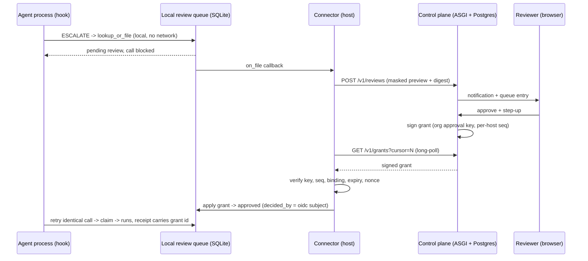

# Cloud control plane: remote reviews, audit and policy

Depends on: `specs/console/01-console-server.md` (the loopback console contract
this spec leaves untouched), `interlock.reviews`, `interlock.receipt`,
`interlock.policy.scopes`.

Today every interlock surface is local: the hook decides in the agent's
process, the review queue is a SQLite file, the console binds loopback only,
and receipts are a file on the host. A team running agents on many machines
cannot see held calls, cannot approve from a phone, cannot search the audit
trail across hosts, and cannot publish one policy to all of them.

This spec adds three separate things, and keeps them separate on purpose:

- a hosted **control plane** — a multi-tenant service where policy is authored,
  compiled, verified, signed and rolled out, and where reviews are decided;
- a host-side **data plane** — a cached, compiled policy artifact plus a fast
  evaluator that decides every call locally, including a native evaluator over a
  C ABI when the optional extension is installed;
- an **audit plane** — receipt and decision ingest into a searchable,
  independently verifiable trail.

The control plane never sits on the verdict path. The hook never opens a network
connection, the data plane never asks the control plane for a decision, and the
host keeps the only copy of the key material that can release a call.

## Overview and user value

- **Review from anywhere.** An on-call engineer approves a held call from a
  browser or phone; the approval reaches the host as a signed grant the host
  verifies before the next identical call runs.
- **One audit trail across the fleet.** Hosts stream their receipt chains to
  the plane; an auditor searches and verifies them per host without holding any
  host's signing key.
- **Policy as a compiled, signed artefact.** Scope bindings are authored once,
  compiled offline to a flat deterministic artifact, verified by round-trip,
  signed inside a manifest (version, epoch, expiry, target, sha256) and rolled
  out in rings. Hosts verify, store the highest version, swap atomically and
  never fetch policy while deciding a call.
- **Fast path, no phone home.** The compiled artifact is loaded once per epoch;
  a native evaluator over a stable C ABI can answer a verdict in well under
  5 ms, with a pure-Python evaluator as the default and the mandatory fallback.
- **No new trust in the plane.** A plane outage never loosens a host, a plane
  compromise cannot silently approve a call without a signed grant, and the
  local console keeps working exactly as it does today.

### Decisions settled in the workshop

| Decision | Choice |
|---|---|
| Shape | Control plane plus the full hosted stack (web UI, API, Postgres) |
| Tenancy | Organisations, fully isolated |
| Human auth | OIDC SSO, step-up (WebAuthn, TOTP fallback) to approve |
| Agent auth | Per-agent keys issued by the plane, scoped to one host |
| Queue authority | Local-first; the plane returns signed grants the host verifies |
| Data egress | Masked previews plus argument digest; no raw arguments |
| Plane stack | New ASGI service under `interlock/cloud/` with Postgres |
| Policy delivery | Compiled flat artifact + signed manifest (version, epoch, expiry, target, hashes), polled with jitter; not a live policy file |
| Verdict path | Host-local only: cached artifact, hook in-process; no network and no remote reasoning |
| Fast check | `PolicyEvaluator` seam; pure Python by default, optional native evaluator over a C ABI with a fixed latency budget |
| Distribution safety | Highest-version persistence, rollback refusal, expiry alarm + last-known-good, rings, signed kill switch |
| v1 scope | Remote approvals, receipt ingest and audit search, org/user admin, compiled policy distribution |

## Personas

- **Owner** provisions the org, configures SSO, issues host enrollment tokens
  and manages members.
- **Admin** manages hosts, agent keys, policy definitions and rollouts.
- **Reviewer** sees held calls for the org and approves or rejects them.
- **Auditor** reads and exports receipts and admin history; cannot decide.
- **Host operator** runs `interlock cloud enroll` and keeps the connector
  running.
- **Agent** is a machine identity: it submits reviews and receipts, and never
  has a permission that can decide one.

## Inputs

- Browser requests to the hosted UI and its same-origin JSON API.
- OIDC authorization-code callbacks from the org's identity provider.
- WebAuthn registration and assertion ceremonies, and TOTP codes.
- Connector requests authenticated with a per-agent key: review upserts,
  receipt batches, grant long-polls, manifest polls, hint long-polls,
  artifact fetches, checkpoints.
- Admin requests: org settings, members, hosts, agent keys, policy publish,
  webhook endpoints.
- Operator CLI: `interlock cloud enroll|run|status|leave`.
- A local review queue (`interlock.reviews.ReviewQueue`), a receipt log, and an
  active compiled artifact plus its accepted manifest version on each enrolled
  host.

## Outputs

- A hosted web UI: review queue, review detail, receipt search, host fleet,
  policy editor, org administration.
- A JSON API under `/v1/` with OpenAPI served at `/v1/openapi.json`.
- Signed **decision grants** delivered to connectors.
- Signed **policy manifests** and content-addressed **compiled artifacts**
  delivered to connectors; a push hint carrying only a version number.
- An active compiled artifact on each host, loaded once and swapped atomically,
  pinned by manifest version and policy epoch, with the previous artifact kept
  as fallback.
- Streamed receipt batches stored per host with a chain head and a verification
  level.
- Webhook notifications on new reviews and decisions.
- An append-only admin audit log.
- `interlock cloud status` output: connection, last sync, spool depth, queue
  lag, manifest version, policy epoch, artifact sha256, evaluator backend
  (python/native), last swap, verification level.

## Three planes

The split follows the line the verdict draws, not process boundaries:

| Plane | Where it runs | What it may do | What it must never do |
|---|---|---|---|
| **Control** | Hosted, `interlock/cloud/` | Author policy, compile and verify it, sign manifests, approve reviews, hold org keys, run rollouts | Sit on the hook's verdict path, or be required to decide a call |
| **Data** | On the host | Evaluate the cached artifact, hold calls, apply grants, read the local queue | Fetch policy, ask for a decision, or reason at call time |
| **Audit** | Host spool, ingested by the plane | Carry receipts, checkpoints, decisions and telemetry | Delay, block or alter a verdict |

```mermaid
flowchart LR
    subgraph Control["Control plane (hosted)"]
        A["Author scope bindings"] --> B["Compile to flat artifact"]
        B --> C["Verify by round-trip"]
        C --> D["Sign manifest: version,<br/>epoch, expiry, target, sha256"]
        D --> E["Rollout rings:<br/>canary, 10%, 100%"]
    end
    subgraph Dist["Distribution"]
        E --> F["Object storage:<br/>2 regions + CDN"]
        F --> G["Signed manifest"]
        F --> H["Content-addressed artifact"]
    end
    subgraph Host["Host data plane"]
        G --> I["Connector: verify,<br/>persist highest version"]
        H --> I
        I --> J["Compile-then-swap<br/>atomic pointer"]
        J --> K["Active artifact"]
        K --> L["Hook: in-process evaluator"]
        K --> M["Sidecar: evaluator<br/>for high-risk classes"]
        L --> N["Verdict + epoch-stamped receipt"]
        M --> N
    end
    N --> O["Audit spool"]
    O --> P["Audit plane:<br/>ingest, verify, search"]
```



The arrow that matters is the one that **does not exist**: nothing between the
active artifact and the control plane. A host holding a valid artifact decides
every call with no network, no remote reasoning and no dependency on plane
availability.

### Signed distribution contract

The unit of distribution is a **manifest**, not a policy document. A manifest
is small, signed and self-describing; the artifact bytes it names are fetched
separately and are immutable.

```json
{
  "v": 1,
  "manifest_id": "m-7c21e0",
  "org_id": "org_...",
  "version": 412,
  "epoch": "9f2c41d0b7a3e5c8",
  "target": {"kind": "ring", "id": "canary"},
  "mode": "enforce",
  "issued_at": 1761446400,
  "expires_at": 1762051200,
  "minimum_agent": "0.9.0",
  "artifact": {"format": 1, "sha256": "…", "size": 18432},
  "rules_digest": "…",
  "key_id": "policy-2026-10",
  "sig": "<hex Ed25519 over canonical JSON without sig>"
}
```

- `version` is strictly increasing per org; `epoch` is the identity of the
  compiled rule set (`PolicyEngine.epoch`), so a receipt can name both the
  rollout and the exact rules that produced a verdict.
- `target` names an org, a host group or a single host. A host applies only a
  manifest that names it; a target mismatch is refused, not ignored.
- `expires_at` is at most 7 days out. Expiry is an alarm, not a licence: the
  host keeps last-known-good, alarms after 15 minutes, and after a grace period
  (default 6 hours) fails closed for irreversible action classes only.
- Hosts persist the **highest version they ever accepted**. A plane restored
  from backup and re-serving version 411 cannot roll a host back to it; the
  host refuses and alarms. Rollback is deliberately not expressible: reverting
  means compiling the old source under a **higher** version.
- The connector polls every 300 seconds with ±10% jitter and also long-polls a
  hint channel. A hint carries **only a version number** — never policy, never
  a signature — so it can only cause a fetch, never a swap.
- Artifacts live in object storage in two regions behind a CDN, addressed by
  sha256. The plane may rewrite an artifact's location; it cannot rewrite its
  bytes without changing its name.
- Rollouts move canary → 10% → 100%, hold while host health regresses, and
  auto-roll back by publishing the previous source under a higher version.
  A manifest also carries a mode — `monitor`, `warn` or `enforce` — so a new
  rule set can observe first (matching the existing `--monitor` flag) and be
  promoted by a later manifest without recompiling.
- A signed **kill switch** names a host, ring or org. A host that receives one
  stops releasing calls within one poll or hint cycle regardless of artifact
  freshness, and records the kill on its receipt stream. The kill does not
  self-expire; removal is another signed publication.

### Two-tier data plane

| Tier | Mechanism | Used for | Deadline |
|---|---|---|---|
| 1 | Evaluator inside the hook process, reading the cached artifact | Default for every call | Python p99 < 10 ms, native p99 < 5 ms |
| 2 | Out-of-process `interlock-sidecar`, same artifact, native evaluator | High-risk and irreversible classes: shell, egress, delete, email, payment | 2 ms; missed deadline follows the class policy |
| Backstop | Kernel / egress firewall, not described here | Defence in depth when both tiers are compromised | n/a |

Tier 1 is fast, survives a plane outage and is the path Claude Code actually
takes. It is also bypassable by an attacker with full control of the agent's
process; that is the tier-2 and backstop argument, not a reason to put the
network back on the hot path.

Failure policy is per action class and ships **inside the artifact**, so a
policy change can retune it without shipping code:

| Action class | Control plane unreachable / manifest expired | Evaluator unavailable |
|---|---|---|
| Read-only, local | Fail open, receipt records `coverage_gap` | Fail open, same |
| Approved LLM call already granted | Fail open, grant expiry still enforced | Fail open |
| Shell, new egress, delete, email, payment | Fail closed after grace | Fail closed |

### Fast path: the evaluator seam

Evaluation goes through one protocol, `PolicyEvaluator`, with two
implementations. The pure-Python one is the default, is always available and
defines the semantics; the native one is an optimisation that must match it
exactly.

```c
/* rust/interlock_eval, built with maturin like interlock_scopes. */
typedef struct il_artifact il_artifact;   /* opaque, loaded once per epoch */

il_artifact *il_artifact_load(const unsigned char *bytes, size_t len,
                              int *err);
void il_artifact_free(il_artifact *art);

/* Returns 0 on success, non-zero on error. Never writes a verdict on error. */
int il_eval(const il_artifact *art,
            const unsigned char *event,     size_t event_len,
            const unsigned char *principal, size_t principal_len,
            int64_t now_ms,
            int *verdict,             /* 0 allow, 1 block, 2 modify */
            char *reason, size_t reason_cap);
```

- The artifact is parsed and indexed **once per epoch**, not per call. The C
  ABI receives the already-loaded handle; the JSON event is the only per-call
  allocation on the boundary.
- A missing shared library, a load failure or a non-zero return falls back to
  the Python evaluator for read-only classes and fails closed for irreversible
  ones. It never defaults to allow.
- Native and Python verdicts must agree on the shipped parity corpus in CI,
  including `modify` payloads and denial reasons keyed by rule id.
- A swap replaces the active artifact pointer; calls already in flight finish
  on the snapshot they started with. Receipts stamp `epoch` and
  `artifact_sha256`, so a mixed-epoch window is auditable rather than invisible.
- `interlock install-hook` gains `--artifact PATH` (mutually exclusive with
  `--policy`); local-only installs keep the existing source-policy path
  unchanged, so the cloud feature is additive.

## Architecture



Trust boundaries:

- The **hook** stays process-local and network-free. Its inputs are the local
  queue and the active compiled artifact; it neither parses source policy nor
  consults the plane.
- The **connector** is the only host process that speaks to the plane. It holds
  the agent key, the pinned plane public keys and the highest accepted manifest
  version, and it never holds the review signing key.
- The **sidecar** is host-local, holds no plane credentials, and shares the
  connector's artifact directory read-only.
- The **plane** holds org policy authoring, review metadata, receipts and
  grants. It holds hosts' *public* keys only.
- The **browser** holds a short-lived session cookie and a step-up assertion;
  it never sees an agent key or a host seed.

The plane cannot dial a host. Connectivity is outbound from the host only;
there is no reverse channel in v1.

## Data model (Postgres)

Every tenant table carries `org_id` and is protected by row-level security in
addition to application filters; the app role is not the table owner and does
not have `BYPASSRLS`.

| Table | Purpose |
|---|---|
| `orgs` | Slug, name, SSO issuer/client id, step-up policy, retention days |
| `org_domains` | Verified email domains for JIT membership |
| `users` | `(org_id, issuer, subject)` unique; role; status |
| `sessions` | Token hash, user, CSRF secret, step-up time/method, expiry, IP, UA |
| `webauthn_credentials` | Credential id, public key, sign count, last used |
| `totp_secrets` | Encrypted secret, confirmed at |
| `enrollment_tokens` | Single-use token hash, org, intended host name, expiry |
| `hosts` | Host id, name, owner subject, pinned public keys, state, last seen |
| `agent_keys` | Key id/prefix, secret hash, host, scopes, expiry, revoked at |
| `reviews` | `(org_id, host_id, id)` PK; masked preview ciphertext; metadata |
| `decisions` | Reviewer, step-up method/time, decision, grant id, grant seq |
| `receipts` | `(org_id, host_id, mac)` PK; canonical receipt body; verification |
| `receipt_heads` | Per-host chain head, count, last checkpoint |
| `policy_artifacts` | `(org_id, sha256)` PK; canonical artifact bytes or an object-store pointer; format, epoch, compiler version |
| `policy_manifests` | `(org_id, version)` PK; epoch, target, artifact sha256, expiry, key id, signature, author |
| `policy_rollouts` | Manifest, ring, state, health signal, promoted or rolled back at |
| `policy_kills` | Scope (org/ring/host), reason, signed document, author, issued at |
| `audit_log` | Append-only admin and disclosure events |
| `webhook_endpoints`, `webhook_deliveries` | Outbound notifications and retries |

The local queue gains one table, created by a forward migration:

```sql
CREATE TABLE IF NOT EXISTS cloud_grants (
    grant_id TEXT PRIMARY KEY,
    review_id TEXT NOT NULL,
    decision TEXT NOT NULL,
    approver TEXT NOT NULL,
    seq INTEGER NOT NULL,
    applied REAL NOT NULL
);
```

The review row's own MAC already covers `status`, `decided`, `decided_by`,
`approval_until` and the approver list, so a remote decision is sealed by the
existing queue signature. The grant table records why the decision was
accepted; the receipt emitted when the call finally runs carries
`approval = "cloud:<grant_id>"`.

## API surface

All routes are JSON, same origin, versioned under `/v1`. Unknown request
fields are rejected (`422`), bodies are capped (`413` means "too large"), and
every tenant route resolves `org_id` from the session or key before touching
data.

| Method | Path | Caller | Purpose |
|---|---|---|---|
| `POST` | `/v1/enroll` | enrollment token | Register host, return host id, agent key, pinned public keys |
| `POST` | `/v1/reviews` | agent key | Upsert masked pending reviews and decisions |
| `GET` | `/v1/reviews` | session | List reviews, filtered by status/host, cursor paged |
| `GET` | `/v1/reviews/{id}` | session | Review detail (decrypts masked preview, logged) |
| `POST` | `/v1/reviews/{id}/decision` | session + step-up | Approve, reject or revoke; returns grant id |
| `GET` | `/v1/grants` | agent key | Long-poll grants after cursor |
| `POST` | `/v1/receipts` | agent key | Upload a receipt batch (gzip allowed) |
| `POST` | `/v1/checkpoints` | agent key | Append-only chain checkpoint |
| `GET` | `/v1/manifest` | agent key | Latest signed manifest for this host's target after a version |
| `GET` | `/v1/artifacts/{sha256}` | agent key | Fetch an immutable compiled artifact by content hash |
| `GET` | `/v1/hints` | agent key | Long-poll a version number only; never policy, never a signature |
| `POST` | `/v1/policy/compile` | admin | Compile source bindings, verify round-trip, return sha256 and diff |
| `POST` | `/v1/policy/kill` | owner + step-up | Sign and publish a kill switch for a host, ring or org |
| `GET` | `/v1/audit` | auditor+ | Search receipts and admin events |
| `GET` | `/v1/hosts` | admin | Fleet state and verification levels |
| `POST` | `/v1/keys` | admin + step-up | Issue or rotate an agent key |
| `POST` | `/v1/keys/{id}/revoke` | admin + step-up | Revoke immediately |
| `POST` | `/v1/policy/publish` | admin + step-up | Sign a manifest for a compiled artifact and open the rollout ring |
| `GET` | `/healthz`, `/readyz` | unauthenticated | Liveness and database readiness |

### Grant envelope

```json
{
  "v": 1,
  "grant_id": "g-6f1c0a2b",
  "org_id": "org_...",
  "host_id": "host_...",
  "review_id": "r-07079caa",
  "binding": "<binding hash recorded on the review>",
  "decision": "approve",
  "approver": {"issuer": "https://idp.example", "subject": "...", "email": "..."},
  "step_up": {"method": "webauthn", "at": 1761446400},
  "issued_at": 1761446410,
  "expires_at": 1761447010,
  "seq": 42,
  "prev": "<previous grant signature or GENESIS>",
  "sig": "<hex Ed25519 over canonical JSON without sig>"
}
```

`seq` is per host and strictly increasing; `prev` chains grants so a deleted or
reordered grant is visible. The signature covers every field. Hosts pin the
org's approval public key at enrollment; rotation happens only through a
grant-like rotation document signed by the old key.

## Functional requirements

### Enrollment and host identity

- **FR-001** When a host operator submits a valid single-use enrollment token,
  the plane shall register a host, issue one agent key, and return the host id
  and the pinned approval, policy and (when used) receipt public keys.
- **FR-002** The plane shall store agent keys only as a hash plus a public
  prefix, shall display the secret exactly once, and shall never log it.
- **FR-003** The connector shall write `~/.interlock/cloud.json` with mode
  `0600`, refuse to start if the file is group- or world-readable, and never
  print the key.
- **FR-004** When an enrollment token is reused or expired, the plane shall
  answer `401` and shall not create a host.
- **FR-005** When an agent key is rotated, the plane shall accept the old key
  for at most 24 hours and the new key immediately.
- **FR-006** When an agent key is revoked, the plane shall reject it within 5
  seconds on every route, including an in-flight long-poll.
- **FR-007** The connector shall generate a host identity seed on first enroll
  and register its public half; the seed shall never leave the host.

### Connector behaviour

- **FR-008** The connector shall be the only component that opens a network
  connection to the plane; the hook, the review queue and the policy loader
  shall make no network calls.
- **FR-009** While the plane is unreachable, the connector shall retry with
  capped exponential backoff (1 s to 5 min) and shall not exit.
- **FR-010** While the plane is unreachable, local approvals and rejections
  shall continue to work and the hook shall keep enforcing the active compiled
  artifact.
- **FR-011** The connector shall spool outbound review and receipt batches on
  disk, cap the spool at 256 MiB, and drop the oldest batches first with a
  counter exposed by `interlock cloud status`.
- **FR-012** The connector shall refresh reviews from the queue using its
  `on_file` callback plus a periodic reconciliation scan, so a review filed
  while the connector was down is uploaded on restart.
- **FR-013** When the connector receives a decision for a review that is no
  longer pending, it shall acknowledge the grant, apply nothing, and report
  the local status so the plane can reconcile.
- **FR-014** The connector shall expose `interlock cloud status` with
  connection state, last successful sync, spool depth, queue lag, policy epoch
  and receipt verification level.

### Review data minimisation

- **FR-015** Before upload, the connector shall pass every argument preview
  through `interlock.masking.Masker` with the org's additional deny patterns
  and shall upload only the masked preview, the argument digest, the mask
  counts and the review metadata.
- **FR-016** The plane shall reject any review field outside the documented
  schema, including raw `event`, `args` or unredacted preview fields.
- **FR-017** The plane shall store previews encrypted with a per-org envelope
  key and shall log every disclosure (who, which review, when) in
  `audit_log`.
- **FR-018** The plane shall not include preview text in notifications,
  webhooks, URLs, metrics or application logs.
- **FR-019** The connector shall upload the local requester as a stable hashed
  label unless the org enables `share_usernames`, in which case it uploads the
  local username.

### Remote decisions

- **FR-020** When a reviewer approves a pending review, the plane shall require
  a step-up assertion no older than 300 seconds, record its method and time,
  and sign a grant bound to that review's binding hash.
- **FR-021** When a review requires `min_approvals` greater than one, the plane
  shall require that many distinct OIDC subjects and shall refuse a repeated
  subject with `409 distinct_approver_required`.
- **FR-022** Where `allow_self_approval` is false, the plane shall refuse a
  decision by the host owner's OIDC subject.
- **FR-023** When a reviewer decides a review at or after `pending_until`, the
  plane shall refuse with `409 review_expired`.
- **FR-024** When the host's last successful sync is older than 300 seconds,
  the plane shall require an explicit "approve anyway" confirmation and record
  its reason in the decision.
- **FR-025** When the connector receives a grant, it shall accept it only if
  the organisation, host id, signature, sequence, binding, expiry and unseen
  grant id all check out.
- **FR-026** If any grant check fails, the connector shall apply nothing, keep
  the review pending, log the refusal with the failed check, and report it to
  the plane on the next sync.
- **FR-027** When an approval grant is accepted, the connector shall release
  the call once: `approval_until` shall be the earlier of the local approval
  TTL and the grant expiry, and the review shall remain claimable by exactly
  one caller.
- **FR-028** When a rejection or revocation grant is accepted, the connector
  shall record it with the reviewer's OIDC subject so the agent stops waiting.
- **FR-029** The connector shall persist applied grant ids in `cloud_grants`
  and shall treat a redelivered or replayed grant as an acknowledged no-op.
- **FR-030** The plane shall deliver a signed grant to a waiting connector
  within 3 seconds p95 of the decision being committed.
- **FR-031** The plane shall sign grants with an org key held in KMS (hosted)
  or an operator-supplied key file (self-hosted); the key shall never be
  readable by the web process in plaintext for longer than one signing call.

### Receipts and audit

- **FR-032** The connector shall tail the receipt log from a persistent byte
  offset, upload only complete canonical receipt lines, and advance the offset
  only after the plane acknowledges the batch.
- **FR-033** Where a host has registered an Ed25519 receipt public key, the
  plane shall verify every receipt's signature and `prev` linkage and mark the
  chain `verified`.
- **FR-034** Where a host signs receipts with HMAC, the plane shall verify
  `prev` linkage only, mark the chain `linkage_only`, and require a signed
  checkpoint at least every 1,000 receipts or 15 minutes.
- **FR-035** If a checkpoint is older than 24 hours for a `linkage_only` host,
  the plane shall mark that host `receipts_unverified` and surface it in the
  fleet view.
- **FR-036** When an incoming batch does not continue the stored chain head and
  is not an exact replay of already stored receipts, the plane shall answer
  `409 chain_fork`, freeze that host's ingest and open an admin alert.
- **FR-037** The plane shall answer duplicate receipt uploads idempotently;
  `(org_id, host_id, mac)` shall be unique.
- **FR-038** An auditor shall be able to search receipts by host, time range,
  action, verdict, principal, policy id and text in the masked fields, and to
  export the result as JSONL.
- **FR-039** The plane shall retain receipts for the org's configured period
  (default 365 days, minimum 30, maximum 2,555) and delete expired rows in a
  daily job whose runs are themselves audited.
- **FR-040** The plane shall verify an exported chain with the host's pinned
  verifier before export and shall refuse to export a chain marked broken.

### Policy compilation and distribution

- **FR-041** When an admin compiles policy, the control plane shall resolve the
  proposed scope bindings through `ScopeRegistry`, lower them to a flat,
  documented artifact format, and verify the artifact by evaluating the source
  and compiled forms over the same corpus and comparing verdicts; a mismatch or
  an invalid binding shall refuse the compile.
- **FR-042** The compiler shall be deterministic — identical source yields
  byte-identical artifact bytes (canonical JSON, sorted keys, sorted rule
  order) — and the artifact's sha256 shall be its only identity.
- **FR-043** When an admin publishes, the plane shall sign a manifest whose
  version is strictly greater than every prior manifest for the org, and whose
  fields carry epoch, target, mode, issued-at, expiry no more than 7 days out,
  artifact sha256 and size, and key id.
- **FR-044** The connector shall poll the manifest every 300 seconds with ±10%
  jitter and long-poll a hint channel that carries a version number only; on a
  newer version it shall verify signature, target, expiry and artifact hash
  before fetching bytes, and shall apply nothing on any failed check.
- **FR-045** The connector shall fetch the artifact into a temporary file,
  verify its sha256, fsync, rename it into the artifact directory, and then
  swap the active pointer atomically, keeping the previous artifact as a
  fallback; a call already in flight shall finish against the snapshot it
  started with.
- **FR-046** If a manifest is rolled back, badly signed, expired, for another
  target or names an artifact whose hash does not match, the connector shall
  keep the last-known-good artifact, elevate the condition in
  `interlock cloud status`, and alarm; a cloud-enrolled hook shall load the
  active artifact once per process and fail closed if it is missing or invalid,
  while a local-only install keeps loading its source policy file per
  invocation exactly as today.

### Human authentication and sessions

- **FR-047** The plane shall authenticate humans only through OIDC
  authorization code with PKCE, validating `iss`, `aud`/`azp`, `nonce`,
  `state`, `exp` and `iat` (60 s skew), and shall require `email_verified`.
- **FR-048** The plane shall identify a user by `(org_id, issuer, subject)` and
  shall never merge accounts by email address.
- **FR-049** The plane shall issue a server-side session cookie named
  `__Host-il_session` with `Secure`, `Path=/`, no `Domain`, `HttpOnly` and
  `SameSite=Lax`; idle timeout 30 minutes, absolute lifetime 12 hours.
- **FR-050** The plane shall reject state-changing requests without a matching
  CSRF token and without a JSON content type.
- **FR-051** When an admin disables a user, the plane shall revoke all of that
  user's sessions immediately.
- **FR-052** Where an org requires phishing-resistant step-up, the plane shall
  offer WebAuthn only and refuse an approval made with TOTP.
- **FR-053** The plane shall rate-limit login, step-up and decision endpoints
  per user and per IP, answering `429` with `Retry-After`.

### Authorization and tenancy

- **FR-054** The plane shall enforce a fixed role model — owner, admin,
  reviewer, auditor — with deny-by-default route permissions, and agents shall
  have only `ingest:reviews`, `ingest:receipts`, `pull:policy` and
  `poll:grants` on their own host.
- **FR-055** The plane shall scope every tenant query by `org_id` in the
  application and shall enable Postgres row-level security on every tenant
  table.
- **FR-056** When a user requests a resource belonging to another org, the
  plane shall answer `404`, never `403`, so existence is not disclosed.
- **FR-057** The plane shall prevent an agent key from reading reviews,
  receipts or audit data of any host other than its own.
- **FR-058** The plane shall record every admin action and every role change in
  the append-only `audit_log` with actor, target, before/after hash, IP and
  time.

### Notifications and operations

- **FR-059** When a review is filed, the plane shall notify the org's
  configured webhook with review id, host, action, policy id and reason only.
- **FR-060** The plane shall sign webhook bodies with HMAC-SHA256 and a
  per-endpoint secret, retry with backoff for 24 hours, and never follow a
  redirect.
- **FR-061** The plane shall expose `/healthz`, `/readyz` and Prometheus
  metrics that contain no tenant data.
- **FR-062** The plane shall write structured logs with request id, org id,
  actor id and outcome, and shall redact tokens, keys, cookies and previews.

### Distribution lifecycle and data plane

- **FR-063** The connector shall persist the highest manifest version it has
  accepted in host state that survives restart and does not live in the
  artifact directory, and shall refuse any manifest at or below it.
- **FR-064** A plane database restore that re-serves an older version shall be
  refused by every host, reported on `/v1/hosts`, and surfaced as a fleet
  alarm; the restore runbook shall require publishing a higher version.
- **FR-065** While a manifest is expired and no replacement arrives, the host
  shall continue on last-known-good, alarm after 15 minutes, and after a
  6-hour grace fail closed only for irreversible action classes.
- **FR-066** A rollout shall proceed through canary, 10% and 100% rings, hold
  a ring whose host health regresses, and auto-roll back by publishing the
  previous source under a higher version — never by re-serving an old version.
- **FR-067** When an owner publishes a signed kill switch, a targeted connector
  shall stop releasing calls within one poll or hint cycle irrespective of
  artifact freshness, and shall record the kill on the receipt stream.
- **FR-068** Evaluation shall go through one `PolicyEvaluator` protocol whose
  pure-Python implementation is the default, always available, and the
  definition of semantics; a native implementation is optional and may never
  be required for interlock to run.
- **FR-069** Where the native evaluator is installed, it shall be reached
  through a stable C ABI, receive the already-loaded artifact handle rather
  than reparsing per call, and return the verdict through an out-parameter
  with 0 allow, 1 block, 2 modify; an error return shall never be read as
  allow.
- **FR-070** The native and pure-Python evaluators shall produce identical
  verdicts, rule ids and modify payloads over the shipped parity corpus in CI.
- **FR-071** High-risk and irreversible action classes shall additionally be
  evaluated through the out-of-process sidecar with a 2 ms deadline; a missed
  deadline or an unreachable sidecar shall follow the class policy, not a
  default.
- **FR-072** The artifact shall carry the per-action-class failure policy, with
  defaults: read-only, local and already-granted LLM calls fail open with a
  `coverage_gap` receipt; shell, new egress, delete, email and payment fail
  closed.
- **FR-073** Every receipt shall record the policy epoch and artifact sha256
  used for its verdict, in addition to the rule ids, so a chain proves which
  compiled rules decided each call.
- **FR-074** Receipt, telemetry and heartbeat upload shall be spooled, batched
  and at-least-once keyed by `(host, sensor, sequence)`, shall never execute on
  the verdict path, and shall drop observability data before security events
  when the spool is full.

## Non-functional requirements

- **NFR-001 (isolation)** No request may read or write another org's rows;
  the test suite shall include a cross-org matrix for every route.
- **NFR-002 (hook cost)** The hook's decision path shall make no network call
  and its p95 latency shall not regress by more than 5% against the current
  benchmark.
- **NFR-003 (latency)** Review filed on the host to visible on the plane: p95
  ≤ 2 s. Decision on the plane to applied on the host: p95 ≤ 3 s.
- **NFR-004 (API)** p95 ≤ 300 ms at 100 requests/s per region, excluding
  long-poll requests held open by design.
- **NFR-005 (availability)** Hosted target 99.9% monthly for authenticated
  routes; the host's enforcement and local approvals remain available during
  any plane outage.
- **NFR-006 (durability)** RPO ≤ 5 minutes via Postgres point-in-time
  recovery; RTO ≤ 1 hour.
- **NFR-007 (scale)** 1,000 orgs, 50,000 hosts, 5 million receipts/day,
  100,000 reviews/day at the stated latency.
- **NFR-008 (security)** TLS 1.2+, HSTS, CSP with no third-party script,
  Argon2id or SHA-256 over high-entropy key material, no secret in logs, and a
  published threat model.
- **NFR-009 (privacy)** Only masked previews leave a host; org deletion
  removes tenant rows within 30 days; exports are audited.
- **NFR-010 (compatibility)** Core `interlock` keeps zero runtime
  dependencies; the connector uses the standard library only; the `cloud`
  extra may add dependencies and requires Python 3.11+.
- **NFR-011 (accessibility)** Review queue and approval flow meet WCAG 2.2 AA
  and work on a 390 px viewport.
- **NFR-012 (self-hosting)** A single `docker compose` stack with Postgres
  runs the plane without any hosted-only component except optional KMS.
- **NFR-013 (verdict budget)** Native evaluator p99 < 5 ms and pure-Python
  p99 < 10 ms for a 1 MiB artifact and a 32 KiB event on the reference host;
  both are benchmark tests that fail CI on regression.
- **NFR-014 (control-plane independence)** A 6-hour control-plane outage leaves
  read-only and already-granted calls running on the cached artifact, and
  leaves irreversible classes closed after grace; no verdict may block on a
  network call.
- **NFR-015 (determinism)** Compiling the same source twice yields the same
  sha256 on every supported Python version; the check runs in CI.
- **NFR-016 (swap safety)** An artifact swap loses no in-flight verdict and
  never exposes a partially written file; `interlock cloud status` reports the
  active version, epoch and artifact hash.
- **NFR-017 (telemetry)** Upload is asynchronous and bounded; verdict latency
  is unchanged when the spool is full, and security events are dropped last.
- **NFR-018 (distribution latency)** Publish to canary host p95 ≤ 60 s; ring
  promotion to 100% ≤ 15 minutes including the jitter window.

## Security model delta

The loopback console's guarantee is "only a process on this machine can reach
it". The plane cannot reproduce that guarantee, so it replaces it with:

| Loopback property | Cloud replacement |
|---|---|
| Network unreachable from off-host | TLS-only public edge, authenticated sessions, rate limits, WAF |
| Host header / rebinding checks | Strict `Host` allowlist, `Origin` checks on state-changing requests, CSP |
| Read-only until unlocked on the terminal | Server-side session plus step-up; no ambient write authority |
| No user accounts | OIDC SSO, org roles, per-user audit |
| One operator | Four-eyes across distinct OIDC subjects |
| Local disk is trusted | Per-org RLS, field encryption, KMS-held signing keys |
| Policy file is trusted because it is local | Signed manifest, content-addressed artifact, pinned key, rollback refusal |
| Nothing outside the machine can widen or weaken it | A plane holding only public keys cannot widen a host; it can withhold updates or let a manifest expire, which the expiry policy bounds |

Residual risk, stated plainly: a fully compromised plane that also holds the
org approval signing key can forge grants for its own hosts. Mitigations are
KMS key custody with signing audit, host-side pinning, per-host grant chains,
four-eyes, and the independent receipt chain; v1 does not claim the plane is
trustless. Hosts may additionally pin an allowed approver subject list in
`cloud.json`, refusing grants from any other subject.

Policy is a narrower claim than approvals: a compromised control plane can
withhold a manifest, delay a rollout or let one expire, but it cannot weaken a
host beyond the last signed manifest without the policy signing key, cannot
roll a host back, and cannot erase the epoch-stamped receipts that show what
was in force.

## Errors

| Condition | Status | Body code | Connector / UI behaviour |
|---|---|---|---|
| Malformed JSON or unknown field | 422 | `invalid_request` | Connector logs and drops the batch; UI shows field error |
| Missing/expired session or key | 401 | `unauthenticated` | UI redirects to SSO; connector backs off and retries |
| Role or step-up insufficient | 403 | `forbidden` / `step_up_required` | UI prompts step-up; connector never retries with the same key |
| Unknown or cross-org resource | 404 | `not_found` | No existence leak |
| Review not pending / expired | 409 | `review_not_pending` / `review_expired` | Connector acks, applies nothing, reconciles |
| Duplicate subject for four-eyes | 409 | `distinct_approver_required` | UI asks a different reviewer |
| Receipt chain fork | 409 | `chain_fork` | Host ingest frozen, admin alerted |
| Manifest version not newer | 409 | `stale_manifest` | Connector keeps last good artifact, alarms |
| Manifest expired or for another target | 409 | `expired_manifest` / `target_mismatch` | Connector keeps last good; expiry follows the grace policy |
| Fetched artifact hash mismatch | 409 | `artifact_hash_mismatch` | Bytes discarded, no swap, admin alert |
| Compile round-trip mismatch or invalid binding | 422 | `bad_artifact` | Publish refused; nothing is signed |
| Revoked host or key | 410 | `revoked` | Connector stops syncing and reports unhealthy |
| Body over cap | 413 | `payload_too_large` | Connector splits the batch |
| Rate limit | 429 | `rate_limited` | Honour `Retry-After` |
| Database unavailable | 503 | `unavailable` | UI shows retry; connector spools |

## Edge cases

- **Clock skew.** Grants carry both `issued_at` and `expires_at`; the host
  accepts 60 seconds of skew and refuses a grant issued in the future beyond
  it. Expiry is evaluated on the host clock after skew correction.
- **Concurrent decisions.** Two reviewers deciding at once: the first commits,
  the second gets `409 review_not_pending`. A local reviewer racing a remote
  grant: whichever the queue settles first wins; the later grant is acked and
  ignored.
- **Connector restart.** Review upload reconciles from the queue; receipt
  upload resumes from the stored byte offset; grants resume from the stored
  cursor; all three are idempotent.
- **Database restore.** Restoring the plane below the last delivered grant
  sequence must not re-issue an old sequence; the connector refuses a repeated
  `seq` unless the `grant_id` is unseen and the binding matches.
- **Step-up expires mid-form.** The decision request fails with
  `step_up_required`; the form keeps its state and re-prompts.
- **SSO outage.** Existing sessions continue until their absolute expiry; no
  new login succeeds. Deprovisioning in the IdP takes effect at the next
  absolute expiry unless back-channel logout is configured.
- **Org deletion.** Ingest and logins stop immediately; tenant data is purged
  on the retention schedule and the purge is audited.
- **Key rotation.** Approval, policy and receipt keys each rotate through a
  document signed by the previous key; hosts refuse an unsigned rotation.
- **Revoked host reconnects.** The connector gets `410`, stops, and instructs
  the operator to re-enroll; it never falls back to an unauthenticated mode.
- **Active artifact corrupt on disk.** The hook bootstrap fails closed
  (denies), exactly as it does for any corrupt pinned policy today; the
  connector keeps the previous artifact and re-fetches by hash.
- **Manifest expires mid-incident.** Hosts alarm, stay on last-known-good, and
  keep read-only and granted calls running; irreversible classes close after
  grace. A control-plane outage therefore degrades to a known, published
  posture instead of an accidental one.
- **Plane restored from backup.** Hosts still hold a higher version than the
  restored database; every host refuses the re-served manifest and the fleet
  view shows the split. The runbook requires publishing the current source
  under a version above every host's.
- **Artifact swapped under load.** Calls already past the evaluator entry keep
  their snapshot; receipts carry its epoch and hash, so a window where two
  epochs were live is visible and bounded by the call, not by a timer.
- **Native library missing, stale or crashing.** The evaluator falls back to
  Python for read-only classes and fails closed for irreversible ones; a crash
  inside the DSO is caught at the boundary and never yields an allow.
- **Kill switch while offline.** Kills are signed publications, so one issued
  during a partition reaches the host when it reconnects; there is no
  self-expiring kill, and a host that never reconnects stays on the posture it
  last verified — the expiry alarm is what surfaces that.
- **Hint storm or forged hint.** Hints carry only a version; a forged hint can
  cause at most a manifest fetch, which is signed and version-checked.

## Constraints

- The local console must remain loopback-only and unchanged in behaviour; the
  existing loopback tests stay green.
- No plane-initiated connection into a customer network in v1.
- No raw tool arguments on the plane in v1, including on demand.
- No decision authority for agent keys.
- Receipt signing keys never leave the host.
- The control plane does not evaluate production calls; it compiles, verifies,
  signs and rolls out. The host's data plane remains the only decision engine.
- No verdict may depend on network I/O, on control-plane availability or on
  remote reasoning. A missing artifact fails closed; a stale one follows the
  published expiry policy.
- The native evaluator is an optimisation, never a requirement; its absence or
  failure degrades latency, never enforcement.
- The artifact format is versioned. A host refuses a format it does not
  understand rather than interpreting it best-effort.
- Public docs only under `docs/`; internal notes under `internal-docs/`.
- New runtime dependencies live in the `cloud` extra; core stays dependency
  free.

## Delivery order

1. **M0 — Skeleton.** `interlock/cloud/` package, config, health routes,
   migration runner and schema, `cloud` extra, `interlock cloud` CLI stub.
2. **M1 — Identity and tenancy.** OIDC login, sessions, CSRF, RBAC, RLS,
   org/user admin, cross-org test matrix.
3. **M2 — Enrollment and connector.** Enrollment tokens, host/key issuance,
   `enroll|run|status|leave`, spool, long-poll transport, revocation.
4. **M3 — Reviews and grants.** Masked upload, queue UI, step-up decisions,
   grant signing and delivery, host verification and `apply_grant`, nonce
   store, receipts' `approval` stamp.
5. **M4 — Receipts and audit.** Tailer, batch ingest, Ed25519 and linkage
   verification, heads/forks, checkpoints, search and export, retention.
6. **M5 — Policy compilation and distribution.** Artifact format and
   deterministic compiler, round-trip verification, manifest versioning and
   expiry, artifact fetch by hash, connector verify/persist/atomic swap, rings
   and rollback by higher version, signed kill switch, status surfaces.
7. **M6 — Fast path and two-tier data plane.** `PolicyEvaluator` seam, compiled
   pure-Python evaluator, native `rust/interlock_eval` over the C ABI, parity
   and budget benchmarks, sidecar deadline path for high-risk classes,
   per-class failure policy, epoch-stamped receipts, spool priorities.
8. **M7 — Operations.** Webhooks, admin audit, metrics, compose stack,
   threat-model page, runbook, public guide.

## Acceptance criteria

1. **Given** a reviewer in org A is signed in, **when** they request a review
   id belonging to org B, **then** the plane answers `404` and writes no data.
2. **Given** an unauthenticated browser, **when** it calls any `/v1/` route
   other than health, **then** the plane answers `401` and sets no session.
3. **Given** an OIDC callback with a wrong `nonce`, `state`, `aud` or `iss`,
   **when** it is submitted, **then** login fails and no session is created.
4. **Given** a pending review and a reviewer without a fresh step-up, **when**
   they approve, **then** the plane answers `403 step_up_required` and no grant
   is signed.
5. **Given** a fresh WebAuthn step-up, **when** the reviewer approves, **then**
   a grant is signed within 3 seconds and the waiting connector applies it.
6. **Given** a granted approval, **when** the agent retries the identical call,
   **then** it runs exactly once; a second identical call is blocked again
   after the approval TTL.
7. **Given** a replayed grant id, **when** the connector receives it, **then**
   it applies nothing, acknowledges it, and the queue remains unchanged.
8. **Given** a grant signed by a key the host did not pin, **when** it arrives,
   **then** the connector refuses it, keeps the review pending, and reports the
   failed check.
9. **Given** the plane is stopped, **when** a local reviewer approves on the
   host, **then** the call runs and the hook still enforces the last good
   policy.
10. **Given** a preview containing a card number, IBAN and API key, **when** it
    is uploaded, **then** none of those values appear in the request, the
    database plaintext, or logs, and the mask counts are present.
11. **Given** an Ed25519 receipt chain, **when** one field is edited before
    upload, **then** the batch is rejected with the index of the first bad
    receipt and the stored head does not advance.
12. **Given** an HMAC-signed host, **when** a checkpoint is older than 24
    hours, **then** the fleet view marks the host `receipts_unverified`.
13. **Given** a receipt batch that forks the stored chain, **when** it is
    uploaded, **then** the plane answers `409 chain_fork`, freezes ingest and
    alerts an admin.
14. **Given** manifest version 7 is on a host, **when** the plane serves
    version 6 or a bad signature, **then** the connector refuses it and the
    host keeps enforcing version 7's artifact.
15. **Given** a published valid manifest, **when** the connector polls, **then**
    the artifact is verified and swapped atomically within 60 seconds p95.
16. **Given** a review with `min_approvals=2`, **when** the same OIDC subject
    approves twice, **then** the second request returns `409
    distinct_approver_required`; **when** a different subject approves, the
    review becomes approved.
17. **Given** an agent key, **when** it calls a session-only route, **then**
    the plane answers `403` and no audit data is returned.
18. **Given** an admin revokes a key, **when** the connector's in-flight
    long-poll is open, **then** the poll ends, the next request gets `410`, and
    the connector reports unhealthy.
19. **Given** a review filed while the connector is stopped, **when** it
    restarts, **then** the review appears on the plane within one poll cycle.
20. **Given** the local console is started with a non-loopback `--host`,
    **when** it starts, **then** it still refuses, and no cloud route exists on
    the local console.
21. **Given** a webhook endpoint, **when** a review is filed, **then** the
    delivery is HMAC-signed, contains no preview text, and is retried on
    failure.
22. **Given** receipts older than the retention period, **when** the daily job
    runs, **then** they are deleted, the deletion is audited, and newer
    receipts remain.
23. **Given** the same source bindings, **when** they are compiled twice on two
    supported Python versions, **then** the artifact bytes and sha256 are
    identical.
24. **Given** a host on manifest version 11, **when** a plane restored from
    backup serves version 10, **then** the host refuses, keeps version 11,
    alarms, and the fleet view shows the split.
25. **Given** a manifest naming artifact sha256 A, **when** the fetched bytes
    hash to B, **then** the connector discards them, swaps nothing, and raises
    the failure.
26. **Given** a manifest that expired 7 hours ago and has no replacement,
    **when** a read-only call and a `shell` call arrive, **then** the read-only
    call runs with a `coverage_gap` receipt and the shell call is blocked.
27. **Given** an artifact swap during a call, **when** the call completes,
    **then** it was decided by the entry snapshot and its receipt names that
    epoch and sha256; the next call names the new one.
28. **Given** the native evaluator and the pure-Python evaluator, **when** both
    evaluate the parity corpus, **then** verdicts, rule ids and modify payloads
    are identical and both meet their budgets.
29. **Given** the native library is absent, **when** a call is evaluated,
    **then** the Python evaluator decides it, `interlock cloud status` reports
    the python backend, and no verdict changes.
30. **Given** the native evaluator returns an error, **when** a read-only call
    and a `delete` call arrive, **then** the read-only call falls back to
    Python and the delete fails closed; neither is allowed by default.
31. **Given** a valid, unexpired artifact, **when** a signed kill switch names
    the host, **then** no call is released within one cycle and the kill is
    recorded on the receipt stream.
32. **Given** a forged hint carrying a version number, **when** the connector
    receives it, **then** it fetches and verifies a manifest, applies nothing
    without a valid signature, and swaps nothing.
33. **Given** a control-plane outage of 6 hours with an unexpired artifact,
    **when** calls continue, **then** verdict latency is unchanged, read-only
    and granted calls run, and no verdict attempts a network connection.

## Verify

These gates are added with the implementation; the commands below are the
contract for "done" at each milestone.

```bash
# Unit and integration suites (no external services for the local parts).
python3 -m pytest -q tests/test_cloud_*.py
python3 -m pytest -q tests/test_reviews.py tests/test_receipt.py
python3 -m pytest -q tests/test_console_server.py -k loopback

# The plane against a disposable Postgres.
docker compose -f deploy/cloud/docker-compose.yml up -d --wait
python3 -m interlock.cloud.migrate --dsn "$IL_CLOUD_DSN"
curl -fsS http://127.0.0.1:8787/healthz
curl -fsS http://127.0.0.1:8787/readyz

# End-to-end: enroll a host, file a review, approve it, watch the grant apply.
python3 -m interlock.cloud enroll --url http://127.0.0.1:8787 --token "$TOKEN"
python3 -m interlock.cloud run --once
curl -fsS -b "$COOKIE" http://127.0.0.1:8787/v1/reviews?status=pending
python3 -m pytest -q tests/test_cloud_e2e.py

# Local console invariant is unchanged.
python3 -m interlock.console --host 0.0.0.0 --port 0   # must exit non-zero

# Compiled policy: determinism, distribution refusal paths, evaluator parity.
python3 -m pytest -q tests/test_policy_compile.py -k determinism
python3 -m pytest -q tests/test_cloud_distribution.py
python3 -m pytest -q tests/test_policy_evaluator.py -k "parity or budget"
```

## Implementation TODO

### M0 — Skeleton

- [ ] Add `interlock/cloud/__init__.py`, `app.py`, `config.py`, `db.py`,
      `migrate.py`; keep the package importable without optional deps.
- [ ] Add `interlock/cloud/sql/001_init.sql` with every tenant table, indexes
      and `ENABLE ROW LEVEL SECURITY` plus `CREATE POLICY` for each.
- [ ] Add `[project.optional-dependencies] cloud = [...]` (ASGI server,
      Postgres driver, OIDC client, WebAuthn, TOTP, crypto) and a `cloud`
      console script entry point.
- [ ] Add `interlock cloud` subcommands to `interlock/cli/` with
      `enroll|run|status|leave|policy|keys` stubs and argument tests.
- [ ] Add `/healthz`, `/readyz`, structured logging and request ids.
- [ ] Add `deploy/cloud/docker-compose.yml` with Postgres and a dev secret.

### M1 — Identity and tenancy

- [ ] Implement OIDC login/callback/logout with PKCE, state, nonce and claim
      validation in `interlock/cloud/auth/oidc.py`.
- [ ] Implement server-side sessions, CSRF, idle/absolute expiry and
      `__Host-` cookie in `interlock/cloud/auth/sessions.py`.
- [ ] Implement WebAuthn registration/assertion and TOTP fallback with
      step-up freshness in `interlock/cloud/auth/stepup.py`.
- [ ] Implement the role permission table and a single `authorize()` seam used
      by every route.
- [ ] Implement org/user admin routes and screens; revocation of sessions on
      disable.
- [ ] Add the cross-org matrix test that walks every route as a foreign user
      and asserts `404`.
- [ ] Enable and test RLS with a non-owner app role.

### M2 — Enrollment and connector

- [ ] Implement enrollment tokens, host registration and pinned public keys.
- [ ] Implement agent-key issuance, rotation (24 h overlap), revocation and
      hashed storage.
- [ ] Implement the connector: config file, TLS, auth header, backoff, spool,
      `--once`, signal handling and `status`.
- [ ] Implement the long-poll transport with cursor persistence and revocation
      checks on every wake-up.
- [ ] Add launchd/systemd unit examples and a container image for the
      connector.
- [ ] Tests: token reuse, revoked key, connector restart, spool cap.

### M3 — Reviews and grants

- [ ] Add the queue migration for `cloud_grants` and
      `ReviewQueue.apply_grant(grant, verifier=...)` that re-checks binding,
      four-eyes and expiry, then settles the row in one transaction.
- [ ] Wire the connector to `ReviewQueue(on_file=...)` plus a reconciliation
      scan; implement masking with org deny patterns before upload.
- [ ] Implement review upload/list/detail with field-level encryption and
      disclosure audit.
- [ ] Implement decision routes with step-up, four-eyes, expiry and
      "approve anyway".
- [ ] Implement the grant signer, per-host sequence and `prev` chain; store
      the signed grant and delivery state.
- [ ] Implement connector grant verification (signature, seq, prev, binding,
      expiry, nonce) and redelivery acknowledgement.
- [ ] Stamp `approval="cloud:<grant_id>"` on the receipt of the call released
      by a grant; add a test that it survives chain verification.
- [ ] Build the review queue and detail screens (mobile-first) and the
      desktop-alert parity hook.
- [ ] Tests: replay, wrong key, offline host, local/remote race, TTL release.

### M4 — Receipts and audit

- [ ] Implement the receipt tailer with a durable byte offset and batch
      framing for complete lines.
- [ ] Implement receipt and checkpoint ingest, gzip support, idempotency by
      mac, chain-head tracking and fork detection.
- [ ] Reuse `interlock.receipt.verify_chain` with
      `ed25519_verifier(public)` for verified hosts; add the linkage-only
      path and verification-level display.
- [ ] Implement audit search, filters, JSONL export and pre-export
      verification.
- [ ] Implement the retention job, its audit record and an operator override
      with a reason.
- [ ] Tests: edited receipt, reordered receipt, duplicate batch, fork,
      checkpoint staleness.

### M5 — Policy compilation and distribution

- [ ] Define artifact format v1 in `interlock/policy/artifact.py`: flat rule
      records, principals, detectors, per-class failure policy, format version;
      canonical serializer with sorted keys and rule order.
- [ ] Implement `interlock/policy/compile.py`: lower `ScopeRegistry` bindings
      to the artifact and verify by evaluating source and compiled forms over a
      corpus before signing anything.
- [ ] Implement `POST /v1/policy/compile` and artifact storage by sha256 in
      `policy_artifacts` plus object store; deterministic sha256 in tests.
- [ ] Implement manifest signing, the strictly increasing version allocator,
      expiry (≤7 days), target resolution and `policy_manifests`.
- [ ] Implement `POST /v1/policy/publish` with rollout rings, hold on health
      regression and rollback by publishing the old source above every host
      version.
- [ ] Implement `GET /v1/manifest`, `GET /v1/artifacts/{sha256}` and the
      version-only `GET /v1/hints` long-poll.
- [ ] Implement connector verification: signature, target, expiry, artifact
      hash, highest-version persistence **outside** the artifact directory,
      temp-file fetch, fsync, rename, atomic pointer swap, `.prev` fallback.
- [ ] Implement signed kill switch (`POST /v1/policy/kill`), connector honouring
      within one cycle, and its receipt stamp.
- [ ] Load the active artifact once per hook process; fail closed when missing
      or invalid; keep the legacy source-policy loader for non-cloud installs.
- [ ] Extend `interlock cloud status` with version, epoch, sha256, last swap
      and alarm state.
- [ ] Tests: determinism, rollback, restored-plane refusal, hash mismatch,
      expiry grace, in-flight swap, forged hint, kill switch, bad signature,
      truncated write.

### M6 — Fast path and two-tier data plane

- [ ] Add the `PolicyEvaluator` protocol in `interlock/policy/evaluator.py` and
      `PurePythonEvaluator`, compiled from the artifact once per epoch with no
      per-call scope merging.
- [ ] Add `--artifact` to `interlock install-hook` and `interlock hook`,
      mutually exclusive with `--policy`, keeping the local path unchanged.
- [ ] Add `rust/interlock_eval` (maturin cdylib) implementing `il_eval` over
      the C ABI, plus the `ctypes` binding and absent-library detection.
- [ ] Add the parity corpus and a test asserting identical verdicts, rule ids
      and modify payloads between backends.
- [ ] Add the budget benchmarks (native p99 < 5 ms, Python p99 < 10 ms at
      1 MiB artifact / 32 KiB event) and wire them into CI.
- [ ] Extend `interlock-sidecar` to load the active artifact, enforce the 2 ms
      deadline and fail according to the class policy; route high-risk classes
      through it from the hook.
- [ ] Implement per-class failure policy from the artifact, the expiry grace
      behaviour and the `coverage_gap` receipt.
- [ ] Stamp `epoch` and `artifact_sha256` on every receipt; keep
      `verify_chain` compatibility.
- [ ] Implement the bounded sensor ring and disk spool with
      `(host, sensor, sequence)` keys, batch upload off the verdict path, and
      security-before-observability drop order; test that a full spool leaves
      verdict latency unchanged.

### M7 — Operations and docs

- [ ] Implement webhook endpoints, HMAC signing, retry/backoff, no-redirect
      policy and delivery log.
- [ ] Implement admin audit log and its UI.
- [ ] Add Prometheus metrics without tenant labels or preview text.
- [ ] Write `docs/guides/cloud.md` (operator + reviewer), add a cloud section
      to `docs/security-model.md` and a threat-model page.
- [ ] Add the runbook: key rotation, host freeze, chain fork, org deletion,
      plane restore (publish above every host version), manifest expiry during
      an incident, kill switch, native backend rollback to Python.
- [ ] Document the artifact format, the evaluator budget and the per-class
      failure policy in `docs/` (public) with a worked rollout example.
- [ ] Add SBOM/pinned-dependency checks to CI for the cloud extra.
- [ ] Add the end-to-end test `tests/test_cloud_e2e.py` used by `Verify`.
